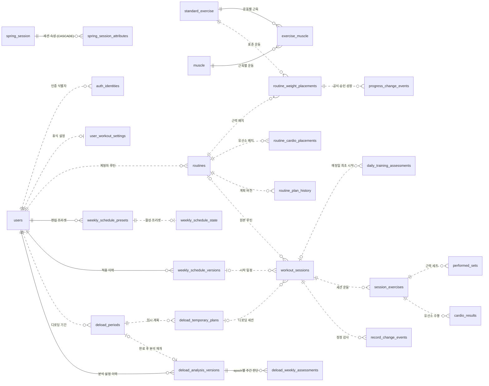
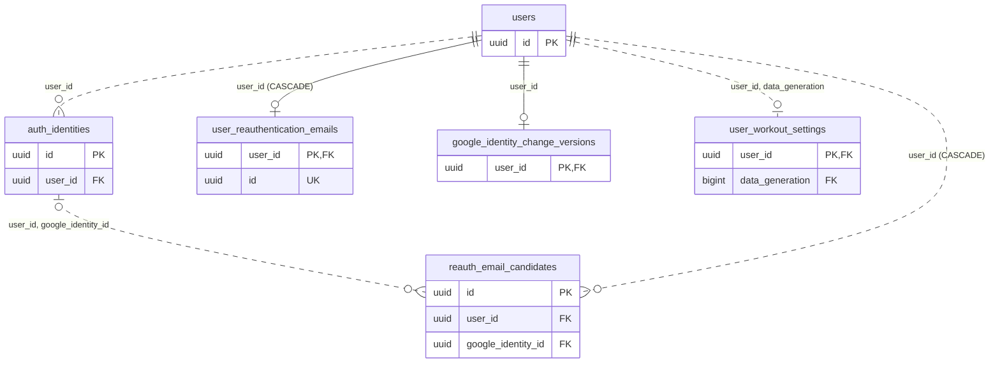
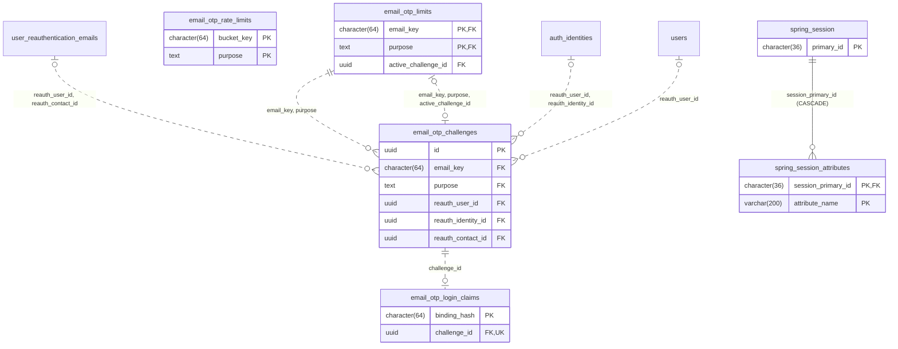
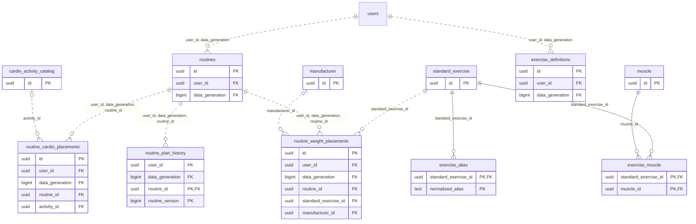
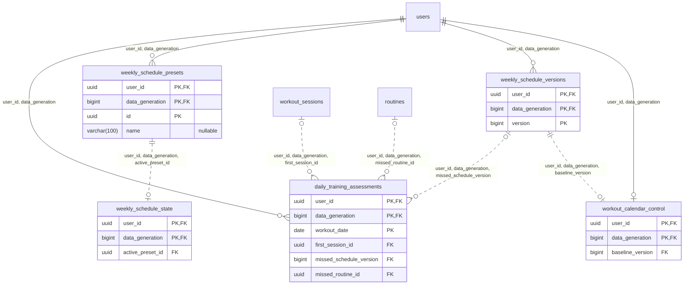
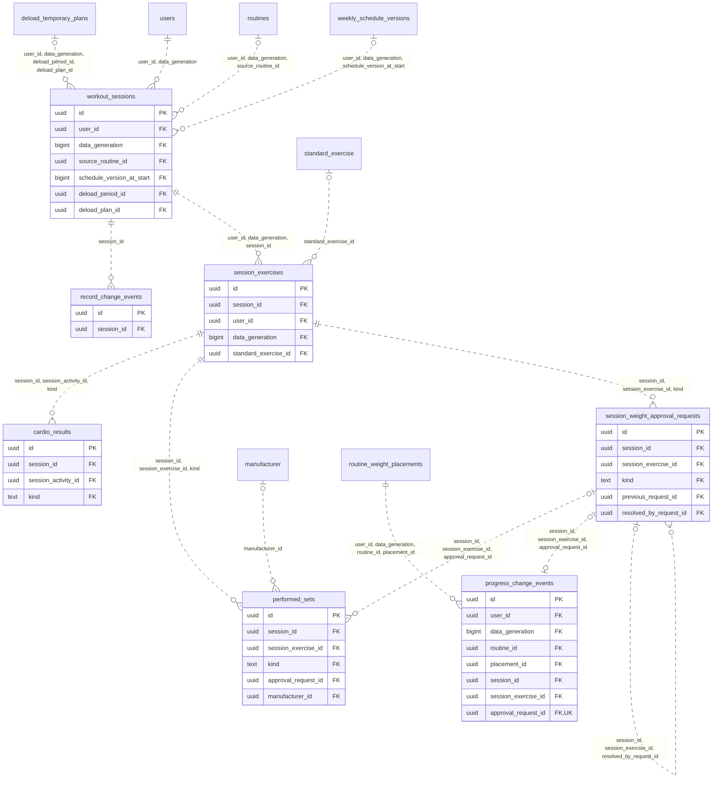
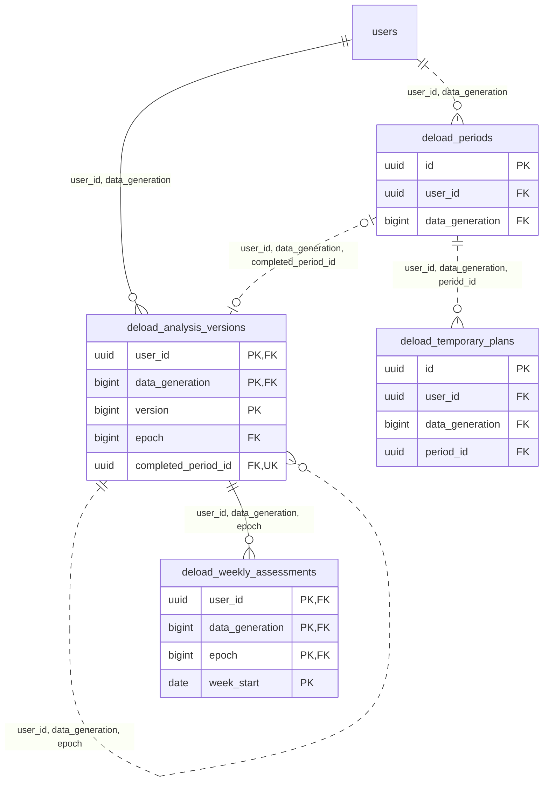
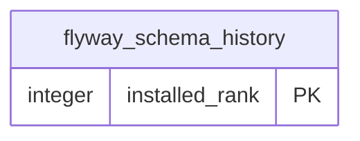

# Overload ERD

이 관계도는 격리 PostgreSQL 18.6에서 확인한 V30 구조에 [V31 이름 컬럼](../../src/main/resources/db/migration/V31__add_weekly_schedule_preset_name.sql)을 반영한 목표 스키마다. 실제 개발 DB의 적용 버전은 별도 확인이 필요하다. 컬럼 전체, 제약조건 이름, 인덱스와 보존 규칙은 [DB 설계서](schema.md)를 참고한다.

- 상세 관계도의 선은 PostgreSQL FK이며, 관계 이름은 자식의 FK 컬럼 순서다. 상위 개요는 이 중 대표 관계를 표시한다.
- 부모 쪽 `||`는 자식 행의 참조가 필수이고 `|o`는 일부 FK 컬럼이 NULL일 수 있음을 뜻한다. 자식 쪽 `o|`는 FK가 자식의 PK 또는 UNIQUE 조합을 포함해 부모당 최대 한 행이라는 뜻이며, `o{`는 최대 여러 행을 뜻한다. 부분 인덱스나 특정 상태로 제한된 유일성은 [설계서](schema.md)에서 확인한다.
- 실선은 자식 PK에 FK 전체가 포함된 식별 관계다. 점선은 그 외의 물리 FK다. `PK`/`FK`/`UK`는 키 구성 컬럼 표시이며 단일 컬럼의 `UK`만 별도 표기했다.
- FK의 삭제 기본 동작은 `NO ACTION`이다. `CASCADE` 세 곳은 계정·인증 및 로그인 세션 절에 표시했다.

## 전체 관계 개요

## 기능별 상세 관계도

### 1. 계정·인증·휴식 설정

데이터 세대가 필요한 참조는 `users(id, data_generation)`을 사용한다. `user_reauthentication_emails`와 `reauth_email_candidates`의 직접 계정 FK에 삭제 연쇄가 있다.

### 2. OTP·로그인 세션

한도 행과 활성 챌린지의 상호 참조, 재인증 연락처·식별자의 소유자 범위를 표시한다. Spring Session 속성은 세션 물리 삭제 시 연쇄 삭제된다.

### 3. 운동 카탈로그·루틴

`exercise_muscle`은 표준 운동과 근육의 N:M 연결이며 역할을 저장한다. `exercise_definitions`는 V30에도 존재하지만 루틴·세션의 선택 경로는 `standard_exercise`다.

### 4. 주간 프리셋·일정·일별 판단

활성 프리셋 FK는 같은 사용자·세대의 프리셋을 가리킨다. 적용 이력과 프리셋은 물리 FK로 연결되지 않는다. 일별 최초 START·MISS는 아래의 개별 FK로 보존한다.

### 5. 운동 세션·수행·정정·성장

세션 종류와 소속을 복합 FK로 제한한다. 디로딩 기간 ID는 임시 계획을 향한 복합 FK의 일부다. 정정 대상 레코드 ID와 계획 JSON 내부 키는 하단 논리 관계를 참고한다.

### 6. 디로딩 분석·기간·임시 계획

분석 버전의 자기 참조가 epoch의 시작 버전을 보장한다. 완료한 기간은 분석 재개 버전에 연결된다. 세션의 임시 계획 참조는 운동 세션 관계도에 표시했다.

### 7. Flyway 메타데이터

애플리케이션 테이블에 대한 FK가 없는 Flyway 실행 이력이다.

## 논리 관계와 뷰

| 저장 위치 | 연결 대상 | 연결 근거 |
| --- | --- | --- |
| `weekly_schedule_presets.assignments`, `weekly_schedule_versions.assignments` | `routines` | 요일→루틴 UUID를 JSON에 저장한다. 프리셋 쓰기에서 현재 계정·세대의 루틴을 확인한다. 적용 이력에는 프리셋 ID FK가 없다. |
| `deload_periods.source_snapshot` | 프리셋 및 원본 루틴 계획 | 시작 때 복사한 근거로 읽는다. 저장된 원본 프리셋 ID에 FK를 걸지 않는다. |
| `daily_training_assessments.missed_plan_version` | `routine_plan_history` | 계정·세대·루틴·버전으로 과거 계획을 조회한다. 일정 및 루틴 FK는 물리적이지만 계획 버전 조합을 강제하는 FK는 없다. |
| 루틴 계획 이력, 세션의 최초·적용·평가 계획, 디로딩 임시 계획 JSON | 배치·운동·목표·수행 근거 | 스냅샷 내부의 식별자와 당시 값은 API와 서버가 검증·보존한다. JSON 내부 필드에는 FK가 없다. |
| `record_change_events.record_kind` / `record_id` | `performed_sets` 또는 `cardio_results` | 종류에 따라 해석되는 UUID다. 감사 행의 세션 FK만 존재한다. |
| `spring_session.principal_name` | 로그인 계정 | Spring Session의 검색 키이며 계정 FK는 없다. |
| `email_otp_challenges.retired_reauth_identity_id`, `reauth_email_candidates.retired_google_identity_id` | 퇴역 인증 식별자의 과거 UUID | 교체 후에도 참조 근거를 보존하는 값이다. 활성 식별자의 복합 FK와 구분한다. |
| `deload_analysis_contexts` | `deload_analysis_versions`, `deload_periods` | V29 조회 뷰다. 분석 버전의 epoch 시작 행을 찾아 그 행이 연결한 완료 기간에서 재개일을 읽는다. |

주간 통계와 승인 중량 성장 응답은 당시 일정, 최초 계획, 종료·수행 기록과 승인 사건을 읽어 계산한다. 영속화하는 일별 판단과 디로딩 주간 분석은 각 기능의 입력·판단 근거다. [통계와 디로딩 보존 규칙](schema.md#통계와-디로딩)
