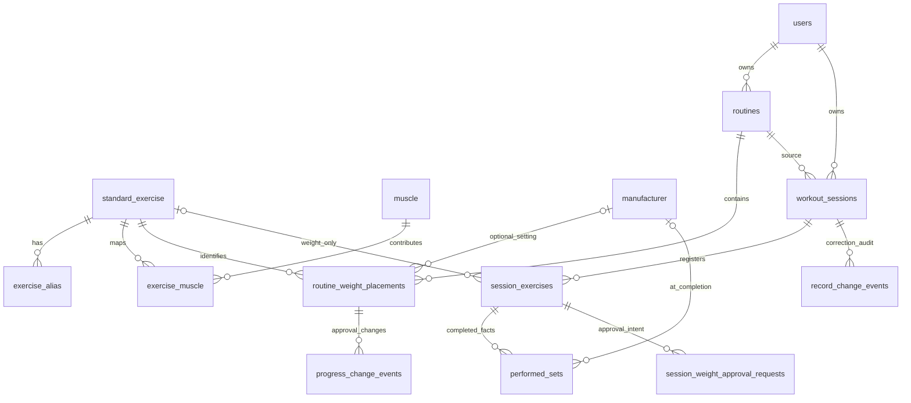

# 표준 운동 카탈로그 최종 연결 설계 — Backend V15 / Frontend 5E

개정일: 2026-11-02 (Asia/Seoul). 상태: **확정 제품 요구를 반영한 설계 문서. 구현·적용 전.**

## 1. 채택 구조와 적용 전제

**루틴·세션의 웨이트 운동은 standard_exercise UUID 하나를 직접 참조한다.** 사용자별 표준 사본, 개인 정의와 표준의 이중 식별, 구 데이터 매핑은 없다. 제조사·부하 방식은 선택 기록 정보이며 승인 중량·배치 UUID·공식 평가 조건을 바꾸지 않는다. 실제 완료 세트에는 완료 당시 값을 별도로 고정한다.

현재는 정식 v1 출시 전이고 보존할 실제 사용자 데이터가 없다는 사용자 결정을 적용한다. 개발 DB는 비어 있는 상태를 기준으로 설계한다. 기존 계정·루틴·세션·개인 정의·IndexedDB 문서가 발견되더라도 이관·호환 대상으로 만들지 않고 승인된 개발 전환 절차에서 정리할 테스트 데이터로 취급한다. **이번에는 DB에 접속하거나 비어 있음을 재확인하지 않았다.** 사용자 제공 상태와 [개발 V15 재구성 기록](task-009-dev-v15-rebuild-report.md)을 근거로 삼으며, 후속 적용 직전 실제 대상과 빈 상태를 반드시 확인한다.

테스트 데이터 보존 불필요와 검증된 프로그램 기능 유지는 별개다. Task 009의 소유권·세대·동시성·승인·전체 snapshot·FINISH·AUTO_CLOSED·사후 정정/삭제/복구·IndexedDB/PWA 보호 기능은 유지한다. 계약 전환 뒤 생성되는 데이터에는 기존과 같은 무결성·원본 보존 규칙을 적용한다.

이번 변경은 **이 설계 문서만**이다. 제품 코드·migration SQL·DB·브라우저 저장소·API·테스트를 변경하지 않았다.

### 1.1 현재 소스 기준

| 저장소 | branch / HEAD | 작업 시작 상태 |
| --- | --- | --- |
| Backend | main / `be73b2201824058020ddcfa11798466d88663d94` | 이전 분석 보고서1개만 untracked. 기존 추적 파일 변경 없음 |
| Frontend | main / `984899c2d5545483026b6014a0361e91a18ade96` | clean |

양쪽 AGENTS·Engineering, [Task 009 현행 설계](task-009-redesign-v1.0.md), [유지할 Task 006 정책](task-006-integrated-design-v0.3.1.md), [온라인 쓰기](../api/workout-online-write.md)·[루틴](../api/routine-management.md)·[세션](../api/workout-sessions.md) 계약과 관련 실제 코드를 확인했다. 이번 사용자 결정이 과거 개인 종목 정책·데이터 호환 제안보다 우선한다.

Backend의 ‘Frontend/IndexedDB 미구현’, 일부 Frontend 문서·주석의 ‘오프라인 재실행은 후속’ 문구는 현재 5A~5E 코드보다 오래된 설명이다. 실제 구현과 [최종 통합 보고서](task-009-final-integration-report.md)를 기준으로 하며, 이번에 해당 문서들을 함께 수정하지는 않는다.

### 1.2 폐기하는 이전 제안

- LEGACY/STANDARD 구분, 두 운동 UUID 병존, nullable XOR 식별 FK.
- 개인 정의→표준 매핑 컬럼, 이름 기반 매핑·백필, 미대응 구 기록 통계.
- 구/신 JSON·IndexedDB 이중 codec 및 구 고정 요청의 버전 간 재전송.
- `/api/v2` 전체 추가. 기존 `/api/v1` 계약을 한 번에 교체한다.
- 제조사·부하 변경 시 새 배치 UUID·승인 초기화·공식 비교 키 확장·TODAY_ONLY 강제.
- FREE_WEIGHT / PLATE_LOADED / WEIGHT_STACK 부하 코드.

## 2. 실제 V15에서 유지할 관계와 기술 제약

Java 파일은 `src/main/java/com/overload/overload_server/`, Frontend feature는 `../overload-pwa/src/features/` 아래다.

| 실제 대상 | 확인 내용·근거 | 전환 방향 |
| --- | --- | --- |
| exercise_definitions | V2·V9/V10, exercise/ExerciseDefinition.java: 개인 user_id·data_generation·이름·version·deleted_at | 표와 기존 개인 CRUD 내부 구현은 분리 보관. 신규 운동 경로에서는 참조하지 않음 |
| routine_weight_placements | V11, routine/RoutineWeightPlacement.java: 정의 FK, 배치 UUID, 계획·최초/승인 중량 | 정의 FK를 표준 FK 하나로 교체. 배치 정책 유지 |
| session_exercises | V13: 세션 소유자·세대 FK, WEIGHT 정의 FK / CARDIO null, 이름 추가 시 사본 | 표준 FK 하나로 교체. 세션 운동 UUID·kind·소유권 유지 |
| performed_sets | V13~V15: 세션종목 FK, ordinal·중량·횟수·completed_at·승인 문맥·deleted_at | 완료 당시 제조사·부하2열 추가. 운동은 registry 경유 |
| workout_sessions | V12~V15: InitialPlan/AppliedPlan/최초 평가 JSONB, 상태·version·epoch/revision | 구조 계약만 교체. 잠금·상태·시각·불변 정책 유지 |
| progress_change_events / session_weight_approval_requests | 루틴 배치·세션종목·요청 sequence·이전/다음 중량·적용/해결 사실 | 제조사·부하를 승인 조건에 추가하지 않음 |
| record_change_events | 정정·삭제·복구 전후 사실·원래 승인 주장 | 세트 전후 값에 장비2필드 포함. 새 감사 표는 불필요 |
| routine_cardio_placements / cardio_results | 유산소는 현재도 개인 정의 FK 없음 | 표준 웨이트 도입을 이유로 유산소 식별·수치·타이머 계약을 재설계하지 않음 |

완료 세트는 performed_sets 행 자체다. completed boolean이 따로 없고 reps>0·completed_at NOT NULL이다. 미완료 초안·예정 슬롯은 서버 수행 행이 아니다. 세트의 운동 식별 경로는 `performed_sets.session_exercise_id → session_exercises.id → 운동UUID`다.

필수 제약과 코드 근거:

- V11·V13의 기존 운동 정의 FK는 소유자·세대를 포함한다. 컬럼 이름만 바꾸면 여전히 개인 정의를 참조하므로 **FK 대상도 교체**해야 한다.
- `InitialPlan.java`는 schemaVersion=1, `WorkoutSnapshotRequests`는 정확한 키와 AppliedPlan schemaVersion=1을 검증한다. FE 런타임 검증도 같다. DTO만 바꾸고 파서를 두면 실패한다.
- V12/V13의 계획 CHECK와 V14 `workout_sessions_closure_check`는 JSON schemaVersion=1을 강제한다. 새 schema2와 함께 후속 CHECK를 교체해야 한다. 불변 trigger는 필드 값의 변경을 막는 것이므로 제거할 이유가 없다.
- `WorkoutAssessment.Context`는 routineId·sourcePlacementId·exerciseDefinitionId·목표 세트/반복·승인 중량·KG다. **운동 UUID 필드만 표준으로 치환**하고 장비를 추가하지 않는다.
- `RoutineRepository.ApprovalScope`, snapshot/FINISH·RecordService의 잠금·version·트랜잭션은 이미 검증된 동작이다. JpaRepository 스타일 통일을 위해 다시 쓰지 않는다.
- `WorkoutRecordService`는 정정 및 복구 중복 확인에서 SetValue를 재구성한다. 새 장비 필드를 빠뜨리면 소실·동일성 오판이 생기므로 이 경로도 함께 고친다.
- Frontend `WorkoutStore`는 `overload.workout.v1` DB version2, 문서는 schemaVersion1이다. worker는 DB version<=2만 확인한다. 계약 전환 시 저장소·worker 경계도 함께 변경해야 한다.

## 3. 최종 ERD



standard_exercise와 session_exercises 연결의 nullable 표시는 CARDIO 때문이다. **WEIGHT에서는 표준 UUID가 반드시 존재**한다. ExerciseDefinition은 이 경로에 연결하지 않는다. 사용자·세대 FK는 소유 데이터에 유지하며 공용 카탈로그에는 user_id/data_generation이 없다.

제조사·부하는 루틴 설정, InitialPlan/AppliedPlan JSONB, 완료 세트에만 저장한다. 제조사별 표준 운동·근육 매핑, 별도 장비 조합 표·부하 방식 표는 없다.

## 4. 신규5표 — 최소 컬럼·제약

UUID는 관리자가 직접 등록하는 고정 값이며 이름·별칭 변경으로 교체하지 않는다. 모든 FK는 기본 NO ACTION/RESTRICT로 두고 수행·계획을 cascade 삭제하지 않는다. TEXT는 비공백 CHECK, 등록 시 유효 Unicode·NUL 금지를 검증한다. 불필요한 이름 길이 제한·이름 기반 자동 병합은 없다.

| 표 | 컬럼·타입·NULL | PK / FK / CHECK |
| --- | --- | --- |
| standard_exercise | id UUID NOT NULL, name TEXT NOT NULL, is_active BOOLEAN NOT NULL DEFAULT true, created_at/updated_at TIMESTAMPTZ NOT NULL DEFAULT CURRENT_TIMESTAMP | id PK. name 비공백. 이름 UNIQUE 없음 |
| exercise_alias | standard_exercise_id UUID NOT NULL, alias TEXT NOT NULL, normalized_alias TEXT NOT NULL | PK `(standard_exercise_id,normalized_alias)`, 표준 FK. 두 문자열 비공백 |
| muscle | id UUID NOT NULL, group_code TEXT NOT NULL, name TEXT NOT NULL, is_active BOOLEAN NOT NULL DEFAULT true | id PK. name 비공백. group_code 허용값 CHECK |
| exercise_muscle | standard_exercise_id UUID NOT NULL, muscle_id UUID NOT NULL, role TEXT NOT NULL | PK `(standard_exercise_id,muscle_id)`, 표준/근육 FK. role CHECK IN ('PRIMARY','SECONDARY') |
| manufacturer | id UUID NOT NULL, name TEXT NOT NULL, is_active BOOLEAN NOT NULL DEFAULT true, created_at/updated_at TIMESTAMPTZ NOT NULL DEFAULT CURRENT_TIMESTAMP | id PK. name 비공백. 이름 UNIQUE 불필요 |

운동·제조사 updated_at은 관리 SQL 트랜잭션에서 갱신한다. 별칭·근육 연결에는 이력 보존 요구가 없으므로 별도 UUID·타임스탬프·버전·논리 삭제 컬럼을 추가하지 않는다. 현재 연결을 관리 SQL로 추가/수정/해제하면 된다. 별칭/연결 삭제는 완료 수행 삭제와 다르다.

대분류는 muscle.group_code로 직접 보유한다. 최소 초기 코드안은 CHEST/BACK/SHOULDERS/ARMS/LEGS/CORE이며 한글 표시는 코드별 대응으로 제공한다. 세부명은 muscle.name이다. 세부 근육은 행만 추가하고 새 대분류가 필요하면 CHECK·표시 대응을 바꾸면 된다. 대분류별 컬럼·계층 엔진·추가 표는 만들지 않는다. 정확한 근육 목록·대분류 배치는 초기 관리 데이터 작성 시 검토한다.

역할별 기여는 PRIMARY=1.0, SECONDARY=0.5, 연결 없음=0으로 계산한다. 중복 기여율 컬럼은 없다. PRIMARY를 운동별 UNIQUE로 만들지 않으므로 복수 주동근을 허용한다. 같은 운동·근육은 PK상 한 역할만 갖는다.

별칭 정규화는 NFKC→앞뒤 공백 제거→연속 Unicode 공백을 단일 공백으로→locale 비의존 소문자화를 제안한다. 관리 SQL에 넣는 normalized_alias와 React 검색 정규화는 같은 예제로 검증한다. 같은 운동의 정규화 별칭 중복은 PK로 차단하고 다른 운동의 같은 별칭은 허용한다. 별칭이 표준명과 같으면 중복 등록할 필요 없다.

표준 운동·제조사는 비활성화하여 참조를 보존하고 새로운 선택 목록에서 제외한다. 기존 루틴 설정·진행 운동·완료 사실은 유지하며, 기존에 저장된 ID의 START·재송신·복구를 활성 목록에서 사라졌다는 이유로 거부하지 않는다. 근육 비활성화는 현재 참고 분류에서 제외하는 방식이다. 표준/제조사 비활성으로 과거 수행을 통계에서 제외하지 않는다. UUID를 다른 운동/제조사 의미로 재활용하지 않는다.

서로 다른 실제 운동은 별도 표준 UUID로 관리하되 단순 그립·자세·발 위치 차이를 무조건 분리하지 않는다. 바벨/덤벨 벤치프레스는 별개 표준으로 둘 수 있고 불가리안 스플릿 스쿼트는 같은 표준에서 BODYWEIGHT/DUMBBELL을 선택할 수 있다. 초기 데이터는10~20개면 충분하며 이번에는 데이터·등록 스크립트·관리 UI·ROLE_ADMIN을 만들지 않는다.

### 4.1 부하 방식과 인덱스

루틴·수행의 `load_type TEXT NULL`에 CHECK `load_type IS NULL OR load_type IN ('PLATE','STACK','DUMBBELL','BODYWEIGHT')`를 둔다. JSON에서는 null이며 문자열 'NULL'·'UNKNOWN'·제로 UUID는 쓰지 않는다. 부하는 표준 운동의 고정 속성이 아니다. 표준 기본값 컬럼·허용 조합 표는 추가하지 않고 처음에는 미지정으로 시작해 명시 선택한다.

PLATE=원판 장착, STACK=핀식 스택, DUMBBELL=덤벨, BODYWEIGHT=맨몸이다. 제조사 null도 미지정이다. 이 정보만으로 기존 kg를 환산하거나 체중·도르래비·편측 중량을 가산하지 않는다.

신규 카탈로그 인덱스는 위 PK가 기본이다. 별칭·근육 연결 PK가 운동 기준 JOIN을 지원한다. 검색은 전량 메모리 필터이므로 이름/trigram/GIN/캐시가 필요 없다. 기존 performed_sets(session_id)와 활성 ordinal 부분 UNIQUE를 유지한다. 주간 조회에는 `workout_sessions(user_id,data_generation,workout_date,id)`의 종료·미삭제 행 부분 인덱스1개를 제안한다. FK마다 기계적으로 인덱스를 추가하거나 현재 없는 제조사 조회를 미리 최적화하지 않는다.

## 5. 기존 표의 필수 변경·ExerciseDefinition 분리

| 대상 | 최종 구조 변경 |
| --- | --- |
| routine_weight_placements | exercise_definition_id를 standard_exercise_id로 교체. UUID NOT NULL·단일 표준 FK. manufacturer_id UUID NULL FK, load_type TEXT NULL CHECK 추가. 기존 소유권/루틴 FK·배치 PK·목표·중량·순서·tombstone 유지 |
| session_exercises | 정의 컬럼을 standard_exercise_id로 교체·단일 표준 FK. WEIGHT는 NOT NULL, CARDIO는 null인 조건 CHECK. CARDIO name_at_addition null 규칙 유지. 소유자/세대/session FK와 `(session_id,id,kind)` UNIQUE 유지 |
| performed_sets | manufacturer_id UUID NULL FK, load_type TEXT NULL CHECK 추가. 표준 ID는 중복 저장하지 않음. 기존 수행/승인 FK·정밀도·논리 삭제 유지 |
| workout_sessions | InitialPlan/AppliedPlan/완료 평가의 JSON schema CHECK를 새 단일2로 변경. trigger·상태·시각·version·epoch/revision 컬럼은 유지 |
| 승인·정정 표 | 승인 키에 장비 컬럼 추가 없음. 감사 JSON의 SetValue에 완료 장비 필드가 포함되는 것만 반영 |

단일 운동 식별자란 **종목 동일성 UUID 하나**라는 뜻이다. 루틴 배치 UUID·세션 내 운동 UUID·세트 UUID는 서로 다른 도메인 역할이므로 그대로 필요하다. 같은 표준 종목을 같은 루틴에 여러 번 배치할 수 있고 승인 중량은 배치별로 독립이다.

ExerciseDefinition 표·Entity·Repository·기존 개인 CRUD 내부 구현과 관련 검증은 가능한 한 남긴다. 하지만 루틴/START/snapshot/평가/검색은 이를 조회하지 않는다. 표준 연결 컬럼이나 호환 어댑터를 기존 정의에 추가하지 않는다. 일반 사용자 POST/PATCH `/api/v1/exercises`는 서버403 ACCESS_DENIED로 차단하고 개인 생성·이름 변경 UI는 제거한다. 기존 GET은 개인 목록의 기존 의미로 남길 수 있지만 새 화면 bootstrap에서는 호출하지 않는다. 표준 목록을 이 URL의 다른 의미로 반환하지 않는다.

가입의 `AccountRepository.insertInitialWorkoutData`에서 개인 종목20개 INSERT만 중단하고 사용자·신원·휴식 기본값 생성을 유지한다. 테스트는 seed 종목 수를0으로 조정하고 카탈로그 fixture를 별도로 등록한다. 개인 CRUD 도메인 테스트는 유지할 수 있지만 일반 HTTP 성공 테스트는 차단 요구로 바뀌며 이를 구 기능 재개방 근거로 삼지 않는다. 세션·루틴 테스트 fixture는 표준 UUID를 쓰도록 갱신하고 핵심 검증을 삭제하지 않는다.

## 6. V15 → 신규 구조 migration·개발 전환 설계

**후속 migration1개(다음 미사용 번호, 현재 기준 예V16)로 충분하다.** V1~V15는 그대로 두고 V15까지 생성한 빈 스키마에 신규5표·FK 교체·장비 컬럼·JSON CHECK·주간 인덱스를 적용하는 구상이다. 이번에는 migration 파일이나 실행 SQL을 작성하지 않는다.

설계상의 순서:

1. 실제 host/port/database와 테스트 데이터 상태를 확인하고 구 Backend·프론트 편집 창을 닫는다. 빈 운동 도메인 상태를 적용 전제조건으로 검증한다.
2. 참조될 표준5표를 만든다. 루틴/세션종목의 기존 **개인 정의 복합 FK만** 제거한다. 소유자·세대·루틴·세션 FK는 유지한다.
3. 빈 컬럼 exercise_definition_id를 standard_exercise_id로 이름/Entity 매핑 교체하고 새 표준 FK·kind CHECK를 적용한다. 구 UUID를 새 의미로 재해석하는 데이터 변환은 하지 않는다.
4. 루틴·수행에 장비 컬럼/제약을 추가한다. InitialPlan/AppliedPlan·최초 평가의 schema2 CHECK를 교체하되 불변 trigger는 유지한다.
5. DB 스키마 검증 후 새 코드·새 단일 계약을 함께 사용한다. 관리자가 직접 SQL로 초기 카탈로그를 등록한 뒤 새 계정/루틴/세션을 만든다.

V11/V13의 일부 FK·CHECK는 SQL에 이름이 명시되지 않아 PostgreSQL이 이름을 만든다. 후속 구현은 격리 V15 스키마의 pg_constraint에서 대상 컬럼/참조를 확인해 정확히 교체해야 하며 긴 자동 이름을 추측하거나 모든 FK를 일괄 제거하지 않는다. V14 closure CHECK는 명시 이름이 있으므로 그 조건의 schema 검사를 바꾼다.

실제 도메인 행이 있으면 migration이 중단되도록 하는 전제 검증을 권장한다. migration 내부에 무조건 TRUNCATE/CASCADE나 자동 삭제를 숨기지 않는다. 테스트 데이터를 정리해야 한다면 **후속 적용 단계에서 명시적으로 확인한 대상만** 초기화하고 다시 빈 스키마로 전환한다. 이번의 ‘허용 가능한 전략’은 실제 삭제 실행 지시가 아니다. 초기화 시에도 V1~V15 파일/체크섬은 보존하고 순서대로 재적용한 뒤 후속 migration을 적용한다.

계정까지 새로 만드는 전환이면 기존 쿠키/서버 세션도 더 이상 유효하지 않게 정리하고 온라인 재인증한다. 기존 계정을 남기는 경우에는 그 계정의 테스트 운동 세션·로컬 사본·미확인 쓰기까지 함께 폐기해 경계를 맞춘다. 다른 DB·운영 데이터·다른 앱 저장소는 전환 대상이 아니다. 옛 앱으로의 rollback을 위해 신구 데이터 codec을 만들지 않으며 문제가 있으면 수정 전까지 새 쓰기를 중단한다.

## 7. 루틴·JSONB·snapshot — 필드 단위 단일 계약

경로는 `/api/v1` 그대로다. HTTP·쿠키/CSRF·소유권·현재 세대·정규 decimal/counter·X-Request-ID·no-store는 유지한다. 계약을 바꾸는 개발 전환이므로 구 요청은 새 파서에서 거부하고 호환 의미 변환을 하지 않는다.

### 7.1 루틴 요청·응답

```text
NEW = {id, standardExerciseId, manufacturerId: UUID|null, loadType: 허용값|null,
       setCount, minReps, maxReps, initialWeightKg}

PUT NEW = {mode:"NEW", ...NEW}
PUT EXISTING/RESTORE = {mode, id, setCount, minReps, maxReps,
                        manufacturerId: UUID|null, loadType: 허용값|null}

응답 항목 = {id, standardExerciseId, exerciseName, manufacturerId, loadType,
             setCount, minReps, maxReps, initialWeightKg, approvedWeightKg, deletedAt}
```

기존 루틴 ID·expectedVersion·전체 배열/명시 삭제·weightApprovals 구조는 유지한다. 모든 장비 키는 필수 nullable로 하여 누락과 미지정을 혼동하지 않는다. EXISTING/RESTORE에서는 표준 UUID·초기 중량을 바꿀 수 없다. 종목 자체 교체는 기존 제거+NEW다. RESTORE UI는 저장된 장비 설정을 기본으로 보내며 사용자가 명시 변경한 경우만 다른 값을 제출한다.

실제 장비 설정 변경은 같은 배치 ID의 두 컬럼만 바꾸고 부모 routine.version을1회 증가시킨다. initial_weight/approved_weight는 그대로다. 동일 값의 저장은 기존 무변경 처리다. 별도 승인 요청이 없는 장비 변경으로 progress_change_event를 생성하지 않는다.

### 7.2 세션·JSONB

변경된 문서 형식은 schemaVersion2 하나만 생성/읽는다. 기존 schema1 parser는 제품에서 계속 유지하지 않는다. 구조 버전은 달라지지만 공식 평가 알고리즘은 바꾸지 않으므로 기존 `task009-completion-v1` ruleVersion은 유지할 수 있다. schemaVersion은 형식, ruleVersion은 평가 규칙이라는 역할을 구별한다.

```text
InitialPlan(schemaVersion=2)
  routineId, routineName, routineVersion
  weightExercises[]:
    sessionExerciseId, sourcePlacementId, standardExerciseId, exerciseName,
    manufacturerId, loadType,
    setCount, minReps, maxReps, initialWeightKg, approvedWeightKg
  cardioActivities[]: 기존 구조

AppliedPlan(schemaVersion=2)
  weightExercises[]:
    sessionExerciseId, setCount, minReps, maxReps, manufacturerId, loadType
  cardioActivities[]: 기존 구조

snapshot.sessionExercises[]:
  {id, kind:"WEIGHT", standardExerciseId:UUID}
  {id, kind:"CARDIO", standardExerciseId:null}

snapshot.performedSets[]:
  {id, sessionExerciseId, ordinal, weightKg, reps, completedAt, weightContext,
   manufacturerId:UUID|null, loadType:허용값|null}

CompletionAssessment(schemaVersion=2).comparisonContext:
  routineId, sourcePlacementId, standardExerciseId,
  plannedSetCount, minReps, maxReps, approvedWeightKg, unit:"KG"
```

Snapshot의 나머지 배열·삭제 ID·승인 요청 구조, START·takeover·snapshot·FINISH의 외부 메타는 유지한다. 이름은 서버가 표준 ID로 결정하며 InitialPlan에 당시 이름을 보존한다. 추가 종목의 name_at_addition도 서버가 표준명에서 채운다. 근육 매핑은 snapshot하지 않는다.

## 8. 제조사·부하 변경과 실제 완료 보존

| 시점 | 저장·변경 흐름 |
| --- | --- |
| 루틴 운동 최초 추가 | 표준 UUID와 선택 제조사/부하, 계획·최초 중량 저장 |
| 루틴의 명시 설정 변경 | 같은 배치UUID·승인 중량 유지, 장비2필드만 변경. 이후 START의 기본값 |
| START | 현재 루틴 장비를 InitialPlan·초기 AppliedPlan에 복사. 재선택 없음 |
| 진행 중 명시 설정 변경 | AppliedPlan 장비만 변경. 원래 루틴·InitialPlan·기존 완료 세트는 유지 |
| 세트 완료 | 그 순간 AppliedPlan의 장비2값을 SetValue·performed_sets에 복사해 고정 |
| 종료 후 일반 정정 | 기존처럼 중량/횟수 등 허용값만 수정. 장비·세트 ID·ordinal·완료 시각·승인 문맥은 교체하지 않음 |
| 명시 복구 | 누락된 완료 세트의 원본 장비값을 같이 전달·저장. 현재 계획으로 보충하지 않음 |

예: 같은 배치/세션 운동에서 파나타+PLATE로2세트 완료 후 해머스트렝스+PLATE로 변경하고1세트 완료하면, 완료 행은 이전 제조사2개·새 제조사1개다. 마지막 AppliedPlan만 새 제조사를 가진다. 세션 변경은 루틴 기본값을 바꾸지 않는다. 맨몸→덤벨 변경도 같은 방식이며 자동 중량 초기화·강제TODAY_ONLY는 없다.

snapshot은 전체 최종 상태이므로 한 요청에 과거 장비 세트와 최종 새 장비 계획이 같이 올 수 있다. 모든 세트 장비를 현재 AppliedPlan과 일치시킬 수 없다. 새 세트는 UUID/FK·허용값·기존 승인 문맥을 검증해 사용자 수행 사실로 저장하고, 이미 저장된 UUID의 장비 변경은 거부한다. 미송신 중간 장비 변경 이력을 별도로 저장·추측하지 않는다.

장비 정보의 원본은 완료 세트의 UUID/코드다. 제조사 이름 변경은 같은 제조사의 표시명 수정이며 회사가 달라지면 다른 제조사 UUID를 사용한다. 제조사별 조회를 위해 현재 루틴 설정에서 과거 장비를 역산하지 않는다. 이번에 제조사 통합/분리 UI나 통계 축을 미리 구현하지 않는다.

## 9. 승인·FINISH·정정·복구 영향과 유지 기능

**공식 비교 키는 기존 운동 UUID 필드를 standardExerciseId로 바꾸는 것뿐**이다. 제조사·부하를 추가하지 않는다. 최초N개 선택·원계획 전체 완료·승인 문맥·동일 중량·목표 반복·단일 과거 세션 기준과 증량/유지/감량 판단은 그대로다. 장비가 달라도 기존 공식 조건을 만족하면 비교한다.

장비만 변경한 루틴 PUT도 실제 편집이므로 routine.version은 증가한다. 이전 expectedRoutineVersion으로 도착한 세션 승인은 현행 `ownVersionPath`/ROUTINE_CHANGED 규칙상 PENDING이 될 수 있다. 이는 **기존 경쟁 제어**이며 장비 비교 조건·중량 초기화가 아니다. 이를 피하려고 장비용 version이나 승인 예외 경로를 추가하지 않는다. 진행 중 세션에서만 장비를 바꾸면 루틴 version은 변하지 않는다.

| 기능 | 필수 영향·유지 사항 |
| --- | --- |
| START | users→routine→종목 조회/잠금의 일관된 복사. 대상만 공용 표준으로 변경. 개인 사본 생성 없음 |
| 승인 요청/해결 | sourcePlacementId·sequence·previousRequestId·기대 version·이전 중량·요청/해결 불변 사실 유지. 장비 검증을 승인 자격으로 사용하지 않음 |
| snapshot | 장비필드가 DTO/hash·실제 계획 동등성에 포함. 같은 revision 다른 장비는 다른 본문. 높은 revision의 실제 장비 계획 변경은 유효 상태 저장 |
| FINISH | 최종 snapshot·최초 평가·종료를 단일 tx로 확정. 재송신은 동일 epoch/revision/내용/endedAt. 초기 평가·계획 봉인 유지 |
| AUTO_CLOSED | 마지막 유효 서버 저장24시간 기준·저장 완료 실적만 보존. 늦은 ACTIVE 쓰기 거부. completionAssessment=null 유지 |
| 사후 정정/삭제 | expectedVersion·감사·현재 평가 재계산. 변경 전후 SetValue에 장비를 유지. 최초 평가/봉인 계획 불변 |
| 복구 | 기존 registry에 등록된 운동의 누락 완료만 명시 선택. 원본 장비 포함. 동일ID 내용 비교에도 장비 포함. 승인 확인불가 UNVERIFIED 유지 |
| 소유권·기기·로컬 | 사용자/세대·한 ACTIVE·writerEpoch/localRevision·Web Locks·계정/로그아웃 경계 유지 |

기존 세트의 장비는 생성 후 불변으로 취급한다. Entity의 수치 정정 메서드는 이를 덮지 않고 서비스의 동일 UUID 검증에도 포함한다. 기록 감사는 기존 record_change_events를 이용한다. 전체 plan/record .equals()에 장비가 추가되더라도 **평가 대상 판단에 plan 전체 동등성을 사용하지 않고** 기존 목표 필드 검사만 유지해야 한다.

제조사/부하를 바꾼 뒤에도 작업 중량·기존 weightContext를 자동 초기화하지 않는다. 사용자가 별도로 중량 변경/승인을 선택하면 기존 정책을 따른다. 같은 null도 정상 미지정 값이다. 새 필드가 비어 있다는 이유만으로 UNVERIFIED나 평가 제외를 만들지 않는다.

## 10. Backend 구현 방식·API 범위

카탈로그 Entity의 일반 조회는 Spring Data `JpaRepository<Entity,UUID>`를 우선한다. 활성 목록·별칭 목록은 파생 메서드/JPQL @Query를 쓴다. 작은 두 목록을 서비스에서 UUID로 묶으면 N+1 없이 검색 DTO를 만들 수 있다. 별도 범용 카탈로그 인터페이스·캐시 계층·추상 Base는 만들지 않는다.

변경은 workoutTransactionManager의 명확한 서비스 트랜잭션과 JPA 변경 감지를 따른다. 표준명 복사 시 필요한 정렬된 공유 잠금은 기존 START 경계를 유지하고 필요하면 @Lock/@Query로 표현한다. 통계는 GROUP BY·MAX가 필요한 PostgreSQL native @Query를 우선 검토한다. 특수 SQL/잠금 필요가 있는 현행 세션 Repository의 EntityManager/JdbcTemplate는 유지한다. 전 저장소 스타일 리팩터링은 하지 않는다.

| 경로 | 후속 변경 |
| --- | --- |
| GET /api/v1/standard-exercises/search-data | 경량 표준/별칭 목록 신규 조회 |
| GET /api/v1/manufacturers | 활성 제조사 id/name 별도 목록 |
| 기존 /api/v1/routines | 기존 메서드 유지,7절 요청·응답 필드 교체·장비 명시 편집 |
| 기존 /api/v1/workout-sessions 및 하위 경로 | 기존 메서드·경로 유지. 단일 새 DTO/검증/장비/표준UUID 반영 |
| 기존 개인exercise POST/PATCH | 구현 코드 유지하되 일반 사용자403으로 차단 |
| 기존 개인exercise GET·휴식 설정 | 표준 검색과 별개. 설정·인증 계약 유지 |

주간 집계의 서비스/SQL은12절로 정의한다. 통계 읽기 경로가 필요하면 작은 `/api/v1/statistics/muscle-sets`에 fromDate/toDateExclusive를 받는 정도로 구현할 수 있으며 이는 경로 제안이지 이번 구현 결과가 아니다. 서버가 principal·현재 세대를 결정한다. 관리자 쓰기 API·새 ROLE_ADMIN은 없다.

## 11. Frontend 검색·IndexedDB/PWA 단일 전환

### 11.1 검색·기존 화면 연결

```json
{
  "schemaVersion": 1,
  "exercises": [
    {"id": "11111111-1111-4111-8111-111111111111", "name": "불가리안 스플릿 스쿼트", "aliases": ["불스스", "bulgarian split squat"]}
  ]
}
```

UUID는 구조 예시다. 검색DTO schema1은 새 카탈로그 DTO 자체의 버전으로 운동 문서schema2와 별개다. 무거운 설명·미디어·근육 정보·제조사·개인 정의는 넣지 않는다.

로그인 후 한 번 조회·검증하여 React 메모리에 두고 이름/별칭 정규화 검색값을 만든다. 입력마다 단순 filter하고 표준UUID로 중복을 제거해 표준명으로 최대20개 표시한다. 완전 일치→접두→부분 일치, 같은 순위는 이름/UUID로 정렬하는 정도면 충분하다. 매 키 입력 HTTP·Redis·Spring Cache·검색 엔진·검색 라이브러리는 없다.

RoutineForm의 개인 select/생성 폼과 운동 중 추가 UI가 같은 검색 데이터를 사용한다. 루틴 새 항목·기존 명시 설정 화면과 진행 중 명시 설정 화면에만 제조사 목록·부하 선택을 둔다. START에는 선택 화면을 추가하지 않는다. 기존 개인 생성/이름 변경 UI·bootstrap의 개인 목록 요청은 제거한다.

메모리 목록은 앱 재실행 시 다시 온라인 조회한다. 명시 새로고침·비활성 선택 거부 시 재조회하고 polling하지 않는다. 검색API를 SW·Cache Storage·localStorage에 저장하지 않는다. 이미 열린 운동은 ID·이름·장비를 문서로 복원하므로 목록이 없어도 이어갈 수 있다. cold offline 신규 카탈로그 검색은 제공하지 않고 카탈로그 부재로 기존 수행 입력을 막지도 않는다.

### 11.2 구 테스트 저장소 폐기 전략 — 후속 구현/전환 때만

새 문서는 schemaVersion2 하나만 처리한다. **동일 전용 DB 이름 `overload.workout.v1`에서 DB version을3으로 올리고**, schema2 문서를 담는 방식을 제안한다. 이름의 v1은 기존 저장소 식별명일 뿐 문서 계약 버전으로 해석하지 않는다. 새 DB 이름을 계속 추가해 구사본을 남기지 않는다.

1. 개발 전환 때 모든 Overload 탭/설치앱 창과 구 Backend를 닫아 구 편집기의 쓰기를 멈춘다. 새 앱·새 Backend를 함께 배치하고 테스트 문서 폐기 안내 후 전환한다.
2. 새 앱의 저장소 진입 이전에 Overload 전용 localStorage 키 `overload.offline.access.v1`의 오프라인 허용을 차단한다. 구 허용 정보를 새 문서에 재사용하지 않는다.
3. DB3의 onupgradeneeded 트랜잭션에서 **확인된4개 store(meta/startAttempts/sessionCopies/localWorkouts)의 테스트 내용만** 지운다. 미확인 FINISH·snapshot·사후 쓰기·오프라인 포인터도 meta/문서와 함께 폐기한다. 구 문서를 파싱·변환하지 않는다. 업그레이드 실패는 롤백하고 새 쓰기/오프라인 진입을 열지 않는다.
4. blocked/versionchange에서는 다른 Overload 창 종료를 안내하고, 완료 전 편집/송신을 시작하지 않는다. 알 수 없는 미래 DB 버전은 삭제하지 말고 접근을 중단한다.
5. 온라인 재인증·bootstrap으로 현재 계정/세대·새 device ID·서버 상태를 확인한다. 새 START와 로컬 저장이 성립한 뒤 기존5E 방식으로 오프라인 허용을 새로 부여한다.
6. worker의 호환 검사도 DB3 기준으로 바꾸되 **worker는 운동 DB를 초기화/작성하지 않는다**. 기존 정적 해시 캐시·waiting·모든 창 종료 후 갱신·강제 reload/claim 없음은 유지한다. 구 앱의 DB2 접근은 DB3에서 실패하도록 두며 구 버전 복원 코드를 추가하지 않는다.

다른 앱 IndexedDB·같은 origin의 다른 저장소를 열거해서 삭제하지 않는다. localStorage.clear(), 전체 사이트 데이터 초기화·모든 Cache Storage 삭제는 쓰지 않는다. Overload의 예전 데모 저장소도 이번 전환의 필수 대상으로 확대하지 않는다. 구 테스트 문서 폐기는 **이 일회성 계약 전환에서만** 수행하며, 전환 후 일반 앱 업데이트 때 새 운동 데이터를 지우는 정책으로 만들지 않는다.

전환 뒤에도 매 변경 시 로컬 저장·초안/타이머 복원·고정 요청·UNKNOWN·ACK 경계는 유지한다. 새 계약 내 네트워크 재시도는 여전히 같은 JSON/epoch/revision이며 데이터 초기화로 ACK 유실 처리를 대체하지 않는다.

## 12. 근육별 주간 통계 SQL

범위는 서버가 확인한 본인·현재 세대와 `workout_date >= fromDate AND workout_date < toDateExclusive`다. 주간 화면은 선택한 주의 시작일부터7일의 종료일 배타 구간을 전달한다. 특정 요일을 전역 주 시작 정책으로 새로 고정할 필요는 없다. workout_date는 시작 당시 현지 운동일이며 저장/종료/재송신 시각으로 바꾸지 않는다.

FINISHED·AUTO_CLOSED의 실제 미삭제 웨이트 완료 세트만 포함한다. TODAY_ONLY·UNVERIFIED·PENDING·혼합 중량도 승인과 별개인 완료 사실이면 포함한다. ACTIVE·미완료·예정 세트·유산소·삭제 세트/세션은 제외한다. 정정/복구 후 현재 performed_sets를 읽으며 record_change_events를 합산하지 않는다.

다음은 **설계용 조회 예시**로 신규 스키마 적용 후를 가정하며 이번에 실행하지 않았다. 표준/제조사 활성 여부로 과거 실세트를 필터하지 않는다.

```sql
WITH completed AS (
    SELECT ps.id AS set_id, se.standard_exercise_id
    FROM workout_sessions ws
    JOIN performed_sets ps ON ps.session_id = ws.id
    JOIN session_exercises se
      ON se.session_id = ps.session_id
     AND se.id = ps.session_exercise_id
     AND se.kind = ps.kind
     AND se.user_id = ws.user_id
     AND se.data_generation = ws.data_generation
    JOIN standard_exercise e ON e.id = se.standard_exercise_id
    WHERE ws.user_id = :user_id
      AND ws.data_generation = :generation
      AND ws.workout_date >= :from_date
      AND ws.workout_date < :to_date_exclusive
      AND ws.status IN ('FINISHED', 'AUTO_CLOSED')
      AND ws.deleted_at IS NULL
      AND ps.deleted_at IS NULL
      AND ps.kind = 'WEIGHT'
), contribution AS (
    SELECT c.set_id, m.id AS muscle_id, m.name, m.group_code,
           CASE em.role WHEN 'PRIMARY' THEN 1.0::numeric
                        WHEN 'SECONDARY' THEN 0.5::numeric
                        ELSE 0::numeric END AS credit
    FROM completed c
    JOIN exercise_muscle em ON em.standard_exercise_id = c.standard_exercise_id
    JOIN muscle m ON m.id = em.muscle_id AND m.is_active
), per_set_group AS (
    SELECT set_id, group_code, MAX(credit) AS credit
    FROM contribution
    GROUP BY set_id, group_code
)
SELECT 'ACTUAL' AS metric, NULL::text AS subject_id,
       '실제 완료 세트'::text AS label, NULL::text AS group_code,
       COUNT(*)::numeric AS sets
FROM completed
UNION ALL
SELECT 'MUSCLE', muscle_id::text, name, group_code, SUM(credit)
FROM contribution
GROUP BY muscle_id, name, group_code
UNION ALL
SELECT 'GROUP', group_code, group_code, group_code, SUM(credit)
FROM per_set_group
GROUP BY group_code;
```

동일 세트가 같은 대분류의 PRIMARY2개에 연결되면 세부는 각각1.0, 대분류는MAX1.0이다. SECONDARY만 여러 개면 대분류0.5, PRIMARY와 섞이면1.0이다. 실제 완료 세트 수는 근육 JOIN 전 COUNT(*)로 별도 표시한다. 예를 들어 벤치프레스3세트가 가슴 PRIMARY이면 중량 승인 여부와 무관하게 가슴 기여3.0이다.

표준 운동의 근육 연결이 아직 없으면 실제 완료 총수에는 남고 근육 기여에는 나타나지 않는다. 이를 실제 수행0건으로 해석하지 말고 미분류 세트 수를 같은 completed에서 NOT EXISTS로 계산해 표시할 수 있다. 근육 연결·역할·분류 변경은 다음 조회에 과거까지 반영되며 실제 수행·최초 평가·공식 중량 평가는 변경하지 않는다. 필요하면 총수/미분류/기여를 같은 read-only REPEATABLE_READ에서 읽는다.

별도 집계 저장표·materialized view·재계산 작업·Redis·선계산 캐시는 없다. 제조사·부하에 따라 근육 매핑을 갈라 저장하지 않는다.

## 13. 단계별 후속 구현·검증 계획

| 단계 | Backend | Frontend / 완료 조건 |
| --- | --- | --- |
| 1. 단일 계약 고정 | 이 문서의 표준UUID·부하·장비/평가 경계를 API 문서·fixture에 반영 | DTO·schema2·저장소 전환 범위 고정. 아직 제품 개방 없음 |
| 2. 스키마·카탈로그 | 후속 migration1개, JpaRepository 기반 조회·직접 관리 SQL 대상 제약. 격리 빈V15→신규 검증 | 검색DTO/제조사 조회를 준비 |
| 3. 루틴·seed | 정의 FK 교체·설정 변경·개인seed중단·일반 개인쓰기403. 승인 중량/배치 유지 | 검색·장비 선택·개인 생성/수정 제거 |
| 4. 세션·수행 | START 복사·snapshot/hash·수행 장비·FINISH·정정/복구·평가UUID 교체. 기존 잠금 유지 | 단일문서·DB3 일회전환·완료복사·동기화·PWA 업데이트를 함께 연결 |
| 5. 참고 통계 | 현재 수행JOIN·세부SUM·대분류MAX·실세트 총수 | 승인 자격과 구분해 표시. 불필요한 제조사조회 UI는 추가하지 않음 |
| 6. 통합 전환 | 승인된 실제 개발 대상의 빈상태 확인·필요 테스트데이터 정리·카탈로그 등록·새 버전 기동 | 모든 구창 종료·전용 테스트문서 전환·재인증 후 새 루틴/운동 검증 |

중간 단계에서 표준 루틴만 먼저 사용자에게 열어 START가 실패하게 하지 않는다. Backend/Frontend 단일 계약을 한 릴리스로 전환하며 옛 앱과 새 앱의 동시 쓰기를 지원하기 위한 계층을 만들지 않는다.

후속 테스트는 기존 기능을 삭제하지 않고 fixture/필드만 새 계약에 맞춘다. 특히 다음을 확인한다.

- 신규/빈V15 migration, 표준 FK와 WEIGHT/CARDIO CHECK, 잘못된/누락된 장비·부하값 거부.
- 같은 표준 복수배치 독립승인, 제조사/부하 변경 시 같은 배치UUID·같은 승인값·승인사건 없음·routine version 실제변경1회.
- 장비가 다른 세션 간에도 기존 조건이면 공식 비교 가능. 추가/삭제·3→4→3·첫N개·TODAY_ONLY/UNVERIFIED 자격의 현행 규칙 유지.
- 진행 중 장비 변경 전후 완료값 보존·원루틴 불변, snapshot 재시도·동일revision 다른 장비 거부·정정/복구 원본 보존.
- FINISH 원자성·ACK유실·최초평가 봉인, AUTO_CLOSED·takeover·expectedVersion·서버실패 전체롤백 유지.
- DB3 전환의 blocked/실패·오프라인허용 취소·타앱 저장소 무변경, 전환 후 초안/타이머·두 탭·계정전환·PWA waiting·재연결.
- FINISHED/AUTO_CLOSED·TODAY_ONLY/UNVERIFIED 포함, 삭제/ACTIVE 제외, 복수PRIMARY·대분류MAX·근육 매핑 수정 후 참고통계만 재계산.

## 14. 남은 결정과 이번 작업 결과

**아키텍처·부하 허용값·장비와 승인 관계·통계 범위/MAX에 반드시 추가 제품 결정을 받아야 할 미확정 정책은 없다.** 사용자 결정대로 고정했으며 이전 보고서의 장비 평가 분리 제안은 철회했다.

초기 표준 운동/별칭·근육/대분류·제조사 UUID와 정확한 매핑은 관리 데이터 준비 사항이다. 등록 전 검토하면 되며 별도 관계·호환 체계를 요구하지 않는다. 실제 전환 시 어떤 테스트 DB/브라우저 origin을 정리할지, 데이터가 정말 비어 있는지는 적용 직전 확인할 실행 조건이다. 이번 작업은 그 삭제를 실행하지 않는다.

- 변경: 기존 `standard-exercise-catalog-design-analysis.md`만 최신 단일 구조로 재작성.
- 검증: 양쪽 HEAD·Git 상태, 관련 migration/코드/문서 재확인, 보고서 필수 항목·참조 링크·공백/Markdown 검사.
- 미실행: 제품 수정, migration 파일 작성/적용, DB접속/초기화·데이터삭제, IndexedDB삭제, API/FE구현, 테스트삭제/전체재실행, commit/push.
- 프로세스: 앱·테스트·DB·브라우저를 시작하지 않아 종료 대상 없음.
- 현재 단계: 설계 재검토 완료. 후속 구현·실제 데이터 전환은 미실행이며 사용자 검토를 기다린다.
