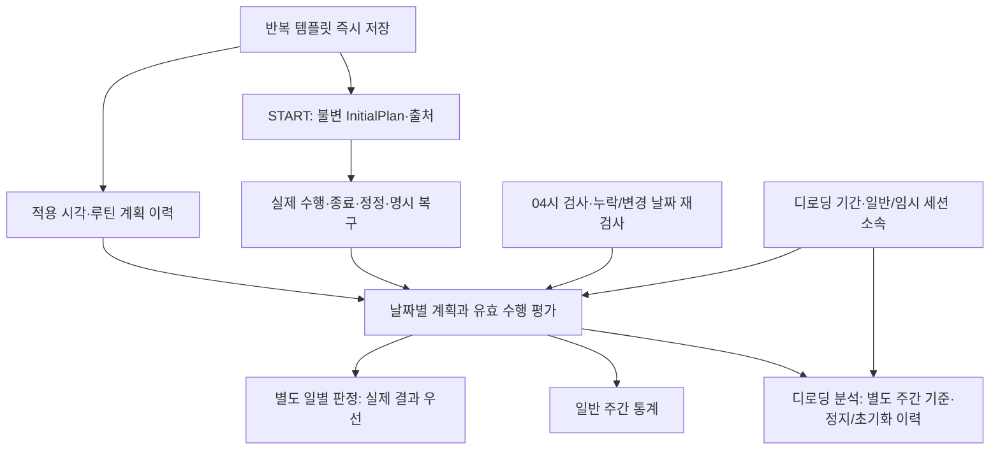

# 주간 루틴 즉시 변경·04시 자동 미수행 판정 영향 분석

작성: 2026-11-06, Asia/Seoul. **분석 제안이며 구현·정책 승인 완료 문서가 아니다.** 조사 대상은 T02-B 미커밋 변경을 포함한 양쪽 작업 트리다. 코드·공식 설계·테스트·DB·서버 상태를 변경하지 않고 이 보고서만 신규 작성했다.

## 1. 결론 요약

**기술적으로 가능하다. 권장안은 C안을 중심으로 A안의 이력을 재사용하는 구조다.** 현재 월~일 반복 배정은 저장 즉시 바꾸고, 통계는 과거 일정 이력·세션 InitialPlan·현재 유효 수행에서 계산한다. 04시 판정은 실제 운동과 별개의 작은 일별 판정으로 기록한다. 전체 일정을 매일 복제하거나 미수행 WorkoutSession을 생성할 필요는 없다.

운영 화면에서 current/pending/nextEffectiveFrom을 나누는 복잡성은 줄어든다. 반면 다음 사항은 단순히 nextMonday를 today로 바꾸는 것으로 해결되지 않는다.

1. **시각 단위 적용 이력:** 현재 effective_from은 DATE이고 기존 일정은 다음 월요일에 적용된다. recorded_at만 적용 시각으로 바꾸면 기존 예약을 과거부터 적용한 것으로 오해한다. 새 이력에는 서버가 결정하는 적용 Instant와 안정적인 version 순서가 필요하다.
2. **그날의 평가 계획 고정 기준:** 운동을 마친 후 같은 날 A→B 또는 운동일→휴식으로 바꿔도 이미 수행한 결과를 재분류하지 않아야 한다. 현재는 요일 배정이 주중에 바뀌지 않아 이 문제가 드러나지 않는다. 아래의 ‘첫 예정 운동 START 고정 / 미시작일은 날짜 종료 직전 이력’ 혼합안을 권장하되 제품 확인이 필요하다.
3. **저장되는 미수행 판정:** 사용자·세대·달력 날짜당 유일한 별도 판정과 재검사 근거가 필요하다. 기존 운동 세션·record_change_events를 가짜 기록용으로 재사용하지 않는다. 실제 기록 우선·정정 반영은 기존 정책을 유지한다.
4. **서버의 진행 중 변경 차단:** 현재 UI의 화면 보호와 별개로 RoutineService/WeeklyScheduleService에는 ACTIVE 세션을 이유로 쓰기를 거절하는 공통 검사가 없다. START와 관리 쓰기의 경합까지 보호해야 한다.
5. **04시 재검사 운영:** 기존 24시간 자동 종료 작업과 별개다. 누락 일자 따라잡기와 정정된 날짜 재검사를 영속적으로 관리해야 한다.

**새 일반 주간 성공률의 일별 분모를 디로딩 분모에 자동 대입하면 안 된다.** v1.6 DL-06/09/11에는 빈도 변경의 다음 월요일 적용이 명시되어 있다. 즉시 운영과 분리해 기존 주간 분석 기준을 유지할지, 일별 확정 계획으로 분석 기준까지 바꿀지는 승인할 제품 결정이다. 계산식 자체를 이번 분석에서 변경하지 않았다.

### 1.1 조사 기준과 최신 승인본 확인

- Backend HEAD `80327ca3b7db52e9cdedbbca8a153a667f021752`, PWA HEAD `afd6ed95245cadae1a6c4212dd12a2c365c1dd2d`. T02-B 코드·V23·문서 변경은 아직 미커밋이다. HEAD만 읽으면 실제 검토 구현을 놓치므로 작업 트리를 조사했다.
- 통계 기준은 [통계·추적 v1.3](../product/Overload_Statistics_and_Tracking_Design_Specification_v1.3.md)의 ST-10~23, ST-53~57이다.
- 디로딩 기준은 PWA의 [v1.6 본문](../../../overload-pwa/docs/product/Overload_Deloading_Design_Specification_v1.6.md)이다. 파일명뿐 아니라 문서 머리의 ‘제품 정책 합의본·구현 전’, §14의 2026-11-05 v1.6 변경 이력, [Decision Log](../../../overload-pwa/docs/product/Overload_UI_Decision_Log_v0.9.md) 서두·10.10·참조 문서의 현행 v1.6 지정을 함께 확인했다. Backend 저장소의 v1.3은 현행 기준이 아니다.
- **문서 불일치:** v1.6의 DOC-01에 ‘v1.5를 현재 기준’이라는 오래된 문구가 남아 있다. 위 승인·변경 이력에 따라 v1.6을 사용하되 이번에 원문을 고치지 않았다. Backend 기술 문서의 일부 과거 인증·migration 상태도 각 현행 API/구현과 구분했다.
- [T02-B 2차 보고서](../../../overload-pwa/docs/tasks/ui-v09-t02b-second-report.md)와 Decision Log 10.13은 여전히 현재/예약 일정 및 다음 월요일 변경을 설명한다. 새 방향은 이를 바꾸는 **이번 분석의 대상**이며 이미 구현된 것으로 취급하지 않는다.

## 2. 현재 구현 현황과 재사용 근거

패키지 기본 경로는 `src/main/java/com/overload/overload_server/`, 테스트는 대응하는 `src/test/java/com/overload/overload_server/`다.

| 영역 | 실제 파일·주요 메서드 / 계약 | 상태와 영향 |
|---|---|---|
| 일정 CRUD·동시성 | [WeeklyScheduleService](../../src/main/java/com/overload/overload_server/routine/WeeklyScheduleService.java) `read/save/view/effectiveFrom/nextMonday/history`, [요청 파서](../../src/main/java/com/overload/overload_server/routine/WeeklyScheduleRequests.java), [API](../api/weekly-schedule.md) | **이미 구현됨 → 수정 필요.** 최초 당일, 이후 엄격한 다음 월요일. 사용자 FOR UPDATE, expectedVersion, 동일 최신 배정 no-op, 고정 시간대, 전체7요일 배정 교체를 재사용한다. current는 별도 SQL, history는 최근20개와 페이지 조회다. |
| 일정 이력 | [V19](../../src/main/resources/db/migration/V19__add_weekly_schedule_and_routine_plan_history.sql), [V20](../../src/main/resources/db/migration/V20__allow_immediate_first_weekly_schedule.sql) | **이미 구현됨 → 수정 필요.** PK(user_id,data_generation,version), recorded_at/effective_from/time_zone/assignments. V20은 version1만 평일 허용, 이후 ISO 월요일 제약. UPDATE 금지 트리거가 있으므로 기존 행 backfill/update를 전제하면 안 된다. |
| 루틴·계획 이력 | [RoutineService](../../src/main/java/com/overload/overload_server/routine/RoutineService.java) `create/update/delete`, [RoutinePlanHistory](../../src/main/java/com/overload/overload_server/routine/RoutinePlanHistory.java) `record/removeFromNextSchedule` | **이미 구현됨 → 수정 필요.** 루틴 저장·승인·삭제와 이력 INSERT는 같은 운동 트랜잭션. 루틴 삭제와 다음 월요일 배정 제외도 원자적이다. 구성 편집의 ACTIVE 차단은 없다. 새 규칙에서는 당일 평가 근거 보존과 운영 배정 즉시 제외를 함께 처리해야 한다. |
| T02-B V23 | [V23](../../src/main/resources/db/migration/V23__routine_tag_and_cardio_catalog.sql), [루틴 API](../api/routine-management.md) | **이미 구현됨.** nullable 태그·유산소 catalog ID 추가다. 일정의 날짜 정책, 일별 판정, 디로딩 기간을 구현한 migration이 아니다. V21 실제 유산소 측정, V22 추가 부하도 그대로 보존한다. |
| START·날짜·불변 계획 | [WorkoutSessionRequests](../../src/main/java/com/overload/overload_server/workoutsession/WorkoutSessionRequests.java) `start`, [WorkoutSessionService](../../src/main/java/com/overload/overload_server/workoutsession/WorkoutSessionService.java) `start`, [V12](../../src/main/resources/db/migration/V12__create_workout_sessions.sql) | **이미 구현됨 → 일부 연동 필요.** startedAt을 startedTimeZone에서 해석한 날짜와 workoutDate가 같은지 검증한다. InitialPlan/시작 날짜는 DB 트리거로 불변, 사용자당 ACTIVE 하나. 현재 일정 버전과 START의 결합 참조는 없다. |
| FINISH·자동 종료 | [WorkoutSnapshotService](../../src/main/java/com/overload/overload_server/workoutsession/WorkoutSnapshotService.java) `finish/save`, [WorkoutSession](../../src/main/java/com/overload/overload_server/workoutsession/WorkoutSession.java) `expireIfDue`, [WorkoutExpiryJob](../../src/main/java/com/overload/overload_server/workoutsession/WorkoutExpiryJob.java) | **이미 구현됨.** 유효 상태 갱신 후24시간 경과 시 AUTO_CLOSED. 기본60초 반복, batch1000·SKIP LOCKED·잠금 후 재검사. 04시 미수행 작업은 **신규 구현 필요**다. |
| 정정·삭제·누락 복구 | [WorkoutRecordService](../../src/main/java/com/overload/overload_server/workoutsession/WorkoutRecordService.java) `edit/recover/delete/assessment`, [세션 API](../api/workout-sessions.md), [V15](../../src/main/resources/db/migration/V15__add_closed_workout_record_edits.sql) | **이미 구현됨 → 일별 파생 판정 재검사 연결 필요.** 종료 후 expectedVersion과 원본/변경 이력 보존. 복구는 누락 완료 수행 추가이며 삭제된 UUID나 세션 전체 삭제를 되돌리는 API가 아니다. |
| 실제 통계 | [StatisticsRepository](../../src/main/java/com/overload/overload_server/statistics/StatisticsRepository.java) `read`, [StatisticsService](../../src/main/java/com/overload/overload_server/statistics/StatisticsService.java) `overview` | **이미 구현됨.** 미삭제 FINISHED/AUTO_CLOSED의 현재 유효 수행을 읽고 매 조회 재계산. ACTIVE·삭제 세션 제외. 실제 운동량·근육/유산소 집계는 재사용하며 자동 미수행을 여기에 더하지 않는다. |
| 예정 계획·일별 달성 | [PlanningRepository](../../src/main/java/com/overload/overload_server/statistics/PlanningRepository.java) `read`, [PlanningCalculator](../../src/main/java/com/overload/overload_server/statistics/PlanningCalculator.java) `calculate/judge` | **이미 구현됨 → 시각 이력/일별 대상 선택 수정 필요.** effective_from별 최종 일정, 루틴의 날짜별 마지막 이력, 최초 START InitialPlan, 후보별 최고 유리수 달성률을 사용한다. 최신20개 화면 이력에 의존하지 않는다. 현재 미수행은 조회 결과 PLANNED·0이며 저장된 자동 미수행 엔터티가 없다. |
| 오프라인·ACK | PWA [sync.ts](../../../overload-pwa/src/features/workout-local/sync.ts), [sync-state.ts](../../../overload-pwa/src/features/workout-local/sync-state.ts), [ClosedWorkout](../../../overload-pwa/src/features/workout-online/ClosedWorkout.tsx), [Task009](task-009-redesign-v1.0.md) | **이미 구현됨.** 고정 snapshot/finish 원문·writerEpoch·revision·로컬 ACK 확정을 보존한다. AUTO_CLOSED 뒤의 옛 ACTIVE 요청은 자동 적용하지 않고 명시 복구로 연결한다. 새 일별 판정이 이 원본들을 덮어쓰지 않는다. |
| 실제 루틴 UI | PWA [routine-schedule.ts](../../../overload-pwa/src/features/workout-online/routine-schedule.ts), RoutineForm/Workspace, WeeklySchedulePanel, HomePanel | **이미 구현됨 → 수정 필요.** pending 우선 편집, nextEffectiveFrom 확인, current/예약 분리, 부분 성공·재조회 재시도다. 즉시 변경 응답으로 함께 전환해야 한다. 화면 숨김만으로 서버 직접 쓰기까지 차단되지는 않는다. |
| 디로딩 도메인 | v1.6 DL-05~22/80~84, PWA backend-ui-v0.9.md | **설계 문서에만 존재 / 신규 구현 필요.** 실제 서버의 기간·임시 루틴·분석ON/OFF·누적·시작 자격 API/테이블은 없다. 검색된 서버 deload 언급은 향후 제외를 설명하는 주석이다. PWA ReviewHeader/sample.ts의5.2/8주는 개발 표시값이다. |

### 2.1 기존 테스트에서 확인한 보장

- `PlanningCalculatorTests`: `fourPlannedDaysIncludeMissedDayAnd225EffectiveDaysYield5625Percent`, `bestSingleSessionWinsWithoutCombiningDisjointHalfSessionsAndRestDayDoesNotFillPlan`, `routineEditsOnlyAffectSubsequentDaysAndDeletedSessionStillAnchorsOriginalDayPlan`, `cardioTimeAndDistanceUseInitialTargetsAndMissingActualIntensityRemainsUnverifiable`.
- `StatisticsIntegrationTests`: `firstThursdayRegistrationStartsTodayAndOnlyRemainingDaysCountWhileEditsWaitUntilMonday`, `concurrentScheduleSavesSerializeAndNoopDoesNotCreateAnotherVersion`, `routineDeletionRemovesFutureAssignmentWithoutErasingCurrentWeekDenominator`, `scheduleHistoryIsPagedAndCurrentVersionRemainsVisibleAfterManyPendingEdits`, `failedHistoryWriteRollsBackRoutineDeletionAndScheduleReservationTogether`.
- `WorkoutSessionRequestsTests`: `exactCountersAndLocalDateAcrossMidnight`, `inconsistentDateAndUnknownZoneAreNotServerCorrected`.
- `WorkoutSessionIntegrationTests`: START와 구성 변경 경합 및 섞이지 않는 InitialPlan, `exactDeadlineClosesBeforeLateRequestAndCommitsDespiteHttpConflict`, `reservationJobRechecksRowsIsIdempotentAndCatchesUpOnRestart`, `explicitRecoveryAddsMissingAndExtraSetsKeepsOrdinalAndIsSafelyRecognizedOnRequery`, `autoClosedRecoveryAcceptsActualCompletionAfterServerClosureWithoutCreatingFinish`, `sessionLogicalDeletePreservesChildrenAndOriginalFinishConfirmationWithoutResurrection`.

위 내용은 **기존 테스트의 소스 조사**다. 이번 분석에서는 재실행하지 않았으며 과거 T02-B의 실행 결과를 이번 검증 성공으로 보고하지 않는다.

## 3. 새 설계의 데이터 흐름과 저장 범위 제안

이하 테이블/필드/상태명은 이해를 위한 **기술 제안명**이며 API 확정안이나 구현물이 아니다.

그림의 새 일별 판정과 디로딩 연결은 제안/후속 구현이다. 미수행에서 실제 운동 세션으로 향하는 생성 경로는 없다.

### 3.1 운영 템플릿 → START → 종료

1. **반복 템플릿 저장:** 인증·CSRF·사용자/세대·expectedVersion을 검사하고, START와 경합하는 서버 잠금 경계 안에서 진행 상태를 재확인한다. 같은 내용은 no-op, 실제 변경은 새 version으로 즉시 적용한다. 적용 시각은 클라이언트가 소급 지정하지 않는다. 적용일 선택 UX는 만들지 않는다.
2. **이력 보존:** 새 적용 시각에 유효한 월~일 배정은 바꾸되 이전 version과 루틴 계획 이력은 INSERT 전용으로 남긴다. 같은 날 여러 번 저장해도 version 순서와 적용 Instant로 구별한다.
3. **START:** 기존 불변 InitialPlan을 원자적으로 복사한다. 첫 예정 운동을 날짜 평가의 기준으로 삼는 경우, 서버가 확인한 `scheduleVersionAtStart` 같은 별도 출처 참조를 함께 남기는 것이 안전하다. 기존 InitialPlan JSON/hash를 다시 쓰지 않고 신규 관계/컬럼으로 연결한다. 현재 START 요청에는 이 참조가 없으므로 과거 값을 이름·현재 배정으로 추정하지 않는다.
4. **운동 중:** AppliedPlan·실제 수행·중량 승인·타이머는 기존 경로를 따른다. 원본 구성·요일 편집은 새 서버 검사가 차단한다. 현재 운동의 허용된 임시 변경을 원본 수정 금지와 혼동하지 않는다.
5. **FINISH/정정/복구:** 실제 사실을 기존 트랜잭션으로 확정한 뒤 해당 운동 날짜의 일별 파생값을 재검사 대상으로 표시한다. ACK 응답을 받았다는 사실만으로 날짜를 바꾸지 않는다.

### 3.2 그날의 계획 선택 — 핵심 제품 확인 사항

권장 기준은 다음과 같다.

- **예정 루틴과 일치하는 첫 START가 있는 날:** 당시 배정과 그 세션의 InitialPlan을 그날 평가 출처로 고정한다. ACTIVE·무수행 종료·논리 삭제가 됐다고 계획 근거까지 지우지 않는 현재 anchor 성질을 유지한다. 이후 같은 날 템플릿을 바꾸어도 이미 끝낸 A의 성공을 B 미수행으로 뒤집지 않는다.
- **그런 START가 없는 날:** 해당 날짜 다음 날00:00 **미만**에 유효했던 마지막 배정/루틴 이력을 사용한다. 수요일00:01 변경은 화요일을 바꾸지 않는다. 04시에 현재 템플릿을 읽어 과거 계획을 정하지 않는다.
- **후보 수행:** 같은 날짜·고정된 예정 루틴의 각 세션을 자기 InitialPlan으로 판단하고 최고 단일 달성률을 사용한다. 표시 계획과 최고 후보의 버전이 다를 수 있는 현재 계약도 유지한다. 다른 루틴·추가 운동은 실제 통계에 남는다.
- **과거 근거 없음:** UNKNOWN이다. 현재 루틴을 역투영하거나 임의0을 생성하지 않는다.

이 혼합안은 이미 끝낸 결과를 보존하는 요구에 유리하지만, **같은 날 A 종료 후 B를 추가로 예정 루틴으로 바꿔 운동할 때 그날 대상은 A로 남는다.** 이를 원하지 않는다면 일일 대상 정의를 먼저 바꿔야 한다. 날짜 종료 최종 배정만 사용하는 안은 더 단순하지만 완료 A 뒤의 배정 변경이 과거 결과를 바꾸는 문제가 있다. 무수행 START까지 계획을 고정할지는 현재 anchor 보존과의 관계를 포함해 승인해야 한다.

현재 `PlanningRepository`의 날짜별 마지막 루틴 이력 압축은 미시작일의 종료 시점 조회에는 재사용 가능하지만, 새로 필요한 당일 START 시점 배정 선택 전에 모든 중간 version을 버리면 안 된다. START의 별도 참조 없이 `startedAt`만으로 역산하는 것도 서버 수락 시점·기기 시계·지연 START의 차이를 놓칠 수 있다.

### 3.3 최소 데이터 모델

| 데이터 | 권장 저장·재사용 | 필요한 이유 / 저장하지 않을 것 |
|---|---|---|
| 즉시 적용 이력 | 기존 weekly_schedule_versions에 신규 행용 적용 Instant 추가 등 최소 확장 | DATE만으로 시간·동일 날짜 여러 변경을 표현하지 않는다. 과거 recorded_at과 예약 effective_from의 의미를 보존한다. |
| 당시 루틴 계획 | routine_plan_history / 세션 InitialPlan 재사용 | 이미 있는 불변 계획 JSON을 매일 다시 복사하지 않는다. |
| START 출처 | 신규 세션의 일정 version 참조 | 첫 예정 START 고정안을 선택할 때 필요. 과거 JSON에 넣거나 기존 요청 원문을 재작성하지 않는다. |
| 일별 판정 head | PK `(user_id,data_generation,workout_date)` | 계획 출처 참조, 판정 상태/시각, 평가 revision·ruleVersion·재검사 표시를 보관한다. 예정 루틴ID/루틴version 또는 anchorSessionId 등 정확한 근거를 연결한다. |
| 재평가 이력 | 의미가 달라진 경우에만 일별 판정의 변화 이력 | 매번 스케줄러 실행 로그를 도메인 이력으로 무한 적재하지 않는다. 기존 record_change_events는 session 종속이라 무관한 날짜 이벤트에 재사용하기 부적절하다. |
| 검사 진도 | 계정·세대별 완료 검사 날짜/cursor와 재검사 대상 | 서버 중단 후 누락을 따라잡는다. cursor를 넘긴 과거 정정도 처리해야 한다. 전체 계획 스냅샷은 필요 없다. |

`MISSED`, `SUPERSEDED_BY_RECORD`, `DEFERRED_ACTIVE`, `UNKNOWN` 등은 제안 상태다. 같은 날짜에 MISS 행과 실제 행을 따로 더해 분모를 늘리지 않는다. 일반/디로딩 분류가 필요하면 한 날짜 head가 당시 모드/기간을 참조하게 하고, 같은 일반 예정일의 중복 판정을 막는 유일성을 유지한다.

**실제 결과의 출처는 계속 수행 원본이다.** 판정 head는 검사 이력/파생 결과다. 미수행이0이어서 score 계산에 도움이 되더라도, 저장된 MISS와 실제 기록만 나열해서는 휴식·UNKNOWN·등록 전 날짜·미처리 예정일을 구분할 수 없다. 이력과 계획 범위가 여전히 필요하다.

### 3.4 04시 검사와 재평가

1. 사용자 달력 시간대의 **다음 날04:00이 지난 날짜** 중 미검사/재검사 대상을 제한 batch로 찾는다. 서버가04시에 꺼졌다면 재시작 뒤 같은 날짜를 검사한다. ‘정각 cron 한 번’에 의존하지 않는다.
2. 사용자/세대 및 그날의 계획 근거를 잠금·일관된 트랜잭션에서 다시 확인한다. 계획 없음/등록 전이면 MISS를 만들지 않는다. 근거 부족은 UNKNOWN이다.
3. 해당 예정일의 진행 중 정상 세션이 있으면 DEFERRED로 두고 종료/24시간 만료 뒤 재검사한다. 수요일03:30에 시작한 **수요일 세션** 때문에 화요일 검사를 무조건 미루지는 않는다.
4. 유효한 실제 결과가 있으면 이를 사용한다. 없고 예정일이 확실하면 MISSED를 유일키로 확정한다. 일부 세트라도 실제 수행이 있는 결과와 무수행을 같은 설명으로 표시하지 않는다.
5. FINISH·자동 종료·사후 정정·세션/수행 삭제·명시 누락 복구가 해당 날짜를 다시 검사하도록 연결한다. 고정 요청의 중복 ACK/no-op은 판정 revision이나 이력을 불필요하게 늘리지 않는다.
6. 여러 서버가 실행해도 날짜 유일키와 잠금 후 재검사로 같은 결과를 얻는다. 기존 expiry job의 짧은 batch·SKIP LOCKED·실패 재시도 성질은 참고하되 ‘운동을 자동 종료하는 작업’을 ‘미수행 검사’로 사용하지 않는다.

구현 단순성 측면에서는 **기존 사실 쓰기와 같은 트랜잭션에서 해당 날짜의 `needs_recheck`를 표시**하고, 작업이 최신 근거로 갱신하는 방식을 권장한다. 새 범용 명령/Outbox/이벤트 프레임워크는 필요 없다. 최초 sweep 진도와 과거 dirty 날짜는 별도로 처리해야 한다. DEFERRED/UNKNOWN을 cursor만 전진시켜 영원히 잃으면 안 된다.

작업 실패 중에도 통계 조회는 실제 사실과 일정 이력으로 계산하거나 dirty 결과를 무효로 취급해야 한다. 오래된 MISSED가 새 FINISH를 이겨서는 안 된다. 실제 원본 변경과 dirty 표시가 원자적이어야 하며, 작업은 최신 사실을 읽은 뒤 head만 오래된 값으로 덮는 경쟁을 막아야 한다.

일별 시각은 저장된 IANA ZoneId로 계산한다. 서버 OS 시간대나 `현재 UTC시각-24시간`으로 전날을 정하지 않는다. 일광절약 시간대의 없는/중복04시에는 명시한 ZoneRules 해결과 날짜 유일키로 한 날짜 한 판정을 보장한다. 이는 기존 운동 만료의 **경과24시간**과 다른 달력 규칙이다.

### 3.5 ‘기록이 있다’의 의미와 이중 집계 방지

| 데이터 | 일반 예정일 달성/자동 판정에서의 취급 |
|---|---|
| 예정 날짜·예정 루틴 일치, 미삭제 FINISHED/AUTO_CLOSED, 실제 수행 있음 | 실제 결과 우선. 각 세션 InitialPlan으로 완료 종목 수를 구하고 단일 최고값 사용 |
| 일부 세트 수행, 완료 종목0 | 실제 부분 수행 기록은 보존하되 유효일은0일 수 있다. ‘전혀 운동 안 함’이라고 단정하지 않는다. |
| 시작/종료만 있고 웨이트 수행·양의 완료 유산소 활동 없음 | session 행 존재만으로 성공하지 않는다. 예정 목표의 유효 결과 없음/무수행으로 판정 가능하며 원본 세션은 삭제하지 않는다. |
| 다른 루틴 완료 / 휴식일 추가 운동 | 실제 운동량에는 포함, 예정 루틴 분자를 채우지 않음(ST-12/20/23). A 예정일에 B만 완료했다면 A 미이행0과 B 실제 수행은 동시에 존재할 수 있다. |
| 유산소 실제값 부족 또는 당시 계획 확인 불가 | 확인 불가를0/성공으로 바꾸지 않는다. 현재 PlannedDay UNVERIFIABLE/UNKNOWN 성질 유지 |
| 동일 날짜 A 세션 두 개가 각각 다른 절반 완료 | 합성하지 않고 max(0.5,0.5)=0.5. AUTO_CLOSED도 현재 통계 후보지만 공식 중량 benchmark 후보와는 다름 |
| 일별 MISSED와 나중에 도착한 적격 실제 결과 | 한 날짜 결과를 실제값으로 대체/갱신. MISS 이력은 보존 가능하지만 분모와 분자에 중복 가산하지 않음 |

DL-80/81의 ‘오늘 실제 운동 여부/최근7일 실제 일반 운동’은 **계획 달성 여부와 별도**다. 다른 루틴·추가 운동·완료 종목0이라도 실제 수행이 있으면 자격 판단의 증거가 될 수 있다. 자동 미수행은 실제 수행 증거가 아니므로 이 자격을 채우지 못한다.

## 4. 구조 대안 비교와 권장안

| 평가 항목 | A: 기존 이력 + 미수행 | B: 날짜별 계획 스냅샷 | C: 최소 확장 + 원본 재계산 |
|---|---|---|---|
| 기존 코드 재사용 | 높음. 다만 현재 DATE/예약 의미를 그대로 둘 수 없음 | 중간. 기존 이력과 일별 사본의 우선순위 추가 | **가장 높음.** 이력·InitialPlan·후보 평가 재사용 |
| 구현 복잡도 | 중간. 시간축·당일 고정·재평가가 결국 필요 | 높음. 생성/변경/누락 snapshot 관리 | 중간. 같은 문제는 해결하되 복제 범위를 줄임 |
| 정확성/과거 보존 | 충분한 적용 시각과 START 문맥을 추가하면 가능 | 생성 시점이 정확하면 강함. 잘못 고정한 snapshot도 문제 | 필요한 출처 참조가 있으면 A와 동등 |
| 즉시 변경 UX | 가능 | 가능. 이미 만든 오늘 snapshot과 현재 설정 불일치 처리 필요 | 가능. 운영 최신값과 과거 평가 출처 분리 |
| 오프라인·늦은 기록 | 별도 판정 정정 필요 | 별도 판정 정정 필요 | 원본 우선 재계산을 가장 직접적으로 재사용 |
| 통계/디로딩 | 원본 공유 가능. 분모 정책 별도 확인 | 공유 가능하지만 모든 사본의 분석 경계 관리 | 원본 공유, 일반 성공률/분석 누적은 별도 소비자 |
| 스케줄러 | 저장 MISS 요구 때문에 필요 | snapshot 생성과 MISS 검사 모두 필요할 수 있음 | 저장 MISS + 검사 진도 필요. 계산식용 별도 scheduler 불필요 |
| DB 범위 | 시각 이력·판정·재검사 메타 | 날짜별 snapshot + 판정 + 생성 진도 | **시각 이력·필요 출처·판정/진도 최소 확장** |
| 장애/복구 | 이력으로 재구축 가능 | snapshot 생성 누락·중복·고아 복구 필요 | 원본으로 head 재구축 가능, head는 권한 원본 아님 |
| 장기 유지보수 | 양호. ‘이력만으로 충분’이라는 과소설계 주의 | 전체 복제는 데이터/정합성 부담 큼 | **권장.** 정책 계산을 한곳에 모으고 파생값 최소화 |

A안도 정확히 구현하면 C안과 상당 부분 같아진다. 차이는 ‘매일 모든 계획 사본을 만드는가’와 ‘파생값을 권위 원본으로 삼는가’다. **C + A의 불변 이력 + 필요한 날짜 출처 참조**를 선택한다. 전일 계획을 재현할 수 없다면 B의 일부 snapshot을 제한적으로 도입할 수 있으나, 현재 이미 계획 이력/InitialPlan이 있으므로 전면 도입이 기본값일 이유는 없다.

### 4.1 기존 Weekly Schedule의 구체적 전환

- **current/pending:** 새 운영 API는 현재 반복 배정/version/고정 시간대를 중심으로 단순화할 수 있다. pending/nextEffectiveFrom과 편집 적용일 선택은 새 운영 계약에서 제거한다. 이력과 expectedVersion은 유지한다. 기존 PWA의 pending 우선 편집·ACK 확인·삭제 후 제외·홈 조회도 같은 계약으로 전환한다.
- **이력 재사용:** 예를 들어 신규 행용 `applied_at` nullable 추가를 검토할 수 있다. 기존 행은 UPDATE하지 않고 원래 effective_from+time_zone로 날짜 단위 효력을 해석하며, 신규 행만 시각 단위 효력을 가진다. V20 월요일 제약은 새 행의 즉시 적용을 허용하도록 새 migration에서 교체해야 한다. 이는 과거 사실 보존용 해석이며 옛 클라이언트를 위한 이중 API를 유지하자는 제안이 아니다.
- **조회 변경:** PlanningRepository의 `DISTINCT ON(effective_from)`와 PlanningCalculator의 DATE 우선 선택은 그대로 재사용할 수 없다. 적용 시각/동일 시각 version/날짜 경계/START 출처를 사용해야 한다. 사용자 화면 history20개는 과거 판정 근거의 보관 한도가 아니다.
- **동일 날짜 여러 저장:** 모두 보존하되 현재는 최신 유효 version, 미시작 과거일은 그날 종료 직전 유효 version을 선택한다. 같은 시각이면 version으로 순서를 정한다. recorded_at을 사용자 임의 소급 적용일로 받지 않는다. 자정에 걸친 긴 저장은 서버가 적용 시점을 결정하는 트랜잭션 지점과 응답 적용 시각을 명확히 해야 한다.
- **삭제:** 새 운영 배정은 즉시 제외하되 이미 고정된 당일/과거 평가의 계획 출처는 지우지 않는다. 일정 제외·루틴 tombstone·계획 이력은 기존처럼 같은 트랜잭션이어야 한다. 삭제 후 과거 분모까지 자동 감소시키는 방식은 피한다.
- **전체/개별 편집:** 기존 전체 배정 PUT을 공통 저장 경계로 삼을 수 있다. 개별 루틴 요일 UI도 같은 expectedVersion·진행 중 검사·충돌 교체 규칙을 사용한다. 루틴 CRUD와 별도 PUT의 부분 성공 보호를 버리거나, 다른 루틴 배정을 모르는 채 조용히 덮어쓰지 않는다.

### 4.2 2026-11-09 기존 예약 처리

T02-B 보고서에는 해당 날짜부터 적용하는 예약이 있다. **이번 분석에서 조회 API나 DB를 호출해 변경하지 않았다.** 저장된 예약 행 삭제/수정 없이 다음 중 전환 규칙을 승인해야 한다.

| 방법 | 효과·위험 |
|---|---|
| 예약이 기존대로 유효해진 뒤 즉시 모델로 전환 | 기존 의도를 가장 자연스럽게 보존. 실제 전환 시각이 그 이후일 때 권장 |
| 전환 시 현재 배정을 새 기준으로 고정, 미래 예약은 보관만 | 새 운영을 바로 시작하나 예약의 자동 적용을 중단한다는 명시 승인이 필요 |
| 미래 예약을 전환 시 현재 배정으로 승격 | 선택한 의도는 보존하지만 원래 예정일을 앞당기므로 명시 승인 필요 |

어느 안이든 전환 기준 시각/정책 epoch 또는 그에 상응하는 명확한 효력 경계를 남긴다. 즉시 저장 뒤 과거 pending이 월요일에 다시 덮어쓰게 두면 새 UX와 충돌한다. old recorded_at을 새 applied_at처럼 일괄 해석해 예약을 과거 금요일로 소급시키는 방법도 금지한다.

## 5. 구체적 시나리오 검증

아래 시각은 별도 표시가 없으면 Asia/Seoul이며 2026-11-09(월)~15(일)을 사용한다. 새 결과는 **3.2절 권장 계획 고정안을 채택한 경우의 시뮬레이션**이다. 기존 정책은 소스/기존 테스트를 근거로 비교했다. 신규 기능을 실제 서버에서 실행한 결과가 아니다.

### 5.1 날짜·04시·일정/기록·분자와 분모

| 시나리오 | 계획/사실 | 04시 및 재검사 결과 | 하루 유효값 / 주간 영향 |
|---|---|---|---|
| 화23:59 시작→수00:40 종료 | 화 A 예정, A 완료 | 수04 검사 대상은 화. 종료된 A 사용 | 화1/1일. 수 운동으로 분할 안 함 |
| 수00:01 시작→01:00 종료 | 수 A 운동 | 수04는 화 검사, 이 세션은 목04의 수 검사 대상 | 수의 적격 계획일이면1, 화의 미수행을 채우지 않음 |
| 수03:30 시작→04:30 종료 | 수 세션 ACTIVE | 수04의 화 판정을 무조건 보류하지 않음 | 수요일 결과는 수요일 귀속. 04시 시작/종료 제한 없음 |
| 화23:59 시작→수06:00 종료 | 화 A ACTIVE가04시에 남음 | 화만 DEFERRED,06시 종료 후 재검사 | 완료 시 화1. 04시에 임의 FINISH/MISS 확정 안 함 |
| 화08 A→13 B→22 A, 수00:01 휴식으로 변경 | 화에 적격 START 없음 | 화24:00 미만 마지막 A가 대상, 수04 현재 휴식은 무관 | 화 수행 없음이면0/계획일1 |
| 화 A 완료 뒤21시에 B로 변경 | 첫 예정 START/InitialPlan A 보존 | A 결과를 B 미수행으로 뒤집지 않음 | A1. B 추가 운동은 실제 통계에 남음. 당일 기준 승인 필요 |
| 화 A 예정, B만 완료 | 다른 루틴 실제 수행 있음 | ‘적격 예정 A 결과’는 없음. A 미이행, B 수행 보존 | 예정 분자0/분모1. B로 자동 성공 안 함 |
| A 두 번 각각 서로 다른 절반 완료 | 두 InitialPlan 각각0.5 | 최고 단일0.5, 합성1 금지 | 하루0.5/계획일1 |
| A 시작·종료, 실제 수행0 | session은 존재 | 무수행이 성공을 막지 않음.0/무수행 근거로 판정 | 하루0/계획일1, 원본 세션 유지 |
| A 한 종목 계획4세트 중3세트만 수행 | 실제3세트, 완료 종목0 | 실제 부분 수행으로 표시. 임의 완료 없음 | 하루0/계획일1, 실제 세트 통계3 |
| 수04 MISSED 후 목요일 화요일 기록 동기화 | 원래 workoutDate=화, 적격 A 완료 | 실제 결과 우선, MISS는 비활성/대체·이력 보존 | 화0→1, 주간 분모는 그대로1회 |
| AUTO_CLOSED 뒤 오래된 snapshot 도착 | 서버 상태는 이미 종료 | 기존409 유지. 자동 합치지 않고 명시 누락 복구 후 재검사 | 복구 확인 전 결과 유지, 확인 후 화 실제값 반영 |
| A 완료 기록 삭제 | 과거 계획 anchor·이력 남음 | 다른 적격 세션이 없으면0, 있으면 그 최고값 | 분자는 내려가도 예정일 분모1 유지 |
| 누락 수행 명시 복구 | 삭제 UUID 되살림이 아닌 합법적 누락 추가 | 기존 expectedVersion/원본 문맥 검증 후 계산 |0→0.5/1 등 실제값. 세션 삭제 해제는 현재 미지원 |
| 목요일 첫 등록 | 월/목/금/토 배정, 목·금 완료 | 등록 전 월~수는 새 계획/미수행 생성 안 함 | 첫 주2/3=66.666667%, 다음 주 분모4 |
| 휴식일에 추가 운동 | 정상 실제 수행 있음 | 정상 계획 미수행 행 없음 | 계획 분모+0, 실제 운동량에는 포함 |
| 계획 이력 없음 / 유산소 증거 부족 | UNKNOWN / UNVERIFIABLE | 과거를 추정해 MISS/성공 생성 안 함 | 기존처럼 전체 분모/달성률 확인 불가를 표시 |
| 서버가 수04 중단, 목10 재개 / 두 인스턴스 동시 검사 | 미검사일과 기존 판정 존재 | 미처리 화·수 따라잡기, PK/잠금으로 같은 날짜1개 | 실행 횟수로 분모가 증가하지 않음 |

일반 주간 확정 예: 4완료+1미수행=4/5=80%, 3완료+부분0.5+1미수행=3.5/5=70%. 휴식2일은 분모에 포함하지 않는다. 미수행 행의 개수를 분모로 따로 더하지 않는다.

**현재 주와 종료 주를 구분한다.** 현행 overview는 주 전체 예정일을 분모로 계산하며 미래/오늘도 수행이 없으면 계산값0을 보일 수 있다. 새 저장 MISSED는 검사 시각 전 생성하지 않는다. 현재 주 미래 계획은 최신 템플릿의 전망이어서 수정으로 바뀔 수 있지만, 이미 지난 날의 분모는 바뀌면 안 된다. 주간 성공률의 표시 대상을 ‘04시 검사 완료일만’으로 바꾸는 것은 ST-21의 별도 UI/정책 변경이므로 이번 권장안에 몰래 포함하지 않는다. 월요일00시 주 경계와 월요일04시 일요일 검사 완료 시점도 구분한다.

### 5.2 디로딩 A~G 비교

여기서 E는 일반 유효일 합계, N은 해당 분석의 계획일 분모, U는 그 주 이전 누적이다. v1.6의 기본식 `min(1,E/N)` 및 DL-05~14는 그대로 놓고 **분모/빈도 적용 기준의 차이**를 비교한다. 디로딩 누적 엔진이 아직 없으므로 아래는 설계 계산이다.

| 사례 | 현행 v1.6 | 새 운영·일별 계획을 적용할 때 | 판정 |
|---|---|---|---|
| A. 주5일 모두 완료 | E5/N5=1주, 누적U+1 | 일반 성공률100%, 같은 분석 기준이면1주 | 충돌 없음 |
| B. 주5일4완료·1미수행 |4/5=0.8주, U+0.8 | 일반80%, 같은 기준이면0.8주 | MISS 자체가 운동일/양을 만들지 않음 |
| C. 주5일1완료·4미수행 |1/5=0.2주, U+0.2 | 일반20%, 같은 기준이면0.2주 | 주간 유효일이0이 아니므로 DL-10 초기화 아님 |
| D. 주5→주중3 | 현행은 다음 월요일까지 분모5 유지 | 목09시에 월~금5→월/수/금3으로 변경하고 월화수금 완료: 지난 월화수3+금1=그 주4일. 일반4/4=100%. DL 분모5를 유지하면4/5=0.8주, 일별4를 채택하면1주 | 현재 템플릿의3으로 나누는4/3은 그 주 실제 계획을 설명하지 못함. DL-11 변경 여부 승인 필요 |
| E. 주2→주중1 | 기존 주2 유지, 다음 월요일에1 적용→분석 비활성/누적0. DL-06/11 | 예: 월/목2→수요일에 목1로 변경. 그 주 과거 월 계획이 남아 역사상 분모는2일일 수 있지만 **현재 반복 빈도는1**. 즉시 빈도 gate를 적용하면 수요일에 누적0, 기존 주간 분석 기준이면 다음 월요일0 | ‘해당 주 분모2’와 ‘현재 반복 빈도1’을 혼동 금지. 정지/초기화 시점 승인 필요 |
| F. 주 전체 유효일0 | 정상 분석 주가 완전히 끝났으면 누적0. 일부 세트가 있어도 완료 종목0이면 동일 | 정상·근거 확인된 주라면 동일. 나중에 적격 기록이 오면 DL-14에 따라 해당 주 이후 누적도 다시 계산 | UNKNOWN/DEFERRED를 확정0으로 보고 초기화하면 안 됨 |
| G. 디로딩 중 원본 수정 | DL-04/17: 원본 조회만, 수정·삭제·실행 금지 | 즉시 템플릿 API에도 같은 서버 차단 필요. 현재는 실제 기간 모델/차단 구현 없음 | 운영 즉시 반영이 디로딩 읽기 전용을 무시하는 이유가 될 수 없음 |

권장 구현 순서는 **일별 원본을 공유하고 디로딩 계산 정책은 별도로 확정**하는 것이다. 최소 정책 변경을 원하면 분석의 주간 빈도 기준을 주 시작/최초 등록 이력에서 고정해 기존 DL-11 경계를 유지할 수 있다. 사용자가 일별 확정 계획을 분석 분모로 쓰기로 승인한다면 DL-06/09/11 및 관련 수용 예를 갱신해야 한다. 두 경우 모두 공식은 유지되지만 결과가 달라질 수 있으므로 구현자가 임의로 선택하면 안 된다.

### 5.3 디로딩의 다른 영향

- **분석과 시작 자격은 독립:** DL-80의 현재 반복 계획≥2일, 오늘 제외 직전7개 날짜 실제 일반 수행, 이전 완료 이후 신규 일반 수행, 오늘 실제 수행/활성 일반 세션 없음을 유지한다. 현재 템플릿1일로 즉시 변경했다면 새 시작 자격은 충족하지 않는다. 분석용 과거 주 분모가2였다는 이유로 시작을 허용하지 않는다.
- **기간 중 정지:** DL-12에 따라 누적과 주간0일 초기화가 정지된다. 04시 검사도 현재 진행 여부만 보지 않고 **검사 대상 날짜 당시의 기간 이력**을 확인해야 한다. 디로딩 날짜의 원본 일반 계획을 자동 미수행으로 만들지 않는다.
- **실제 통계/계획:** ST-29/52/56의 실제 운동량과 디로딩 임시 계획 비교는 남는다. 일반 원본 미수행과 임시 루틴의 수행 결과는 별개다. 서버에는 아직 일반/디로딩 세션 소속이 없어 이 혼재 계산이 구현됐다고 할 수 없다. 향후 기간·임시 루틴·세션 소속을 권위 있게 연결해야 한다.
- **완료/자동 완료:** 누적0, 완료 당일까지 디로딩, 다음 날 일반 복귀. DL-13은 남은 일반 유효일을 그 주 **전체 계획일 수**로 나누며 기간만큼 분모를 줄이지 않는다. 새 일반 성공률의 일별 분모를 그대로 쓰면 이 규칙과 충돌할 수 있다.
- **무수행 취소:** 누적 보존, 해당 주0일 초기화를 소급 적용하지 않는 DL-12/20을 유지한다. 취소 이후 현재 상태가 일반이라는 이유로 지난 정지 기간을 자동 일반 MISS로 재분류하는 방식은 부적절하다.
- **늦은 기록 후 누적 재계산:** 과거0주로 초기화됐던 주에 유효 수행이 확인되면 그 주부터 이후 누적을 다시 계산해야 한다. OFF→ON·디로딩 완료/취소 등 별도 reset/정지 이력을 넘어서 무조건 옛 U를 복원하면 안 된다. 이 시간축은 디로딩 구현에 원래 필요한 상태이며 자동 MISS만으로 대신할 수 없다.

## 6. 변경해야 할 정책과 유지할 보호 조건

### 6.1 변경 필요

| 항목 | 현재 근거 | 새 설계 영향 |
|---|---|---|
| 기존 주간 배정 변경은 다음 월요일 | Weekly Schedule API, ST-15/AC-20/26, Decision Log10.13 | 반복 템플릿 즉시 변경으로 공식 문서/계약/테스트를 함께 전환 |
| 루틴 삭제의 다음 주 배정 제외 | RoutinePlanHistory.removeFromNextSchedule, StatisticsIntegrationTests | 운영 즉시 제외와 과거·고정 당일 계획 보존을 분리 |
| 운동 중 원본 구성/일정 편집 | 현재 API는 불변 InitialPlan만 보호하며 편집 자체는 허용 | 새 서버 쓰기 제한과 경합 검증 추가. 기존 ‘편집해도 InitialPlan 보존’ 테스트와 새 ‘해당 상황 편집 거절’ 테스트의 기대 행동 구분 |
| 날짜별 자동 판정 저장 | 현재 PLANNED0 조회만 존재 |04시 기준·판정 head·실제 결과 우선 갱신·재검사 정책을 문서화 |
| 디로딩 빈도 적용 시점 | DL-06/11/84, 분석/자격 분리 | 운영과 분리 유지 또는 분모/정지 경계 변경을 승인한 후 갱신 |

### 6.2 유지해야 하는 것

- Cookie 인증·CSRF·principal 사용자 소유권, dataGeneration, expectedVersion, 단일 ACTIVE, writerEpoch/localRevision, 고정 snapshot/finish 요청 원문 및 로컬 ACK 원자 확정.
- START 날짜/시간대와 InitialPlan, 종료 당시 최초 평가, 수행 당시 승인 문맥·장비, 승인 사건/정정 이력. 현재 루틴을 과거 분모로 쓰지 않는다.
- ST-17~23의 최초 계획 종목 기준·세트 전부 완료·유산소 실제 목표 증거·최고 단일 세션·계획 외 수행 제외·일일 상한1. 공식 중량 성과 평가의 eligible과 혼동하지 않는다.
- 종료 후 수정·누락 복구는 기존 expectedVersion, AUTO_CLOSED의 늦은 ACTIVE 쓰기 거절, 명시 복구/UNVERIFIED 문맥. 자동 미수행은 복구 권한을 추가하지 않는다.
- 주간 유효일0, 분석OFF/재활성화, 디로딩 정지·완료·취소 등의 확정 원칙. 변경을 선택하는 항목만 명시 승인한다.

### 6.3 진행 상태별 변경 차단과 기술 한계

| 상태 | 가능한 보호 / 한계 |
|---|---|
| 서버 ACTIVE / 휴식 / 유산소 일시정지 | 모두 같은 ACTIVE다. 별도 PAUSED 세션 enum을 만들 필요 없이 원본 구성·일정 쓰기를 거절 가능 |
| 자정 넘김 | 상태가 종료되지 않으므로 계속 차단. 자정/04시를 자동 종료 경계로 사용하지 않음 |
| AUTO_CLOSED | 서버 ACTIVE 슬롯은 해제. 기존24시간 계약상 온라인 관리 재개 가능. 로컬에 더 최근 수행이 남아 있을 수 있으므로 접속 기기는 원본을 보존하고 재검증/명시 복구 안내 |
| FINISH 응답 미확인 | 서버가 ACTIVE면 차단, 이미 FINISHED면 서버는 종료 상태. 접속 기기는 고정 FINISH의 중복 ACK/서버 조회와 로컬 확정 전 화면 이동·관리 재개를 성급히 허용하지 않음 |
| 오프라인 진행 / 미전송 종료 | 새 관리 API는 온라인 전용 유지. 같은 기기가 알고 있는 미확인 운동은 UI에서 보류 가능. 서버는 다른 기기의 미전송 종료/계속 진행을 완전히 알 수 없음 |
| 계정/세대 변경 | 기존 허용 원본 접근 경계·구 세대 쓰기 거절. 다른 계정의 dirty 날짜나 과거 로컬 운동을 새 세대에 붙이지 않음 |

**모든 기기의 로컬 진행을 영원히 확인하기 전까지 전역 수정을 금지하는 보장은 현재 계약으로 불가능하다.** 그렇게 하려면24시간 종료/온라인 관리 정책을 바꾸거나 별도 무기한 잠금·동기화 확인 체계가 필요하다. 권장 범위는 서버 ACTIVE 차단 + 접속 기기의 알려진 미확인 원본 보호다. 미지의 다른 기기 때문에 모든 날짜의 MISS나 모든 관리 쓰기를 무기한 중단하지 않는다.

구현 시 사용자 잠금→루틴/세션 잠금 순서를 일관되게 잡아 START와 검사·관리 쓰기를 직렬화해야 한다. **현재 START는 REPEATABLE_READ, users FOR SHARE이며 관리 조회는 단순히 잠금 SQL 하나만 바꿔서는 충분하다고 단정할 수 없다.** 배타 잠금 대기 전 잡힌 스냅샷에서 새 ACTIVE INSERT가 안 보이는 문제를 검증해야 한다. READ_COMMITTED와 명시 잠금으로 정리하거나, 확실한 직렬화 실패/재검증 경계를 설계하는 것이 후속 기술 검증 대상이다. 현재 단일 ACTIVE UNIQUE는 START끼리의 중복은 막지만 관리 쓰기와의 write-skew까지 막지는 않는다.

원본 구성 차단을 모든 routine version 변경에 적용하면 운동 중 정상 승인 요청/승인 해결까지 막을 수 있다. 검사 위치는 사용자 관리의 구성·일정 변경 경계로 한정하고, 기존 세션의 명시 중량 승인 기능과 충돌하지 않게 분리해야 한다. 태그/이름 같은 메타데이터 예외를 불필요하게 많이 도입할 필요는 없으나 차단 범위를 후속 계약에 정확히 적는다.

### 6.4 시간대 불일치

현재 START는 **기기에서 받은 startedTimeZone**과 workoutDate의 일치만 검사한다. PWA도 START에 기기 Intl 시간대를 사용한다. 반면 일정은 최초 저장 뒤 time_zone을 고정하고 다른 시간대 PUT은 거절한다. users에는 별도 계정 달력 시간대 컬럼이 없다.

따라서 ‘시작 당시 저장 시간대의 날짜’라는 기본 원칙은 이미 맞지만, 그것이 곧 ‘항상 일정 기준 시간대의 날짜’라는 보장은 아니다. 새 검사에는 저장된 일정 시간대를 기준으로 삼고 신규 START 생성도 같은 기준을 쓰는 방향을 권장한다. 여행/기기 시간대가 다를 때의 기존 행동 변경 여부는 확인해야 한다. **기존 startedAt/workoutDate/startedTimeZone을 재작성하거나 04시 기준으로 날짜를 이동시키지 않는다.**

## 7. 구현 시 예상 범위와 검증 계획

이번 절은 후속 개발 범위이며 이번에 실행하지 않았다.

| 영역 | 수정/추가 대상과 완료 조건 |
|---|---|
| DB | V23 다음 새 migration에서 시각 적용 이력·일별 판정 유일성/근거/재검사 메타·필요한 START 출처 참조 검토. 기존 V19~23/checksum/예약행/불변 JSON은 보존. 기존 UPDATE 금지 트리거와 변경 CHECK를 명시 검증 |
| Backend 일정/루틴 | WeeklyScheduleService/View/Request, RoutineService.delete, RoutinePlanHistory, 관련 Repository. 즉시 current·no-op·expectedVersion·시간대·구성 차단·삭제 원자성을 통합 |
| START/종료/정정 | WorkoutSessionService/SnapshotService/RecordService 및 expiry 경로. START 출처 고정과 관리 쓰기 경합 방어, 실제 날짜의 dirty 표시, 기존 ACK·복구 보호 유지 |
| Scheduler | 기존 expiry와 별도 일별 검사 service/job. 시간대별 due 날짜, durable 진도·dirty/보류 재검사, 중복·restart·다중 인스턴스·잠금 후 재검사. fake 세션 생성 없음 |
| API | WeeklySchedule의 current/pending/nextEffectiveFrom 소비 계약을 새 반복 설정 중심으로 교체. 검사 결과와 UNKNOWN/보류 표현·원본 우선 조회 범위를 확정. 종료/복구 endpoint나 snapshot schema를 무관하게 바꾸지 않음 |
| Frontend | weekly-schedule.ts, routine-schedule.ts, RoutineForm/Cards/Workspace, WeeklySchedulePanel, HomePanel. 예약 편집/적용일 문구 제거, 즉시 재조회, 교체 확인·부분 성공·고정 재시도·진행 중 보류 유지. HTML/Decision Log는 승인 후 동기화 |
| Statistics | PlanningRepository의 시간축/범위 SQL, PlanningCalculator의 대상 선택, StatisticsOverview 일별 상태와 일반 주간 분모. 실제 통계·growth·근육 역할 집계 재사용. dirty MISS보다 실적 우선, query 비용/동일 시점 읽기 확인 |
| Deload | 아직 미구현인 기간·일반/임시 소속·분석 epoch/reset 모델과 연결. 공식 빈도/분모 선택 승인 후 적용. 일반 미수행과 임시 계획/실제 통계 분리, 과거 변경 시 누적 연쇄 재계산 |
| 데이터 전환 | 보존 V23 복제본에서 기존 예약 처리와 구/신 이력 경계·동일 기존 사실을 검증한 후 실제 대상 별도 승인. 개인/운영 DB 자동 적용 없음 |

API에서 pending/nextEffectiveFrom을 제거하는 변경은 현재 소비자와의 전환을 함께 검토하고 AGENTS.md의 Breaking API Change 사전 승인 기준을 적용한다. 이 보고서는 그 실행 승인을 대신하지 않는다. 기간별 계획/실적 조회는 날짜마다 별도 요청하는 N+1 방식 대신 범위 일괄 조회를 유지하며, 신규 적용 시각·계정/세대/날짜·재검사 대상에 필요한 인덱스와 작업의 계정별 순환 처리 비용을 검증한다.

### 7.1 반드시 추가/수정할 회귀 테스트

1. 기존 통계·세션·오프라인 보존 테스트를 유지하고, ‘변경 다음 월요일’ 기대값은 승인된 정책 범위만 교체한다. 기존 단위/격리 통합 테스트를 소스와 함께 갱신한다.
2. 최초 등록/등록 전 UNKNOWN·BEFORE_REGISTRATION, 빈 배열 휴식, 같은 날 다회 변경, 다음 날00:01 변경이 전일을 바꾸지 않음, 자정 경합·동일 timestamp/version tie.
3. 실제 계획A→B 변경과 첫 예정 START/무수행/논리 삭제의 대상 고정, 같은 루틴 다른 버전 최고 단일 후보, 다른 루틴·추가 운동 제외.
4. START와 루틴 수정·요일 저장·삭제 동시 요청, RR 오래된 snapshot/write-skew, 일관된 잠금 순서, DB 오류 전체 롤백, 같은 요청 재확인/no-op.
5. 04시 ACTIVE 보류, 수요일03:30 운동과 화요일 판정 분리,24시간 종료 후 재검사, job 장애/누락 catch-up/다중 인스턴스/반복 실행 유일성.
6. MISS 후 실제 FINISH/명시 누락 복구, 실제 기록/수행 삭제, 유산소 부족 증거, 정정과 job 동시 갱신, 오래된 head가 원본을 덮지 않음.
7. 사용자/세대 격리와 CSRF·권한, 기존 snapshot/finish hash·ACK·writerEpoch·타이머·입력 불변. 일반 관리 금지가 승인 경로를 잘못 막지 않음.
8. 시간대 차이·DST·월요일00/04 경계, 미래/현재 주의 계획 전망과 확정 MISS 분리. 미등록 과거에 current를 백필하지 않음.
9. 디로딩 A~G, 완료 다음 날 복귀/전체 주 분모, 취소 후0일 초기화 소급 금지, 분석OFF/재ON·완료 reset을 넘는 누적 재계산, 일반/디로딩 혼재 실제 통계.
10. 2026-11-09 기존 pending과 새 즉시 저장의 경합·전환 epoch, 원본 루틴3/기존 세션15/검토 루틴3/승인·계획 이력/백업 보존. 전체 이력을 최근20개만 읽어 과거를 잃지 않음.

### 7.2 이번 분석에서 수행한 검증과 보존 확인

- 코드·스키마·기존 테스트·최신 승인 문서의 정적 추적을 수행했다. 전체 테스트/build/lint는 실행하지 않았다. 신규 기능을 구현하지 않았으므로 이 분석을 제품 통과 검증으로 보고하지 않는다.
- 메모리 내 날짜/산술 시뮬레이션 **18개 assertion**을 확인했다: 자정 날짜3건, 전일 종료 기준과04시 현재 설정 차이,80%/70%, 단일 최고값, 다른 루틴 제외, 분모0, 디로딩 A/B/C, D의 실제4일·고정분모5 차이, E의 반복 빈도1/역사 분모2 차이, 유효일0. 새 프로덕션 계산기를 작성·실행한 것은 아니다.
- DB 직접 조사나 live API 호출은 불필요하여 하지 않았다. 특히 세션 GET/ACTIVE는 expireForRead에서 만료 전환을 커밋할 수 있으므로 ‘GET이면 무조건 무변경’이라고 가정해 호출하지 않았다. 서버/컨테이너 시작·종료·복원·migration·시드도 하지 않았다.
- 검토 데이터 수와11/09 예약·백업은 T02-B 보고서의 확인 결과를 인용했다. 이번에 DB에서 재측정한 값이라고 표시하지 않는다.
- 분석 시작 시 Git 대상 파일 전체의 이름/바이트 지문을 메모리에 기록했다. Backend338개 SHA256 `f09df6de91b4288ee4d0bcbc1359abcc57ff17b8301cea4b4985bbaab42a60e2`, PWA412개 SHA256 `e3502716d746a696b4416c868909ce0e488b9001398d3c4cce9d29096618be2f`. 종료 시 이 보고서를 제외한 파일 집합/바이트 지문/HEAD/기존 Git 상태가 **모두 일치함을 확인했다.** 기존 미커밋 작업은 보존됐으며 이 보고서만 추가했다.

## 8. 사용자 결정이 필요한 항목과 권장안

즉시 저장, 반복 월~일 템플릿, 적용일 선택 UX 제거, 시작 날짜 고정,04시는 검사 시각, 실제 결과 우선, 최고 단일 세션, 오프라인 원본 보존은 다시 질문할 항목이 아니다. 아래는 그 규칙만으로 단일 답이 나오지 않는 제품/전환 경계다.

| 결정 | 권장안 | 다른 선택의 영향 |
|---|---|---|
| **당일 평가 대상 고정** | 첫 예정 START의 배정/InitialPlan을 고정하고 미시작일은 날짜 종료 직전 이력 사용. 무수행/삭제 anchor 근거 보존 | 날짜 종료 최종 배정만 쓰면 완료 뒤 변경으로 성공/실패가 바뀔 수 있음. 여러 예정 루틴을 한 날 합산하는 것은 ST-20 재정의라 별도 승인 필요 |
| **디로딩의 주중 빈도/분모·정지 시점** | 최소 변경을 위해 주간 분석 기준은 먼저 현행 경계 유지, 일별 데이터만 공유. 새 일별 분모를 원하면 DL-06/09/11을 명시 개정 | D는0.8주↔1주, E는다음 월요일 reset↔즉시 reset 차이. DL-13 완료 주 전체 분모도 함께 명확화해야 함 |
| **기존11/09 예약의 전환** | 가능하면 예약 적용 후 전환. 즉시 전환해야 하면 현재/예약 중 무엇을 새 기준으로 삼을지 승인 | 조용한 삭제·앞당김·향후 자동 덮어쓰기 모두 사용자 의도 변경 가능 |
| **일정 고정 시간대와 기기 시작 시간대가 다른 경우** | 신규 일반 운동은 저장된 달력 시간대 기준으로 날짜를 일관되게 생성. 기존 불변 날짜는 유지 | 현재 기기 시간대 계약을 계속 쓰면04시 검사 날짜와 운동 날짜가 달라질 수 있으므로 교차 시간대 연결 규칙 필요 |
| **‘운동 중 금지’의 확인 가능 범위** | 서버 ACTIVE + 접속 기기가 아는 미확인 로컬 운동/종료를 보호. AUTO_CLOSED 뒤에는 기존 재검증/명시 복구 유지 | 모든 기기 미동기화가 사라질 때까지 전역 차단하려면 현행24시간/오프라인 계약을 바꾸는 별도 정책 필요 |

이 선택을 검토한 뒤 공식 설계·API·마이그레이션·구현·테스트의 순서로 진행한다. **이번 작업은 이 보고서에서 종료하며, 승인 전 구현 단계로 넘어가지 않는다. commit/push 없음.**
