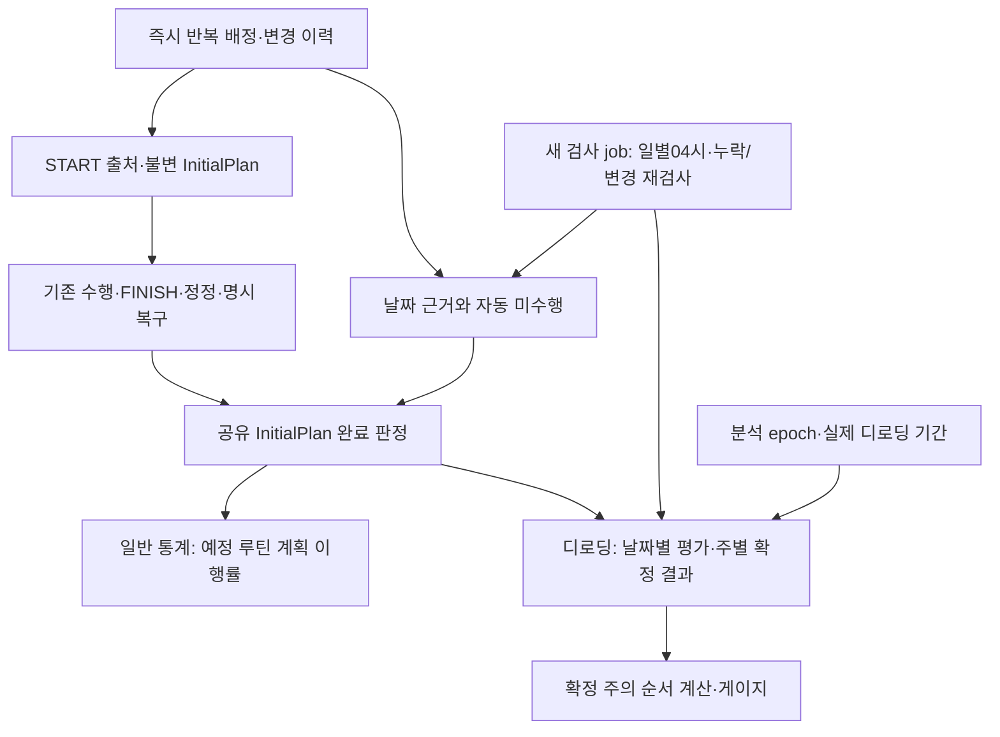

# 주간 루틴 즉시 적용·기록 기반 디로딩 구현 계획

> **완료 단계의 구현 계획 기록.** 현재 순환·일별 검사·기간 적용은 [주간 일정 API](../api/weekly-schedule.md)와 [G5 기간 API](../api/deload-periods.md), 현재 구현 범위는 [Backend 12.5절](../engineering/backend.md#125-다중-주간-일정-프리셋)을 따른다.

> **2026-11-07 현행 진입점:** [디로딩v1.7](../../../overload-pwa/docs/product/Overload_Deloading_Design_Specification_v1.7.md)과 [실제 구현 현황](../../../overload-pwa/docs/tasks/deload-v17-backend-readiness-analysis.md)이 우선한다. G0~G3의 아래 착수 전 문장은 계획 작성 당시 이력이고 현재는 구현 확인 상태다. 남은 구현은 G4/G5 및 G6 실제 디로딩 연결이다. 기존 제품 수치/최소확장 방향은 유지한다.

작성: 2026-11-06, Asia/Seoul. **계획 작성·보완 전용이며 구현 착수·실제 DB 적용 승인이 아니다.** 이번 사용자 요청의 신규 확정 정책을 [이전 영향 분석](weekly-schedule-immediate-application-analysis.md)보다 우선한다. 코드·API·마이그레이션·테스트·공식 설계는 변경하지 않고 이 계획 문서만 보완한다.

보완: 같은 날 후속 요청의 최종 승인으로 예정 외·휴식일 일반 운동의 디로딩 기여를 확정했다. A안(기존 C+A 이력)과 B안(임시 일별 계획 덮어쓰기)을 실제 소비 코드와 장애 흐름으로 비교해 **A안을 유지하되 중복 적용시각 컬럼 제안은 제거**했다. 상세 비교는 §3.7~3.9다. 이는 이 계획 문서의 개정이며 공식 제품 명세 개정이나 구현 승인을 대신하지 않는다.

## 1. 최종 정책과 기존 코드의 적합성

### 1.1 이번 계획의 고정 전제

| 영역 | 확정 정책 | 기존 구현 적합성 |
|---|---|---|
| 주간 루틴 | 현재 월~일 반복 배정, 저장 즉시 적용. 예약·적용일 선택·다음 월요일 적용 제거 | WeeklyScheduleService/요청 검증/expectedVersion/이력 재사용. nextMonday/current-pending 선택과 응답 변경 필요 |
| 운동 날짜 | 시작 시각의 저장 시간대 달력 날짜.00:00 경계,04시는 검사 시각 | WorkoutSessionRequests의 startedAt/startedTimeZone/workoutDate 검증, DB 불변 시작 사실 재사용. 과거 날짜 재작성 없음 |
| 당일 평가 근거 | 첫 예정 START의 배정/InitialPlan 고정. 미시작일은 날짜 종료 직전 최종 적용 배정 | InitialPlan·routine_plan_history 재사용. START 출처와 신규 즉시 행의 recorded_at 해석 보완 필요 |
| 자동 미수행 | 다음 날04시경 검사, 실제 결과 우선, 예정일만0, 휴식일 생성 안 함, UNKNOWN/ACTIVE 보류 | 저장형 미수행 모델·검사 진도·재검사 연결은 신규. 기존 AUTO_CLOSED와 역할 분리 |
| 디로딩 하루 | 예정 외·휴식일을 포함한 적격 실제 일반 세션의 자기 InitialPlan 달성률 중 최고 단일 값. 하루 최대1, 합성 금지 | PlanningCalculator의 종목 완료·유리수·최고 단일 평가 재사용. 일반 통계의 예정 루틴 후보 선택과 분리 |
| 디로딩 한 주 | 월~일. 서로 다른 수행·미수행 평가 날짜 수를 N, 유효일 합계를 E로 사용 | 현재 계획일 분모를 쓰는 부분은 대체. 주별 확정 결과는 신규 |
| 초기화/기여 | 확정된 정상 분석 주에서 E≤1이면 누적0, E>1이면 min(1,E/N) | 기존 ‘E=0만 초기화’와 현재 템플릿≥2일 조건 폐기 |
| 누적 시점 | 다음 월요일04시 이후, 일요일 검사와 그 주 평가가 끝난 뒤 | 운동 종료 때마다 누적하거나 단순 += 하는 방식 금지. 주별 적용·재평가 필요 |
| 완료 후 복귀 | 완료 당일까지 디로딩·누적0, 다음 날 일반 훈련. 같은 주의 남은 일반 기록도 동일 주간 규칙 | 기존 DL-13의 전체 계획일 특별 분모 제거. 완료한 주 전체 제외도 금지 |
| 시작 자격 | 최근7개 날짜 실제 일반 수행, 이전 완료 이후 신규 수행, 오늘 실제 수행 없음, 일반 ACTIVE 없음 | 현재 계획일≥2 조건 제거. 나머지4조건·OFF 수동 시작·게이지0 허용 유지 |
| 운동 중 원본 편집 | 서버 ACTIVE와 접속 기기의 알려진 미확인 원본 보호. 새로운 전역 오프라인 잠금 없음 | 기존 세션/로컬 보호 재사용, 서버 구성·배정 쓰기 차단과 START 경합 보완 |
| 일반 통계 | ST-17~23 계획 이행률·실제 운동량·성과의 역할 유지 | 현재 계획 대상/최고 단일 세션 계산 재사용. 디로딩 정책 변경을 일반 통계에 전파하지 않음 |

이 정책들은 다시 결정할 질문이 아니다. 예정 외 일반 운동의 후보 범위도 최종 확정됐으며 §7에는 그 적용 예와 남은 기술적 선행조건을 적었다.

### 1.2 실제 재사용 파일과 현재 없는 기능

Backend 기본 경로는 `src/main/java/com/overload/overload_server/`다.

- [WeeklyScheduleService](../../src/main/java/com/overload/overload_server/routine/WeeklyScheduleService.java): 사용자 잠금, 버전 충돌, 전체 배정 교체, no-op, 고정 시간대, 이력 페이지 조회를 재사용한다.
- [RoutineService](../../src/main/java/com/overload/overload_server/routine/RoutineService.java) / [RoutinePlanHistory](../../src/main/java/com/overload/overload_server/routine/RoutinePlanHistory.java): 구성·승인·삭제와 계획 이력을 같은 운동 트랜잭션에 저장하는 경계를 유지한다. 삭제의 다음 월요일 배정 제외만 즉시 제외로 바꾼다.
- [WorkoutSessionService](../../src/main/java/com/overload/overload_server/workoutsession/WorkoutSessionService.java) / [WorkoutSnapshotService](../../src/main/java/com/overload/overload_server/workoutsession/WorkoutSnapshotService.java) / [WorkoutRecordService](../../src/main/java/com/overload/overload_server/workoutsession/WorkoutRecordService.java): START·불변 InitialPlan·FINISH·ACK·정정·논리 삭제·명시 누락 복구를 재사용한다. 새 파생 판정을 이유로 수행 원본을 바꾸지 않는다.
- [PlanningRepository](../../src/main/java/com/overload/overload_server/statistics/PlanningRepository.java) / [PlanningCalculator](../../src/main/java/com/overload/overload_server/statistics/PlanningCalculator.java) / [StatisticsService](../../src/main/java/com/overload/overload_server/statistics/StatisticsService.java): 이력·실제 사실의 범위 조회, 완료 종목 판단·최고 단일 세션·정확한 유리수 계산을 활용한다.
- [WorkoutExpiryJob](../../src/main/java/com/overload/overload_server/workoutsession/WorkoutExpiryJob.java): batch, 잠금 후 재검사, SKIP LOCKED, 재실행 성질을 참고한다.24시간 자동 종료 작업은 그대로 별도로 둔다.
- PWA [routine-schedule.ts](../../../overload-pwa/src/features/workout-online/routine-schedule.ts), RoutineForm/Workspace, weekly-schedule.ts, WeeklySchedulePanel, HomePanel: 기존 교체 확인·부분 저장·고정 요청 재확인·계정 경계를 보존하고 예약 소비만 제거한다.
- PWA [sync.ts](../../../overload-pwa/src/features/workout-local/sync.ts)와 로컬 저장·명시 복구: 새 동기화 시스템으로 대체하지 않는다. IndexedDB3/schema2·요청 원문·ACK·writerEpoch·입력·타이머는 유지한다.

현재 서버에는 **일별 미수행 저장, 디로딩 분석 설정/epoch, 주별 누적, 실제 디로딩 기간·임시 루틴·자격 API가 없다.** PWA의 [sample.ts](../../../overload-pwa/src/review/sample.ts)의5.2/8주는 개발 표시값이다. 없는 디로딩 서비스가 이미 있다고 전제해 ‘호출 연결만’ 하는 계획으로 잡지 않는다.

## 2. 이전 분석 및 기존 명세와 달라진 사항

| 조항/주제 | 이전 내용/이전 분석 제안 | 이번 확정 정책과 계획 |
|---|---|---|
| DL-06 | 현재 주간 계획≥2일일 때 분석,1일 이하이면0. 빈도 변경 다음 월요일 | 이 빈도 gate·빈도 변경 reset을 제거. 분석ON의 정상 종료 주에 **기록의 E≤1**로 판단 |
| DL-09 | 그 주 원본 루틴의 계획일 수로 나눔 | 수행·미수행을 평가한 **서로 다른 날짜 N**으로 나눔. 월~일 고정, 최초 등록 전 가상 날짜 없음 |
| DL-10 | E=0인 종료 주만 누적 초기화 | **E≤1.0**이면 초기화. 분모1과 같은 뜻이 아님. UNKNOWN/미확정/진행 중이면 먼저 보류 |
| DL-11 | 분석 분모의 빈도 변경을 다음 월요일로 이연 | 현재 템플릿이 과거 평가에 영향을 주지 않음. 이전 분석의 ‘디로딩 주간 계획 분모 고정’ 권장은 채택하지 않음 |
| DL-13 | 완료 후 남은 일반 유효일을 그 주 전체 계획일로 나눔 | 특별 분모 제거. 완료 다음 날 이후 일반 평가 날짜만 새 분석 구간에 모으고 같은 월~일/월04시 규칙 적용 |
| DL-80 | 현재 계획≥2일을 포함한5조건 | 계획일 조건 제거, 실제 수행/이전 완료 이후 신규 수행/당일 수행 없음/ACTIVE 없음의4조건 유지 |
| 누적 확정 시각 | 기존 본문은 주 완료 중심, 실제 엔진 없음 | **다음 월요일04시 이후, 해당 주 검사/평가 완료 후** 확정. 주중 증분 게이지 없음 |
| 첫 START | 이전 분석의 승인 필요 제안 | 이번에 확정. 첫 예정 START의 계획 고정 + 미시작일은 날짜 종료 직전 이력 |
| 오프라인 차단 범위 | 이전 분석의 확인 필요 경계 | 서버 ACTIVE + 접속 기기가 아는 원본 보호로 확정. 타 기기 미지 상태 감지용 전역 잠금 도입 안 함 |
| 기존 예약 전환 | 이전 분석에서 여러 대안 제시 | §3.4의 **최신 저장 의도를 전환 기준으로 즉시 승격**하는 한 가지 권장안 제시. 예약 기능 자체는 폐기 |
| 예정 외·휴식일 일반 운동 | 이전 계획 §7.1의 미결정 후보 범위 | 자기 InitialPlan 기준 실제 일반 세션을 인정하는 권장안이 최종 승인됨. ST-17~23의 일반 계획 이행률은 유지 |
| 적용시각 저장 | 이전 계획은 별도 applied_at 컬럼 제안 | §3.1/3.9대로 전환 기준 version 이후에는 기존 recorded_at을 즉시 적용시각으로 사용. 기존 예약 행은 계속 구 의미로 해석 |

DL-08의 InitialPlan 종목 기준,7일 권장/최대10일, 목표8유효주, 분석OFF/재ON·정상/자동 완료·취소·정지·원본 우선 정정은 유지한다. ST-12의 옛 디로딩 제외 문구는 최종 승인 정책으로 대체하되 일반 통계 ST-17~23은 바꾸지 않는다. 세션 안의 추가 종목을 InitialPlan 분자에 넣지 않는 규칙도 유지한다.

### 2.1 새 수학 규칙의 적용 순서

1. 월~일의 평가 대상 기간이 종료되고 다음 월요일04시가 지났는지 확인한다.
2. 등록 전/분석 epoch 전/디로딩 정지 기간을 구분하고, 필요한 날짜의 검사·평가가 완료됐는지 확인한다. UNKNOWN·미확정·해당 날짜 ACTIVE가 남으면 확정하지 않는다.
3. 예정 외·휴식일을 포함해 적격 실제 일반 세션을 자기 InitialPlan으로 평가하고 날짜당 최고 단일 값을 선택한다. 실제 수행이 없는 예정일의 미수행0과 중복 계산하지 않는다. N은 이 평가 날짜들의 수, E는 유효값 합계다. 일반 통계의 예정 루틴 근거 부족과 디로딩의 실제 세션 평가 근거 부족은 구분한다. 다른 루틴의 확인 가능한 실제 완료를 예정 루틴과 다르다는 이유로 UNKNOWN으로 만들지 않는다.
4. **E≤1.0이면 RESET(누적0)**이다. 그 다음에만 E>1일 때 min(1,E/N)을 계산한다.1/1을 먼저1주로 계산하면 틀린다.
5. 정상적으로 검사 완료된 분석ON 일반 주가 N=0/E=0이면 초기화 조건이다. 등록 전 전체 주, 분석OFF, 전체 정지 주, UNKNOWN 주를 이 경우로 위장하지 않는다.0/0 나눗셈도 하지 않는다.

예: `[1]`, `[1,0]`, `[0.5,0.5]`는 모두 E=1이므로 초기화. `[1,0.5]`는 E1.5/N2=0.75주, `[1,1]`은1주다.3완료+미수행1은0.75주,4완료+미수행1은0.8주,3완료+부분0.5+미수행1은0.7주다.

## 3. 권장 Backend/DB 아키텍처

**C+A 최소 확장, 수행 원본 하나, 목적별 계산 소비자 둘, 새 주기 작업 하나**를 권장한다. 새 테이블/클래스명은 이 계획의 제안명이며 아직 생성하지 않았다.

### 3.1 기존 구조의 최소 확장

| 대상 | 필요한 변화 | 보존/제약 |
|---|---|---|
| weekly_schedule_versions | **별도 applied_at 컬럼을 추가하지 않는다.** 전환 기준 version 이상은 기존 recorded_at을 즉시 적용시각으로 사용하고 사용자/세대/recorded_at/version 인덱스를 추가한다 | 기존 행·JSON·version·UPDATE 금지 이력 그대로. 새 migration에서 다음 월요일 제약을 제거. 신규 행의 effective_from은 저장 시간대의 당일 날짜로 쓰되, 신규 시간축 판정의 권위는 recorded_at이다 |
| routine_plan_history | 현재 기록/조회 및 트랜잭션 재사용. 새 시간축 조회에 맞는 범위/index 검토 | 하루 전체 계획 복제 없음. 조회용 최근20개 이력과 전체 판정 근거 보관을 혼동하지 않음 |
| workout_sessions | 신규 START용 nullable `schedule_version_at_start` 참조 추가. sourceRoutineId/InitialPlan과 함께 예정 여부 확인 | 기존 행은 null 유지. 기존 날짜/시간대/불변 JSON/hash/요청 원문을 backfill하지 않음 |
| 기존 사실 쓰기 | 변경이 실제 확정되면 해당 workoutDate의 재검사 표시를 같은 트랜잭션에 남김 | FINISH/expiry/정정/삭제/누락 복구 모두 포함. 단순 GET/ACK/no-op으로 기록·시각을 늘리지 않음 |
| 순수 완료 판정 | PlanningCalculator의 private judge를 작은 공유 함수로 분리하고 기존 분수 계산 활용 | 일반 통계의 예정 루틴 후보 선택과 디로딩의 후보 선택은 별도. 중량 성과 평가 eligible을 재사용하지 않음 |

새 공통 함수는 같은 statistics 패키지 안의 작은 계산 도우미로 충분하다. 범용 평가 엔진·전략 등록·전체 DTO 공개화·이벤트 프레임워크를 만들지 않는다. `Fraction`의 정확한 분자/분모 연산은 임계값과 누적에도 재사용한다.

### 3.2 실제 부족한 영속 데이터 — 단계별로만 추가

| 제안 모델 | 최소 내용 / 유일성 | 필요한 이유와 추가 시점 |
|---|---|---|
| `workout_calendar_control` | 사용자/세대PK, 고정 달력 시간대, 최초 검사 날짜·구/신 해석 경계 version, 검사 완료 cursor | 한 계정의 검사 범위/진도와 전환 경계만 저장. 기준 행 recorded_at으로 알 수 있는 전환 시각을 또 저장하지 않음. 일정 전환 단계 |
| `daily_training_assessments` | 사용자/세대/날짜PK, 첫 예정 START/이력 참조, 최초 미수행 시각·계획 근거, 근거 상태, revision/needs_recheck | 자동 미수행과 재검사 근거를 최소 저장. 실제 수행·전체 계획 JSON이나 일반/디로딩별 일별 점수 사본을 복제하지 않음. 일별 판정 단계 |
| `deload_analysis_versions` | 사용자/세대/versionPK, enabled, 분석 epoch, 적용 시각/일반 훈련 재개 경계, 원인/관련 period 참조 | 실제 분석 설정/재ON·완료 reset 경계가 현재 없음. 최신 행으로 설정을 읽고 과거 경계를 보존. 별도 current-total 테이블 불필요 |
| `deload_weekly_assessments` | 사용자/세대/epoch/월요일PK, 입력 revision·ruleVersion, 정확한 E/N, 보류/확정, ADD/RESET, 기여 유리수, 확정/갱신 시각 | 중복 가산 방지·늦은 기록 재평가·주별 적용 근거. 분석 단계 |
| `deload_periods` 및 세션 소속 참조 | 사용자/세대·기간ID, 시작/종료·상태/원인·version, 임시 계획/세션과 연결 | 정지·완료·취소·이전 완료 이후 신규 수행을 판별할 실제 기간이 현재 없음. 기간 연동 단계에서만 추가 |

이는 한 번에5개를 도입하자는 뜻이 아니다. 일정/일별 단계에는 앞의2개만 필요하고, 분석2개와 기간 모델은 해당 기능을 구현할 때 추가한다. calendar 제어를 분석 설정에 억지로 합쳐 OFF일 때 미수행 검사까지 중단시키지 않는다. 반대로 분석의 현재 누적만 별도 테이블에 다시 저장할 필요도 없다. 다섯 책임의 통합 가능성과 제거할 중복은 §3.8에서 검토했다.

일별 모델은 두 소비자가 쓸 **근거**를 저장한다. 자동 미수행의 최초0 사실/계획 근거는 보존하고, 나중에 적격 실적이 생기면 유효 결과를 실제값으로 해석한다. 현재 루틴을 바꿨다는 이유로 기존 MISS 행을 삭제하지 않는다. 변화 추적은 기존 수행 정정 이력·일별 revision·불변 최초 MISS 근거를 우선 활용하고 별도 범용 이벤트 표를 추가하지 않는다.

휴식일은 MISS를 만들지 않는다. 검사 cursor는 휴식일도 확인했다는 진행 메타일 뿐 평가 기록일 N이 아니다. UNKNOWN/ACTIVE의 재시도 표시는 미수행0 또는 확정 평가 날짜로 세지 않는다. 실제 수행이 있는 날짜도 원본 세션/수행을 그대로 참조한다.

### 3.3 날짜 근거·동시성·검사 흐름

**첫 예정 START:** owner 잠금 안에서 적용된 일정 version과 실제 sourceRoutineId를 확인하고 InitialPlan과 함께 출처를 보존한다. 후속 세션·당일 배정 변경·무수행 종료·논리 삭제 때문에 첫 근거를 다른 루틴으로 바꾸지 않는다. 실제 결과 후보는 여전히 각 세션 자기 InitialPlan으로 평가한다.

**미시작 날짜:** 해당 날짜의 다음 날00:00 미만에서 마지막 적용 Instant/version을 선택한다. 전환 기준 version 이후에는 recorded_at/version을 사용하며 구 예약 행을 이 쿼리에 섞지 않는다. 그 루틴의 날짜 종료 전 계획 이력을 사용한다. 수요일02시 변경을 화요일에 소급하지 않는다. 새 주간 템플릿은 목요일 당일 휴식 변경을 즉시 반영하므로 금04시 목요일 MISS가 생기지 않는다.

기존 세션의 출처 참조가 null이면 구 일정/불변 InitialPlan이라는 확인 가능한 근거로만 해석한다. 정확한 근거가 없으면 UNKNOWN으로 남기고 원래 JSON을 고쳐 해결하지 않는다. 이미 지난 날짜의 MISS 근거는 늦은 START나 새 현재 템플릿으로 다시 고정하지 않는다.

**잠금:** START와 원본 구성·배정 관리 쓰기는 동일한 owner 배타 잠금 경계에서 상태를 재확인한다. 권장안은 이 두 쓰기 경계를 READ_COMMITTED + 기존 owner→routine/definition→session 순서의 명시 잠금으로 정리하는 것이다. 현재 START의 REPEATABLE_READ에서 잠금 대기 전 생성된 snapshot이 새 ACTIVE를 놓치는 문제를 반드시 격리 경쟁 테스트로 검증한다. 단일 ACTIVE UNIQUE는 보조 최종 방어이며 관리 쓰기 write-skew를 대신하지 않는다.

원본 구성 검사와 운동 중 승인 처리 경계는 구분한다. 세션 snapshot/승인 해결의 정상 중량 승인은 그대로 허용한다. Routine PUT에 승인만 있고 구성이 동일한 기존 경로도 별도 검증한다. 구성 변경과 승인을 묶어 보내면 구성 변경을 허용하는 우회가 되지 않도록 한다.24시간 만료 전환은 기존처럼 커밋한 뒤 오류로 응답하며 새 검사 때문에 만료가 롤백되지 않게 한다.

**작업은 하나 추가:** `DailyTrainingReviewJob`가 시간대별 due 날짜와 dirty 날짜를 batch로 검사하고, 그 결과 주 평가까지 호출한다. 별도 월요일 전용 scheduler는 추가하지 않는다. 기존 WorkoutExpiryJob는24시간 만료만 담당한다. 새 작업이 기존 expiry 이후 해당 날짜를 다시 검사할 수 있게 연결한다.

- 첫 sweep는 전환/등록 후 근거가 생긴 날짜부터 시작한다. 등록 전 가상 예정일·미수행을 생성하지 않는다.
- cursor 이후 날짜뿐 아니라 과거 needs_recheck도 검사한다. UNKNOWN/해당 날짜 ACTIVE를 cursor만 넘겨 영원히 잃지 않는다.
- 사용자/세대·날짜 유일키, 잠금 후 최신 사실 확인, 짧은 batch·재시도로 중복/다중 인스턴스/재시작을 처리한다.
- 실제 사실 변경과 dirty 표시를 원자적으로 저장한다. stale MISS가 새로운 FINISH/복구 결과를 이기지 않게 한다.
- 일정 현재값 변경만으로 이미 확정된 일별 결과를 dirty 처리해 재분류하지 않는다. 늦은 실제 사실의 확정·정정은 정상 재평가한다.

**시간대:** 이번 변경에서 기존 START 검증/요청/저장 날짜 정책은 바꾸지 않는다.04시 검사와 월요일 마감은 저장된 달력 시간대, 세션 날짜는 기존 workoutDate를 사용한다. 기기/달력 시간대 차이는 기존 고정 날짜를 이동시키지 않고 출처·날짜 조회 테스트로 검증한다. 초기 달력 시간대는 기존 일정의 time_zone을 사용하고 신규 설정 시 유효 IANA 값을 고정한다. 분석이 일정 최초 등록보다 빠르면 명시 설정 요청에서 검증된 시간대를 받는다. 새벽 전용 UX·04시 날짜 이동·서버 OS 시간대 의존은 없다.

### 3.4 기존 예약 전환의 한 가지 권장안

**전환 시각 T에 가장 최근 저장된 배정 의도를 새 즉시 기준 행으로 승격한다.** T02-B 검토 환경의11/09 예약이 최신 저장본이면, 그 배정 내용으로 version+1/recorded_at=T의 기준 행을 추가하고 이 version을 구/신 해석 경계로 저장한다. 기존11/09 예약 행의 날짜·배정·version·JSON은 그대로 둔다.

선택 이유는 최신 저장 의도를 버리지 않고 새 ‘즉시 적용’ 원칙으로 단일하게 전환하기 위해서다. 예약일을 앞당기는 실제 효과는 계획 승인/DB 적용 승인 범위에 명시한다. 현재값으로 몰래 되돌리거나 예약 기능을 한 번 더 운영하는 대안은 채택하지 않는다.

- T 전 과거 조회는 기존 effective_from 규칙으로 해석한다.
- T 이후 현재 배정은 경계 version 이상의 새 recorded_at 행에서만 결정한다. 구 pending의11/09 도래가 다시 덮어쓰지 못한다.
- 당일 T 전 예정 START가 있으면 그 첫 START 근거를 보존한다. 미시작일은 T 이후를 포함한 당일 최종 적용 이력을 사용한다.
- 미등록 계정을 임의의 휴식 일정으로 등록 처리하지 않는다. 기준 template version이 없는 사실을 별도로 보존한다.
- 전환 처리도 사용자 잠금·expectedVersion 경계에서 수행한다. 삭제된 루틴 참조/전환 직전 쓰기/ACTIVE를 확인하고, 재실행 시 기준 행을 두 번 만들지 않는다.

### 3.5 주별 확정 결과와 재평가 — 현재 누적 캐시를 늘리지 않는 방식

`deload_weekly_assessments`의 주별 유일 행이 평가·적용의 근거다. 작업이 실행될 때마다 `누적 += 기여분`을 호출하지 않는다. **확정된 현재 epoch의 주별 ADD/RESET을 날짜 순으로 계산**해 누적을 제공한다. 같은 주 재실행은 같은 행을 확인/교체하므로 중복 추가되지 않는다.

E와 기여분은 정확한 유리수로 보관한다. UI의 소수12자리 문자열을 다시 읽어 E≤1을 판단하지 않는다. 예를 들어1.000000000001은1보다 크다. 불필요한 별도 누적 projection/cache는 우선 만들지 않고 실측 필요가 확인될 때만 검토한다.

중요한 재평가 예: 이전 누적3 → 어떤 주 E1로 RESET → 다음 주 +1이면 현재1이다. 늦은 기록으로 RESET 주가 E1.5/N2=0.75가 되면 정답은 **3+0.75+1=4.75**다. 현재1에0.75만 더하면1.75로 틀린다. 따라서 가장 이른 영향 주부터 같은 epoch의 후속 주를 다시 계산한다.

E≤1의 주간 RESET은 **되돌릴 수 있는 주별 평가 결과**다. 이때 새 epoch를 만들면 늦은 기록으로 초기화 전 누적을 복원할 수 없으므로 금지한다. 반면 재ON·정상/자동 디로딩 완료의 reset 경계는 별도 분석 epoch로 보존하며, 과거 정정이 그 이후 누적에 무조건 섞이지 않게 한다.

주가 PENDING/UNKNOWN이면 이전 결과를 확정0으로 대체하지 않는다. 마지막 확정값과 재평가 중 상태를 구분한다. 후속 주의 독립적으로 확정된 RESET이나 새 epoch가 있으면 그 경계 이후 현재값은 별도로 확정할 수 있다. 늦은 사실이 그 RESET 주 자체를 바꾸면 다시 계산한다.

### 3.6 OFF·재ON·기간·완료·취소의 연결

- 실제 분석 설정이 없던 계정에 개발용 ON/5.2주를 이식하지 않는다. 명시적인 분석 설정 저장으로 활성 구간을 만들고, 그 이전 실적을 새 누적으로 소급 채우지 않는다.
- OFF여도 일별 미수행 보존과 일반 통계는 계속 동작한다. OFF는 디로딩 누적만 중단한다. 재ON은0의 새 epoch로 시작한다.
- epoch는 월요일~일요일 묶음을 바꾸지 않는다. 같은 주에 재ON하더라도 새 수요일~화요일 주기를 만들지 않는다. 활성화 이전 사실은 새 epoch에 재가산하지 않는다. 세션은 시작 시각/출처 단위로 포함 여부를 판단하며 쪼개지 않는다.
- 진행 중 기간에는 디로딩 누적/주간 초기화를 정지하고 일반 원본의 미수행을 만들지 않는다. 판정 시 현재 상태뿐 아니라 검사 대상 날짜 당시의 실제 기간을 확인한다.
- 정상/자동 완료는 그날 누적0, 일반 훈련 재개는 다음 날. 새 일반 구간의 기록은 같은 달력 주에 모으고 다음 월04시에 동일 규칙으로 계산한다. 이전 완료 전 실적을 reset 뒤에 다시 더하지 않는다.
- 월요일 완료 후 화~토5일 완료: E5/N5=1주. 수요일 완료 후 목·금2일 완료: E2/N2=1주. 완료 후 일반1일만 완료: E1이므로0. 완료 주 전체를 제외하거나 옛 전체 계획일 분모를 쓰지 않는다.
- 무수행 취소는 새 reset epoch를 만들지 않고 기존 누적을 보존한다. 기존 정지/취소 주의 소급 초기화 억제 원칙을 승계한다. 새 E≤1 규칙은 정상 분석 종료 주에 적용하며, 취소로 포함된 정지 구간을 일반 미수행으로 바꿔 초기화를 유발하지 않는다. 정지 보호 때문에 초기화를 억제할 때도 E≤1을 양의 주간 기여분으로 계산하지 않는다.
- 실제 기간/소속 모델이 없는데 화면 토글만으로 완료·취소·정지 테스트가 구현됐다고 처리하지 않는다. 기간 서비스와 임시 루틴/세션 소속은 기존 디로딩 후속 작업의 실제 의존성이다.

### 3.7 A안과 임시 일별 덮어쓰기 B안의 실제 비교

**결론은 A안 유지다.** B안의 아이디어는 성립 가능하지만, ‘자정에 한 칸 저장하고04시 뒤 폐기’만으로는 확정 정책을 충족하지 못한다. 아래에서 B안을 정상 상황뿐 아니라 장애를 처리할 수 있도록 보강한 경우까지 비교했다. Redis·세 번째 범용 저장 구조는 도입하지 않는다.

#### 확인한 실제 소비 코드

| 코드/DB | 확인한 용도 | 임시 계획 폐기 시 영향 |
|---|---|---|
| WeeklyScheduleService.save/view/history | 사용자 잠금·expectedVersion·no-op, 현재 일정 별도 조회, 최근20개/과거20개 페이지 | 현재 설정만 남기려면 조회·history 계약을 다시 구성해야 함. 단순 UPDATE로 전환하면 V19 불변 트리거와도 충돌 |
| RoutinePlanHistory.record/removeFromNextSchedule 및 RoutineService | 생성·변경·논리 삭제의 당시 계획 기록, 삭제와 일정 제외를 같은 트랜잭션으로 처리 | 현재 루틴만 보존하면 삭제·수정 전 계획을 잃음. B에서도 별도 날짜 근거나 기존 계획 이력은 필요 |
| PlanningRepository.read | 적용일별 일정·범위 직전 기준·최초 등록, 날짜별 마지막 루틴 계획, ACTIVE/삭제 포함 START 근거 조회 | 실제 수행이 없는 날짜의 원래 예정 여부/종목/세트는 InitialPlan만으로 복원할 수 없음 |
| PlanningCalculator → StatisticsService → StatisticsCalculator | 예정일 분모와 루틴 달성률뿐 아니라 계획 세트·종목·근육 집계 입력도 공급 | MISS0 한 개만 남겨서는 기존 일반 통계의 계획 내용을 재현하지 못함 |
| PWA WeeklySchedulePanel/weekly-schedule.ts/WorkoutWorkspace | 실제 루틴 관리 하위에 접힌 ‘일정 변경 이력’과 더 보기 호출이 연결됨 | ‘사용자 화면 소비가 전혀 없다’는 가정은 현재 코드와 다름. 향후 이 화면을 없애더라도 통계 소비는 별도로 남음 |
| V19/V20, StatisticsIntegrationTests | 기존 이력 UPDATE 금지·FK·불변 계획·원자 삭제,20회 이상 편집 후에도 현재 일정 조회 | 이력 축소는 현재 행 덮어쓰기 한 줄로 끝나지 않음. 기존 실제 행 보존과 새 구조 전환 검증이 필요 |

이력 화면이 있다는 사실만으로 A를 선택한 것은 아니다. 핵심은 **미시작 예정일의 계획 내용과 첫 예정 START의 배정을 사후 정정에도 재현해야 한다는 점**이다. 이력 화면을 새로 확장하는 작업은 제안하지 않는다.

#### B안의 복구 가능성과 필요한 보강

| 상황 | 한 칸 임시 저장만 사용 | 정확성을 유지하는 B안의 최소 보강 / A안 |
|---|---|---|
| 자정 작업 실패, 수02시 화 배정 휴식 변경 | 현재값을 덮으면 화23:59 예정 여부를 잃음 | B: 덮어쓰기 전에 미마감 날짜를 이전 값으로 확정하는 동기 처리가 모든 관련 쓰기에 필요. A: 화 종료 전 이력을 조회하므로 자정 작업 불필요 |
|04시 장애로 화~목 검사 적체 | 한 칸을 계속 덮으면 이전 날짜가 유실됨 | B: 날짜별 backlog 또는 보존 구간 필요. A: cursor에서 이력 기반으로 순서 따라잡기 |
| 해당 날짜 ACTIVE로 판정 보류 | 다음 날짜를 위해 원래 칸을 비우면 출처 유실 | B: 미확정 날짜를 별도 보존하고 원래 기준을 고정해야 함. A: START/이력 참조를 유지하고 해당 날짜 재검사 |
| 실제 기록이 있는 날의 임시 계획 폐기 | 실제 B의 InitialPlan은 그날 A 예정인지 휴식인지 설명하지 못함 | B: 실제 수행이 있어도 일반 통계용 날짜 배정 근거는 영구 보존해야 함. A: 기존 일정/계획 이력 참조 |
| MISS 대신 늦은 실제 기록, 이후 정정·삭제·복구 | MISS0 또는 실제 세션만으로 과거 계획 분모·세트를 복구할 수 없음 | B: 최초 예정 여부/루틴 계획 참조와 최초 MISS를 폐기하지 못함. A: 원본·최초 MISS·이력을 두고 같은 날짜 재평가 |
| 루틴 구성 변경·삭제도 자정 전에 발생 | 배정 routineId만 남으면 당시 운동 목록을 잃을 수 있음 | B: routine_plan_history를 계속 쓰거나 루틴 쓰기에도 마감 처리를 걸어야 함. A: 기존 RoutinePlanHistory 경로 재사용 |

B안도 **자정 scheduler 없이** 만들 수 있다. 사용자 잠금 아래에서 일정·루틴을 바꾸기 전에 미마감 날짜를 먼저 확정하고, 검사 job도 같은 함수를 호출하면 된다. 다만 모든 변경 경로의 쓰기 전 날짜 마감, 적체 보관, 영구 날짜 근거와 임시 상태의 구분이 추가된다. 실패 시 관리 쓰기까지 함께 보류되며, 늦은 기록 처리 때문에 영구 근거를 전부 폐기할 수도 없다. 따라서 B를 원천적으로 불가능하다고 판단한 것이 아니라, 정확하게 보강한 전체 구조가 이 코드베이스에서 더 단순하지 않다고 판단했다.

#### 구현·저장·조회 비용 비교

| 기준 | A: 기존 이력 기반 | 정확성을 보강한 B: 일별 임시 저장 기반 |
|---|---|---|
| 주요 기존 수정 후보 | Backend15개·PWA9개는 아래 공통 목록. 기존 이력 INSERT/이력 조회 책임 유지 | 같은 START·편집 guard·기록 재검사·분석·PWA 전환이 필요. 일정 이력 조회를 줄이는 대신 현재 설정/날짜 마감/영구 근거 조회로 교체 |
| 새 DB | 기존2개 이력 재사용, §3.2의 단계별 최소5책임. 적용시각 중복 컬럼 없음 | 기존 역사 행은 보존. 별도 mutable 현재 설정과 임시 적체가 필요하고, 영구 날짜 근거를 일별 판정에 합쳐도 그 필드는 남음. 분석/주별/기간 책임은 줄지 않음 |
| 증가량 | 변경 횟수 K의 배정 JSON(최대7개) + 루틴 버전 수 R의 기존 계획 JSON. 일별 근거는 필요한 날짜만, 주별 평가는 주당 최대1/epoch | 현재 설정은 계정당1. 그러나 임시 건수는 미처리 날짜 P, 영구 근거는 과거 예정일/필요 날짜 H에 비례. 정상 시 P가 작아도 장애/ACTIVE 때1개 보장 불가. 루틴 이력을 유지하면 R도 그대로 |
|04시 조회 | 날짜 범위의 시각 이력·루틴 이력과 기존 수행 사실을 batch 조회. 기존 PlanningRepository는 일정/루틴/START에 최대3개 고정 SQL을 쓰고 있음 | 임시 근거 직접 조회는 짧을 수 있음. 대신 그 근거 작성/쓰기 전 마감과 영구 근거 전환 비용이 앞단으로 이동. 수행 조회·동시성·늦은 재검사 비용은 공통 |
| 새 scheduler |04시·누락/dirty·주 확정을 담당하는 새 job1개. 기존24시간 expiry 별도 | 문자 그대로 구현하면 자정+04시2개. 쓰기 전 마감으로 자정 작업을 없애면 새 job1개도 가능하지만 관련 쓰기 경로가 더 복잡해짐 |
| 정확성/복구 | 적용시각 범위와 첫 START 참조에서 재계산. 다운타임이 계획 근거 생성 성공 여부를 바꾸지 않음 | 모든 쓰기 전 마감과 backlog가 완전해야 함. 한 변경 경로 누락으로 사라진 과거값은 복구 불가 |
| 일반 통계/유지보수 | 기존 범위 조회와 계획 입력을 수정해 재사용. MISS/실제 결과의 목적별 소비만 분리 | 통계가 날짜별 영구 근거를 읽도록 변경해야 함. 계획 마감과 임시 삭제의 트랜잭션 책임까지 추가 |

수정 후보 수는 실제 존재를 확인한 **주요 기존 파일의 계획상 범위**이며 최종 diff 파일 수나 성능 측정 결과가 아니다. Backend15개는 WeeklySchedule/Requests/Controller/Service, RoutinePlanHistory/Service/Repository, WorkoutSessionService/Repository, WorkoutSnapshotService, WorkoutRecordService, PlanningRepository/Calculator, StatisticsService/Overview다. PWA9개는 weekly-schedule.ts/WeeklySchedulePanel, routine-schedule.ts/RoutineForm/RoutineCards/WorkoutWorkspace, HomePanel/load, auth/api.ts다. 양쪽 모두 신규 구현·테스트·문서 파일은 별도이며, B의 추가 마감 서비스/현재 설정 접근 계층은 이 숫자에 넣지 않았다.

예를 들어 주1회 일정 편집이면 A의 주간 JSON은 연 약52행인 반면, B가 매일 마감 근거를 만들면 연365회 날짜 처리다. 반대로 하루100회 편집하면 A의 중간 이력은 더 많아질 수 있다. 이는 **조건부 증가량 예시**이며 실제 사용자 빈도·DB 크기·실행 시간은 측정하지 않았다. 행 수만으로 우열을 정하지 않고 기존 기능 대체와 실패 복구까지 포함해 A를 선택한다.

### 3.8 다섯 제안 모델의 책임·중복 검토

| 모델 | 다른 구조로 대체/통합 가능한가 | 최소 권장 범위 |
|---|---|---|
| workout_calendar_control | cursor를 일별 행에서 계산할 수도 있으나, 휴식일 행이 없으면 마지막 평가일이 마지막 검사일과 다름. MAX(date)만으로 누락을 판단할 수 없음. 기존 불변 일정 행을 cursor 저장소로 UPDATE하지 않음 | 계정/세대당1행의 경계·시간대·검사 진도만 유지. 별도 job 실행 이력/잠금 표/현재 template 사본은 만들지 않음 |
| daily_training_assessments | 실제 결과는 기존 세션/수행으로 계산하므로 사본 불필요. 하지만 최초 MISS 근거·날짜별 재검사·보류는 세션만으로 나타낼 수 없음 | 최초 MISS/출처·보호된 첫 START 참조·revision/dirty만 저장. 휴식일 확인을 위해 영구 REST 행을 매일 만들지 않음. 점수·전체 계획·누적값 중복 저장 안 함 |
| deload_analysis_versions | 기존 user_workout_settings는 휴식초 설정과 JPA @Version/updated_at을 관리함. 검사 cursor·분석 reset 경계를 끼워 넣으면 설정 쓰기와 job 갱신 책임이 섞임 | ON/OFF·epoch 경계를 하나의 작은 설정 이력으로 보존. 별도 current-settings/epoch 표를 추가하지 않고 최신 행을 조회. OFF가 일반 미수행 검사까지 중단시키지 않음 |
| deload_weekly_assessments | 순수 조회 때 모든 날짜를 매번 재계산하는 것도 가능하지만 주별 확정/보류·월04시 반영·정정 revision의 기준이 없어짐 | E/N·ADD/RESET·입력 revision·확정 상태만 저장. 현재 누적·적용 영수증·일별 점수 cache를 별도 저장하지 않음 |
| deload_periods | 실제 기간은 분석 토글과 같지 않음. OFF 수동 시작·무수행 취소·완료 다음 날 복귀·세션 소속을 분석 ON 행만으로 표현할 수 없음 | G5에서 실제 기능을 만들 때만 추가. 별도 상태 변경 이벤트 프레임워크를 만들지 않고 기간/임시 계획·세션 연결에 한정 |

**검사 cursor와 일별 판정은 구분한다.** cursor는 ‘여기까지 기본 검사를 했다’, 일별 dirty/보류는 ‘이 날짜는 다시 봐야 한다’다. 둘을 하나의 최신 날짜로 줄이면 월요일 완료·일요일 ACTIVE처럼 앞뒤 처리 순서가 달라질 때 누락될 수 있다. 한 테이블에 메타 행과 날짜 행을 혼합하거나 모든 휴식일을 영구 행으로 만드는 것보다, 얇은 제어1행과 필요한 날짜 근거가 더 명확하다.

기존 모델이 없는 디로딩 기능을 위해 필요한 책임은 남긴다. 다섯 표를 그대로 구현하라는 명령은 아니며, 구현 시 이 최소 필드·소유권·유일성을 만족하는지 검증한다. 별도 적용시각 컬럼 제안은 제거한다. 별도 현재 누적/설정 캐시, 일별 수행·점수/전체 계획 복제와 자정 마감 전용 작업도 도입하지 않는다. 기존 실제 DB 표/행은 제거하지 않는다.

모든 중간 변경 이력이 수학적으로 영구 필수인 것은 아니다. 첫 START나 날짜 말 계획에 사용되지 않은 같은 날 중간 버전은 압축 가능성이 있다. 하지만 이를 안전하게 줄이려면 과거 통계·최초 MISS·START 참조와 이력 조회의 대체 근거가 완결돼야 한다. 지금 TTL/자동 삭제를 도입하면 별도 압축·참조 재작성·장애 복구 기능이 늘어난다. 따라서 이번 최소 구현에는 포함하지 않고, 기존 역사 행은 보존한다. 이는 향후의 모든 중간 행 영구 보존을 제품 정책으로 확정한다는 뜻은 아니다.

### 3.9 적용시각 재사용과 남는 기술적 제약

- 구/신 해석 경계 version은 calendar control의 한 번 정한 기준이다. 경계 전 행은 원래 effective_from, 경계 이후 행은 recorded_at으로 판정한다. 이미 기록된 구 예약의 recorded_at을 실제 적용시각으로 소급 해석하지 않는다.
- 신규 저장은 owner 잠금 안에서 시각을 정하고 이력 INSERT와 함께 커밋한다. 신규 effective_from은 그 저장 시각의 달력 날짜이며, API의 appliedAt은 신규 recorded_at에서 제공한다. 같은 시각의 여러 저장은 version으로 순서를 정한다. recorded_at 기존 행 UPDATE는 하지 않는다.
- 전환 후 새 행을 다루는 조회는 반드시 경계 version을 적용한다. 최신20개 화면 이력만으로 판정하거나, 과거 예약·새 즉시 행을 한 effective_from 정렬에 섞지 않는다. 월요일 제한 CHECK를 없애는 신규 DDL과 범위 인덱스는 격리 검증 대상이다.
- 자정/04시 경합, 긴 transaction·서버 시계 역행에서 적용시각 순서가 깨지지 않는지 검증해야 한다. 잠금 획득 전 시각을 미리 캡처하지 않고 새 version의 시각 단조성도 확인한다. 적용시각 컬럼을 하나 더 둔다고 이 문제가 자동 해결되지는 않는다.
- 현재 PlanningRepository는 ‘일별 마지막 일정’보다 거친 effective_from별 선택과 루틴의 날짜별 마지막 이력을 사용한다. 첫 START 고정과 시각 전환에 맞는 쿼리 수정은 여전히 필요하다. SQL/index 계획과 batch 크기의 실제 비용은 구현 후 격리 PostgreSQL에서 측정한다. 이번에는 실제 DB를 조회하지 않았다.
- 과거 근거가 없는 날짜는 여전히 UNKNOWN이다. 이력 재사용으로 사실이 없던 과거를 복원했다고 표시하지 않는다. 새 디로딩 설정/주별/기간 서비스도 여전히 미구현이며, 실제 일반/디로딩 구분이 연결되기 전까지 혼재 통합 완료를 주장할 수 없다.

## 4. 단계별 구현 순서

권장 순서는 **G0 계약·기준 → G1 판정/경합 보호 → G2 일정 DB/API → G3 일별 기록·일반 통계 → G4 기록 기반 분석 → G5 기간/자격 연동 → G6 Frontend 동시 전환·실제 검증**이다. 코드는 격리 테스트 환경에서 단계적으로 완성하고 실제 보존 DB에는 마지막 승인 시점까지 적용하지 않는다. Backend만 새 운영 계약으로 먼저 열어 기존 PWA를 깨뜨리는 순차 운영 전환은 피한다.

신규 migration은 논리 묶음 M1/M2/M3로 표시한다. 현재 다음 번호는 V24지만 실제 착수 시 최신 migration 목록을 다시 확인한다. 기존 V19~V23을 고치지 않는다. M1의 앞/뒷부분은 개발 순서 구분이며, G2~G3을 함께 검증한 하나의 일정·일별 판정 배포 묶음으로 다룬다. G2만 실제 DB에 적용해 과거 평가가 새 현재 배정으로 바뀌는 중간 상태를 열지 않는다.

### G0. 구현 계약과 보존 기준 확정

- **선행:** 보완된 이 계획에 대한 사용자 검토. §7.1의 제품 정책은 이미 승인됐으며 다시 결정받지 않는다.
- **대상:** 이 계획, weekly-schedule.md/routine-management.md/statistics.md, 통계·디로딩 제품 설계의 차기 개정 초안. 새 테스트 명세 및 API DTO 설계.
- **내용:** 확정된 §7.1을 계약/테스트에 반영하고, 최신 저장본 승격의 전환 T, recorded_at 해석의 기준 version, 응답 형상과 구 관리 요청 거절 방식을 정리한다. 기존 T02-B diff/원본·검토 데이터 식별자/덤프·볼륨/불변 JSON 지문을 기준으로 남긴다.
- **API/migration:** 실행 없음. 계약 초안만 검토한다.
- **완료/검증:** 정책→DTO→DB 제약→22개 필수 시나리오의 추적표가 모순 없이 대응. 변경 승인 대상과 데이터 보존 기준이 명시됨.
- **미완료 위험:** 일반 통계까지 기록 중심 분모로 바꾸거나, 확정된 예정 외 일반 운동을 디로딩에서 잘못 제외할 수 있다.

### G1. 공유 완료 판정·관리 쓰기 경쟁 보호

- **선행:** G0의 관리 쓰기 범위·불변 원본 기준. 이 단계에서 일반 통계와 디로딩의 후보 선택을 공통 guard에 섞지 않는다.
- **대상:** PlanningCalculator/PlanningCalculatorTests, RoutineService/Repository, WorkoutSessionService/Repository, WeeklyScheduleService, WorkoutSnapshotService 승인 경로, 관련 IntegrationTests.
- **내용:** 기존 judge/정확한 Fraction의 작은 공유화, 일반 후보 선택 유지. START와 관리 쓰기의 owner 잠금/격리 수준을 정리하고 서버 ACTIVE 중 구성·배정 변경을 차단한다. 세션 승인·임시 계획·무변경 재확인은 구분한다.
- **API/migration:** 기존 관리 요청에 새 ACTIVE 관련409를 정의할 수 있으나 세션 snapshot/FINISH 형상은 변경하지 않는다. migration 없음.
- **완료/검증:** 변경 먼저→START 새 계획 복사, START 먼저→관리 구성 변경 거절의 두 경쟁 결과만 허용. 혼합 InitialPlan/잠금 역전/만료 롤백 없음. 정상 승인 중량 경로 통과.
- **미완료 위험:** 즉시 적용을 켰을 때 운동 중 원본 변경이 API로 가능하거나, 과도한 guard가 정상 승인·동기화를 막는다.

### G2. M1-앞부분: 시각 이력·즉시 일정 API

- **선행:** G0의 시각/전환 계약, G1의 START·관리 쓰기 경합 보호. 경합 보호 없이 즉시 배정을 공개하지 않는다.
- **대상:** WeeklySchedule.java/Requests/Controller/Service, RoutinePlanHistory.removeFromNextSchedule, RoutineService.delete, PlanningRepository의 이력 조회 기반, calendar control Repository, 신규 M1 SQL/전환 검증 도구.
- **추가:** recorded_at용 범위 인덱스·전환/검사 제어·신규 START 일정 참조. 별도 applied_at 컬럼 없이 기존 routine_plan_history JSON과 시각을 재사용한다. 전환 기준행의 재실행 멱등성과 구 예약 덮어쓰기 방지. 신규 즉시 행의 effective_from 월요일 제한은 제거한다.
- **API:** GET/PUT `/api/v1/weekly-schedule`을 현재 반복 설정 중심으로 바꾼다. 제안 응답은 `{userId,dataGeneration,version,timeZone,appliedAt,assignments}`다. 미등록은 version0/appliedAt=null이며 명시적 빈 휴식 배정과 구분한다. pending/nextEffectiveFrom·적용일 선택은 제거한다. 기존 history endpoint/페이지는 읽기 전용으로 유지하되 구 예약의 원래 날짜는 역사 메타로만 표시한다.
- **전환 보호:** PUT에 새 `contractVersion` 같은 명시 계약 식별을 두어 구 관리 클라이언트의 예약 의미 요청을 **쓰기 전** 거절하는 방식을 권장한다. 이 값은 인증 토큰이 아니다. old/new 동작을 계속 운영하는 호환 계층은 만들지 않는다. 실제 세션 snapshot·ACK에는 이 식별을 강요하지 않는다.
- **완료/검증:** 저장 직후 동일 배정 조회, 같은 날 다회 저장, 동일 내용 no-op, 현재/과거/등록 전 이력 정확성, 삭제 원자성,11/09 구 예약 재활성 없음. 코드/SQL은 격리 DB에서만 검증한다.
- **미완료 위험:** today로 날짜만 바꿔도 된다고 오해하거나, recorded_at으로 구 예약을 소급 적용하거나, 구 PWA가 성공한 즉시 저장을 실패/예약으로 오해한다.

### G3. M1-뒷부분: 일별 판정·04시 검사·일반 통계 연결

- **선행:** G2의 시각 이력·전환 경계와 START 출처, G1의 완료 판정. 이 근거가 없으면 현재 템플릿으로 과거 MISS를 추정하게 되므로 실제 적용을 보류한다.
- **대상:** 제안 DailyTrainingAssessmentService/Repository 및 ReviewJob, PlanningRepository/Calculator, StatisticsOverview/Service. START·FINISH·expiry·RecordService의 재검사 연결. M1의 daily table/인덱스/제약.
- **추가:** 첫 예정 START 고정, 미시작일 종료 직전 근거, 별도 자동 MISS, 실제 결과 우선, cursor/dirty/UNKNOWN/ACTIVE 재검사. 신규 job는 이후 G4의 주 평가도 호출한다.
- **API:** 일반 overview의 기존 계획 이행률 목적/분모를 유지하며 필요하면 일별 근거·보류 상태를 확장한다. MISS를 실제 세션 목록으로 반환하지 않는다. 별도 사용자용 일별 쓰기 API는 만들지 않는다.
- **완료/검증:** 임의 시간대 시작 금지 없음, 자정/04시 구분, 늦은 기록·삭제·복구 후 같은 날짜 재평가, 현재 템플릿 변경으로 확정 과거가 바뀌지 않음. 다른 루틴/휴식일 운동은 일반 계획 이행률을 채우지 않음. 기존 실제 세트·볼륨·성장선/승인 불변.
- **미완료 위험:** 판정이 누락되거나 두 번 생기고, 일반 통계가 MISS+실제 기록을 중복 가산하거나 UNKNOWN을0으로 처리한다.

### G4. M2: 분석 설정·epoch·주별 기록 기반 평가

- **선행:** G3의 신뢰 가능한 날짜 근거·재검사와 확정된 §7.1의 독립 후보 선택. 실제 기간에 따른 정지·완료 경계까지 배포하려면 G5도 필요하다.
- **대상:** 제안 DeloadAnalysisVersions/Repository, DeloadWeeklyCalculator/Repository/Service, ReviewJob의 주 확정 호출, M2의 분석/주별 표. 공유 완료 판정과 유리수 재사용.
- **추가:** 예정 외·휴식일 실제 일반 수행을 포함한 E/N distinct 날짜 계산, E≤1 RESET, E>1 기여, 월요일04시 publication gate, 보류/주별 revision, 같은 epoch 후속 주 순서 재계산. 주간 RESET을 hard epoch로 만들지 않는다.
- **API:** 최소한 분석 조회와 ON/OFF 저장 리소스만 추가한다. 예: GET/PATCH `/api/v1/deload/analysis`. 인증/세대/expectedVersion, 현재 누적·마지막 확정 주·현재 주 미확정/재평가 상태를 제공한다. 주중 현재 주 실적을 확정 누적에 더하지 않는다. 클라이언트 계산값을 저장받지 않는다.
- **완료/검증:**0/1/1.5/2 경계,0.7/0.75/0.8 예, N0/UNKNOWN/정지 구분, 같은 주 반복 job 중복 없음, RESET→ADD 정정 후 후속 주 복원, OFF/재ON 비소급. 예정 A 대신 B 완료·휴식일 수행·계획0일에서2일 실제 완료·START만 있음·동일 날짜 MISS+실제의 회귀 테스트를 포함한다.
- **미완료 위험:** 현재 주간 계획일을 다시 분모로 사용하거나, 반올림으로1.0 초과를 초기화하거나, 단순 누적 delta로 정정 결과가 틀린다.

### G5. M3: 실제 기간·시작 자격·완료/취소 연동

- **선행:** G4의 분석/epoch 계약과 아래 실제 기간·임시 루틴 서비스. 원본 수행 조회를 사용하는 자격 판정 함수는 병행 개발할 수 있다.
- **대상:** 현재 없는 DeloadPeriodService/Repository, 분석 경계 연결, 일반/임시 루틴/세션 소속, 원본 읽기 전용 guard, 시작 자격 조회, 관련 M3/테스트. 기존 WorkoutSession/RecordService의 실제 사실 조회 재사용.
- **추가:** 실제 기간과 일반/디로딩 구분, 누적 정지·정상/자동 완료0·다음 날 일반 재개·무수행 취소 보존, 이전 완료 이후 신규 수행 판정. 자격에는 기존 계획일 조건을 넣지 않는다.
- **API:** 예: GET `/api/v1/deload/eligibility`는4조건과 근거를 제공한다. 조회 성공을 시작 성공으로 표시하지 않는다. 실제 시작/완료/취소 endpoint는 기간·임시 계획·세션 guard가 모두 구현된 실제 서비스와 함께만 공개한다.
- **의존:** 기존 디로딩 후속 범위의 임시 루틴 편성/기간 시작 흐름이 아직 없다. 이를 가짜 period 입력/테스트 토글로 대신할 수 없다. 본 변경에서 분석/자격 조회를 먼저 독립 검증할 수 있으나, 실제 기간 동작까지 완료로 보고하려면 해당 v1.6 후속 구현이 선행되어야 한다. 기간이 없는 상태로 일반/디로딩 혼재 검증 완료라고 하지 않는다.
- **완료/검증:** 완료 월/수의 잔여 일반 주 계산, 완료 후1일만 수행0, 취소/정지 구간 소급 reset 방지, 분석OFF에서도4조건 수동 자격,0게이지/계획0~1일만으로 차단하지 않음, 원본 읽기 전용/승인 제외/일반 동시 START 금지.
- **미완료 위험:** 달력 현재 상태로 과거 기간을 잘못 분류하거나, 없는 기간을 전제로 reset·재시작 자격을 잘못 허용한다.

### G6. Frontend 동시 전환·격리 통합·보존 검토 환경 적용

- **선행:** 일정 소비자 구현은 G2 계약 확정 후 병행 가능하다. 실제 전환은 G2~G3과 해당 PWA 소비자가 함께 준비돼야 하며, 분석/기간 UI는 각각 G4/G5의 실제 API 준비에 의존한다.
- **PWA 대상:** weekly-schedule.ts, routine-schedule.ts, RoutineForm/Cards/WorkoutWorkspace, WeeklySchedulePanel, HomePanel/load, AuthApi 허용 경로, 필요한 분석 설정/상태 표시. 기존 IndexedDB/로컬 운동 원본은 변경하지 않는다.
- **내용:** 예약 UI/nextEffectiveFrom 비교를 현재 version/assignments 확인으로 바꾼다. 성공한 즉시 저장 뒤 홈/루틴 재조회, 교체 확인·부분 성공·원본 입력 보호 유지. 같은 날짜 START/과거 평가와 최신 템플릿을 구분한다. 개발용 게이지는 실제 API 값과 섞지 않고 완료된 연동 범위에서만 교체한다.
- **완료/검증:** 전체 자동 테스트/build/lint/diff, 기존 인증/CSRF·오프라인/ACK/writerEpoch/저장 실패 차단 회귀, 실제 API·393/320·iPhone 검토. 일반 통계와 디로딩 수치가 달라도 각각의 근거를 확인 가능하게 표시한다.
- **실제 DB 적용:** G1~G5의 해당 배포 범위와 G6 소비자가 격리 환경에서 준비된 뒤, 별도 승인한 검토 DB 전환 단위로 진행한다. 원본/검토 데이터·백업·구 예약 보존을 확인하고 새 Backend/PWA를 함께 연다. 개인/운영 DB로 적용 대상을 확대하지 않는다.
- **미완료 위험:** 서버만 바뀌어 구 PWA가 예약으로 이해하거나, 새 PWA가 실제 없는 분석/기간 API를 성공한 것처럼 표시한다. 분석 부분 배포와 전체 기간 연동 완료를 구분해 보고한다.

## 5. 문서 수정 계획

이번에는 아래 기존 문서를 수정하지 않는다. 구현 승인 후 정책 변경 이력을 먼저 남기고 코드·API·테스트와 함께 동기화한다.

| 문서 | 정확한 변경 범위 |
|---|---|
| [Weekly Schedule API](../api/weekly-schedule.md) | DB/적용 경계, GET/PUT DTO, 최초/변경 적용일·nextMonday 제거, 현재/예약 구분 제거, recorded_at 재사용과 기준 version/전환 T/구 예약 보존, expectedVersion/no-op/ACTIVE guard/구 계약 거절, 삭제 즉시 제외 |
| [Routine API](../api/routine-management.md) | ACTIVE 구성 편집 차단과 정상 승인 처리 분리, 삭제의 즉시 일정 제외·과거 평가 근거 보존, 별도 일정 PUT 부분 성공, T02-B의 예약 적용 설명 대체 |
| [세션 API](../api/workout-sessions.md) / Task009 후속 계약 | START의 일정 출처·관리 쓰기 경쟁 경계, 파생 재검사 연결만 추가. 기존 날짜/InitialPlan·snapshot/ACK/24시간·명시 복구·승인 불변은 유지 |
| [Statistics 설계 v1.3](../product/Overload_Statistics_and_Tracking_Design_Specification_v1.3.md) | ST-15 및 AC-20/26의 다음 월요일 변경을 즉시 변경/당일 고정으로 개정. ST-17~23 일반 통계는 유지. ST-12의 ‘디로딩 유효주수’ 제외 문구는 확정된 §7.1대로 분리하고 세션 내 추가 종목 제외와 다른 일반 루틴의 인정 범위를 구분. ST-53/54 날짜·무시간제한 유지 |
| [Statistics API](../api/statistics.md) | 계획 이력 선택·과거 고정·일별 근거/보류 표현을 새 계약에 맞춤. 일반 계획일 분모와 별도 디로딩 평가일 분모를 명확히 구분 |
| 디로딩 v1.6의 차기 개정 | DL-06/09/10/11/13/80을 §2대로 변경. DL-05/12/14/15/81~84의 교차 참조·publication/epoch·완료 후 재개 설명 동기화. DL-08의 종목 기준·추가 종목 제외와 다른 루틴 세션의 후보 범위를 구분. DL-23/28의 방식 표는 시작 자격과 분리하여0~1일 상황을 누락하지 않음. §2.3/12 예와 변경 이력 갱신 |
| [UI Decision Log v0.9](../../../overload-pwa/docs/product/Overload_UI_Decision_Log_v0.9.md) |10.13의 현재/예약 편집·다음 월요일 적용을 새 날짜/즉시 정책으로 후속 조항에서 대체. 게이지는 주중 증가 없음·월04시 이후 확정·재평가/보류·새4조건을 기록. T02-A 승인 UI는 재설계하지 않음 |
| HTML/Frontend 문서 | 루틴/홈/설정/디로딩 자격 시연의 예약·2일조건·옛 누적 예를 바꾸고 합성 시연과 실제 API를 구분. frontend.md/backend-ui-v0.9.md의 분석/자격/단계 상태·허용 경로 업데이트 |
| T02-B/이전 분석 보고서 | 역사적 당시 구현·수치는 고치지 않는다. 새 계획/실제 구현 보고서를 별도로 두고 현재 작업 안내에서 연결한다. 기존 보고서의 권장을 사후 확정 정책처럼 재작성하지 않음 |

제품 개정본은 v1.6 등 과거 버전을 보존하고 차기 버전으로 신규 작성하는 방식을 우선 권장한다. 그때 양쪽 AGENTS/기술 문서의 현행 참조도 새 승인본으로 맞춘다. 여기서 차기 파일이나 공식 개정본을 작성하지는 않는다.

## 6. 회귀·마이그레이션 검증과 실패 복구

### 6.1 필수22개 시나리오 추적

| 번호 | 검증 대상 | 단계 / 기존 테스트의 변경 방향 |
|---|---|---|
|1~2| 저장 즉시·동일 날짜 다회 변경 | G2. StatisticsIntegrationTests의 firstThursdayRegistration…/concurrentScheduleSaves…와 WeeklyScheduleRequestsTests를 새 시각/즉시 기대로 보완 |
|3| 당일 START 후 원본 변경 거절 | G1. WorkoutSessionIntegrationTests의 startLocksCurrentRoutine…/concurrentSourceChange… 경쟁 결과 수정. 구성 먼저/START 먼저 두 순서 검증 |
|4| 완료 후 배정 변경에도 평가 유지 | G3. PlanningCalculatorTests의 기존 anchor 보존에 일정 출처/첫 예정 START 사례 추가 |
|5~6| 당일 휴식 변경 / 다음 날 새벽 전날 배정 변경 | G2~3. 날짜 종료 미만 시각 선택, 같은 날 마지막/다음 날 배제, 목 휴식→금04시 MISS 없음 |
|7| 기존 예약 자동 덮어쓰기 방지 | G2/G6.11/09 기존 행 지문 불변, 최신 저장본 승격, T 이후 구 pending 미실행, 전환 재실행 멱등성 |
|8|04시 생성·중복·누락 따라잡기 | G3. 신규 job 격리 통합: 서버 재시작/두 인스턴스/배치 경합/DB 실패 뒤 재시도/유일키 |
|9| 자정 넘김 날짜 유지 | G1/G3. 기존 WorkoutSessionRequestsTests에23:59/00:01/03:30 및04시 화요일 검사·수요일 ACTIVE 구분 |
|10~11| 늦은 기록 대체·정정/삭제/명시 복구 후 재평가 | G3/G4. 기존 RecordService/WorkoutSessionIntegrationTests와 dirty-동일tx·주별 RESET→ADD 재계산 |
|12| 같은 날짜 다중 세션/최고 단일 | G3/G4. 기존 bestSingleSessionWins… 유지, 디로딩은 확정된 §7.1의 예정 외·휴식일 후보까지 추가. 두 절반을 합쳐1로 만들지 않음 |
|13| 월~일·월04시 이후 적용 | G4. 주중/일24시/월03:59:59.999 미가산, 월04시와 일요일 검사 완료 후 한 번만. 미완료 일요일 ACTIVE이면 보류 |
|14| E0/1/1.5/2·정확한 임계값 | G4. RESET/RESET/ADD/ADD,1.000000000001의 반올림 오판 방지, 분모1 자동1주 방지 |
|15| 부분 수행 포함 E/N | G3/G4.3.5/5=0.7,3/4=0.75,4/5=0.8, MISS+실제 같은 날짜 N1, 휴식일 제외, UNKNOWN 확정0 금지 |
|16~17| 완료 다음 날·완료 주 동일 계산 | G5. 월 완료→화~토5/5, 수 완료→목금2/2, 잔여1일 E1이면0. 전체 주 계획 분모/완료 주 일괄 제외 없음 |
|18| 시작 자격에서 현재 계획일 제거 | G5. 템플릿0/1/6일 모두 같은4조건 검사. 게이지0/OFF 수동 자격 허용, 원래4조건은 엄격 유지 |
|19|OFF/재ON·완료·취소·정지 | G4/G5. 같은 달력 주의 epoch 경계·과거 미재가산·취소 주 정지 보호·완료 후 hard reset·후속 주 재평가 |
|20| 오프라인/ACTIVE/AUTO_CLOSED/동시성 | G1/G3/G6. 기존 고정 요청/ACK/원본/계정 세대 보호와 서버 관리 쓰기 제한을 함께 검증. 별도 전역 잠금 없음 |
|21| 일반 통계·승인 회귀 | G1~6. ST-17~23·실제 볼륨/근육/성장·진행 승인·최초 평가 불변. 수동 구성 guard가 승인 경로를 막지 않음 |
|22| 보존 DB 전체 데이터 | G6. 기존 루틴/세션/수행/승인/정정/계획·예약 이력·백업 지문, 새 메타만 추가되는지 확인 |

다음 월요일 정책을 기대하는 `firstThursdayRegistrationStartsTodayAndOnlyRemainingDaysCountWhileEditsWaitUntilMonday`, `routineDeletionRemovesFutureAssignmentWithoutErasingCurrentWeekDenominator`, `scheduleHistoryIsPagedAndCurrentVersionRemainsVisibleAfterManyPendingEdits`, V19/V20 최신 schema 기대값과 PWA routine-contract/weekly-schedule fixture의 pending/nextEffectiveFrom 기대를 새 계약으로 갱신한다. 과거 V19/V20 자체 migration 보존 검증과 InitialPlan 불변·복구·권한 테스트를 삭제하지 않는다.

### 6.2 실제 데이터 적용 단위

1. **읽기 전용 사전 확인:** 적용 대상 container/DB/volume/포트·현재 migration/작업 트리·ACTIVE·미확인 종료 원본·기존 구 예약을 다시 확인한다. 이번 계획에서는 조회하지 않았다.
2. **백업:** 원본 V22 및 T02-B V23 덤프를 덮어쓰지 않고 적용 직전 새 영구 덤프/목록/해시를 확보한다. 별도 격리 복원본에서 전체 사실 지문을 확인한다. 백업/credentials는 Git 제외다.
3. **격리 검증:** M1~M3 각각 실패/재실행/불변 트리거·FK·구 예약 전환·원래 기록을 검증한다. routine/session ID·날짜·InitialPlan/평가/hash·승인·정정 이력이 같아야 한다.
4. **조정된 전환:** 적용 승인 범위에서 관리 쓰기를 잠깐 중지하고 새 Backend/PWA 소비자를 함께 전환한다. 기존 진행 원본은 보존하고 구 관리 요청은 실행 전 거절한다. 전환을 위해 로그아웃·dataGeneration 증가·IndexedDB 초기화를 하지 않는다.
5. **실제 확인:** 원래 루틴3/세션15/검토 루틴3 등은 T02-B 보고서 기준값이며 적용 직전 재확인한다. 보존 자료와 동일한 사실은 유지하고, 승인된 새 근거/판정만 별도로 추가한다. 개인/운영 DB에 자동 적용하지 않는다.

### 6.3 실패 시 복구 원칙

- **전환 T 이전:** 변경 transaction을 롤백하고 기준 행이 생기지 않았는지 확인한다. 추가 schema가 있다고 구 binary/Flyway가 자동으로 안전하게 동작한다고 가정하지 않는다.
- **T 이후 신규 쓰기 존재:** 구 Backend를 재시작해 예약 정책으로 되돌리는 단순 rollback을 하지 않는다. 구 코드가 새 즉시 행을 예약 의미로 해석할 위험이 있다. 관리 쓰기를 보류하고 수정 후 전진 복구한다. 덤프 복원으로 새 사용자 기록을 덮는 작업은 별도 명시 승인이 필요하다.
- **파생 평가 오류:** 실제 세션·MISS 최초 사실·일정 이력은 보존한다. 잘못된 확정 결과를 ruleVersion/revision과 함께 재평가하고 같은 epoch의 후속 주를 다시 계산한다. 단순 음수 delta·소스 삭제로 맞추지 않는다.
- **job 중단:** 영속 cursor/dirty가 남아 재시작 후 따라잡는다.04시 작업이 한 번 실패했다고 영구 누락되거나, 재실행 횟수만큼 누적되지 않는다.
- **PWA 실패:** 실패 입력·고정 요청·미확인 종료 원본을 남긴다. 실제 성공을 모르는 상태에서 새 UUID 재생성이나 자동 병합을 하지 않는다. 수정 배포도 로컬 운동 보호를 유지한다.

### 6.4 이번 비교로 추가·강화할 회귀 검증

- **시각/전환:** 구11/09 예약은 recorded_at이 빨라도 신규 즉시 행으로 해석하지 않음. 경계 version 전후·동일 timestamp의 version 순서·월요일 외 저장·시계 역행을 검증한다. M1에 별도 applied_at 추가나 기존 SQL 재작성 없이 성립해야 한다.
- **장애 복구:** 자정에는 작업이 전혀 실행되지 않은 상태에서 수02시 편집 후 수04시 화 MISS 생성.04시 여러 날 실패 후 최신 설정이 바뀌어도 원래 날짜별 계획 복구. ACTIVE인 앞 날짜와 처리 가능한 뒤 날짜가 공존해도 pending을 잃지 않음. 판정/dirty/cursor 갱신 중 오류는 전체 트랜잭션 롤백 후 멱등 재실행한다.
- **일반 통계 근거:** 화 A 예정/B 수행 뒤 현재 배정·루틴 구성 변경 또는 실제 세션 논리 삭제를 해도, 당시 A의 예정일/계획 종목·세트·근육 근거가 유지됨. 휴식일과 UNKNOWN을 같은 ‘행 없음’으로 오해하지 않음.
- **확정 후보 정책:** 예정 PUSH/PULL 실제 완료는 일반0%·디로딩1.0. 휴식일 완료도 디로딩에 인정. 계획0일/서로 다른2일 완료는 E2/N2=1. 같은 날짜 MISS와 실제는 N1. 두 반쪽 세션은0.5. 휴식일 무수행 START는 N을 늘리지 않고, 실제 부분 수행으로 완료 종목0이면 평가0/N1을 유지한다.
- **복구 후 재평가:** 지연 수행·정정·삭제·명시 누락 복구가 일반/디로딩 각각의 후보 집합을 다시 선택하고, 영향 주의 RESET/ADD와 후속 누적을 재계산하는지 검증한다. 원본 계획/최초 MISS는 수정하지 않는다.

이 항목들은 **구현 후 작성·실행할 테스트 계획**이다. 이번에는 테스트 코드·migration을 작성하지 않았고 DB나 개발 서버를 실행하지 않았다.

## 7. 확정된 후보 정책과 남은 기술적 선행조건

### 7.1 최종 확정: 예정 외 ‘일반 세션’의 디로딩 기여

사용자가 이전 §7.1의 권장안을 최종 승인했다. **예정과 다른 루틴·휴식일을 포함한 실제 일반 세션의 자기 InitialPlan 평가를 디로딩에 사용하고, 같은 날짜의 적격 일반 세션 중 최고 단일 값만 선택한다.** 일반 통계는 ST-17~23대로 유지한다. 세션 안에서 InitialPlan에 없던 추가 종목은 디로딩 분자에 포함하지 않는다. 실제 수행 없이 START만 생성된 세션은 실제 훈련 날짜를 만들지 않는다.

| 상황 | 일반 계획 이행률(변경 안 함) | 확정된 디로딩 결과 |
|---|---|---|
| 화 PUSH 예정, PULL만 전부 완료 | PUSH0/예정일1, PULL의 실제 운동량은 기록 | PULL의 InitialPlan1.0, 화 평가 날짜1. PUSH의 MISS0과 합쳐 날짜2로 세지 않음 |
| 휴식일 B 전부 완료 | 계획 분모/분자에 추가 안 함 | 실제 일반 수행1.0/평가 날짜1 |
| 휴식일 B에서 일부 세트만 수행, 완료 종목0 | 실제 세트는 집계 | 실제 부분 수행 평가0/날짜1. 단순 START/무수행 종료는 휴식일 평가 기록으로 부풀리지 않음 |
| 같은 날 예정 A0.5, B0.5 | 예정 A의0.5만 | max(0.5,0.5)=0.5, 합쳐1 금지 |
| 예정 A는 MISS, 실제 B 완료가 나중에 확인 | A의 예정 근거와 실제 B 기록 유지 | 같은 날짜의 유효값을 B1.0으로 재평가. 최초 MISS 사실은 보존하며 N은1 |

주간 반복 배정0일이어도 서로 다른2일의 일반 루틴을 온전히 수행했다면 E2/N2=1주다. 한 날짜만 온전히 수행했다면 E1이므로 누적 초기화다. 하루별 후보 선택 후 월~일 날짜를 묶고, 다음 월요일04시 이후 확정하는 순서는 그대로다. 이 정책은 미결정 항목에서 해소됐으며 추가 질문이나 후보 정책 승인을 요구하지 않는다.

### 7.2 다시 묻지 않을 항목과 기존 설계의 후속 보완

- 첫 예정 START 고정, 미시작일 종료 직전 배정, E≤1 초기화, 월요일04시 확정, 완료 후 남은 일반 날짜 동일 계산, 계획일 시작 자격 제거, 확인 가능한 ACTIVE/로컬 보호 범위는 확정이다.
- 기존 예약 전환은 §3.4의 최신 저장본 즉시 승격 한 안으로 계획 승인 대상에 포함한다. 여러 운영 정책을 다시 제시하지 않는다.
- 현재 계획0~1일인 계정도4조건을 만족하면 시작 자격이 있다. 기존 DL-23/28의 방식 표가 이 경우를 누락하므로 **자격을 다시 막지 말고**, 이미 있는 완전 휴식 방식을 사용 가능하게 하고1일 원본이 있으면 기존1일 유지와 휴식을 연결하는 방향을 권장한다. 원본보다 많은2/3일 압축을 임의 제공하지 않는다. 이는 기간/방식 연동 문서에서 명시하며, 없는 임시 계획 기능을 이유로 숨은 ‘계획2일’ 자격을 복구하지 않는다.
- 기간/임시 루틴 서비스가 현재 없다는 점은 제품 정책 질문이 아니라 실제 개발 의존성이다. G5를 전체 디로딩 후속 작업과 함께 수행할지, 분석/자격 조회까지만 먼저 배포할지는 **구현 범위 승인 단위**에서 구분한다. 미구현을 성공처럼 노출하지 않는다.

### 7.3 실제 구현 전 해결할 기술적 선행조건

확정된 E/N·후보·자격 정책은 다시 묻지 않는다. 신규 계정의 기본ON·누적0·초기 epoch는2026-11-07 추가 확정됐고 OFF→ON은 새 epoch다. 기존 미설정 계정은 비소급 이행 경계를 사용하며 초기화·API/DDL·단계별 검증은 현행 Backend 분석 보고서5절을 따른다. HTML 초기ON을 실제 서버 상태로 보지 않는다. ACTIVE 기간 중복 생성은 네 운동 자격과 별도 상태/멱등성·동시성 책임이다. 그 밖의 기술적 선행조건은 아래와 같다.

1. **G2~G3:** 기존 구 예약/실제 baseline과 신규 recorded_at 조회를 분리하는 DDL·범위 SQL, 첫 예정 START 참조, owner 잠금·시각 경합을 격리 PostgreSQL에서 검증해야 한다. 이 검증 전 실제 즉시 전환을 하지 않는다.
2. **G3~G4:** cursor와 dirty의 원자성·다중 job 실행·UNKNOWN 보류, 일반 후보와 디로딩 후보의 독립 선택, RESET 정정 후 후속 주 재계산을 구현해야 한다. 모든 것이 현재 존재하는 기능인 것은 아니다.
3. **G5:** 실제 디로딩 기간·임시 루틴/세션 소속이 미구현이다. 분석만 구현한 상태에서 완료/취소/정지까지 실제 통합됐다고 보고할 수 없다.
4. **G6:** 기존 T02-B diff와 검토 DB/백업을 보존하고 Backend/PWA의 깨지는 관리 계약을 함께 전환해야 한다. 실제 대상·새 백업·전환 적용은 승인된 별도 작업에서 확인한다. 현재 작업에는 DB/서버 접근 장애가 발생한 것이 아니라 해당 접근을 수행하지 않는 범위 제한이 적용된다.

## 8. 구현 착수 전 체크리스트와 이번 결과

### 8.1 승인받아야 할 최종 작업 단위

- [x] 예정 외·휴식일 일반 운동의 디로딩 기여와 최고 단일 InitialPlan 규칙은 사용자 최종 승인으로 확정됐다.
- [ ] 보완된 A안과 G0~G6의 실제 구현 착수는 별도 요청을 받는다. 이미 확정된 제품 정책은 재승인받지 않는다.
- [ ] **코드/계약 작업 G0~G4:** 기존 기능 재사용·새 즉시 API/일별 판정/기록 기반 주간 분석의 구현 범위, API breaking 변경과 PWA 동시 전환을 승인한다.
- [ ] **기간 작업 G5:** 실제 디로딩 기간/임시 루틴/세션 소속 의존 범위와 분석 부분 배포 경계를 명시한다. 임시 표시로 완료 처리하지 않는다.
- [ ] **검토 DB 적용 G6:** 정확한 대상 DB/볼륨, M1~M3 적용 범위, 새 백업·복원 검증, 최신 저장본 승격과11/09 구 예약 비실행을 별도 승인한다. 다른 DB로 확대하지 않는다.
- [ ] 22개 시나리오·기존 전체 단위/격리 통합·PWA 테스트/build/lint/diff와 실제 API·iPhone 검토를 완료 조건으로 둔다.
- [ ] 기존 T02-B 미커밋 변경을 보존한다. commit/push 및 이후 서버 종료/운영 반영은 해당 시점의 명시 요청에 따른다.

### 8.2 이번 계획 작성의 검증/보존 범위

- Backend/PWA는 둘 다 main이며 HEAD는 각각 `80327ca3b7db52e9cdedbbca8a153a667f021752`, `afd6ed95245cadae1a6c4212dd12a2c365c1dd2d`다. 이전 분석 보고서와 T02-B 미커밋 작업을 기준으로 조사했다.
- 최초 계획 작성 때 메모리 내 산술·확정 시각 시뮬레이션22건을 확인한 기록은 유지한다. E0/1/1.5/2,0.7/0.75/0.8, N0/보류, 월요일04시 경계, 같은 주3회 적용해도0.8 한 번, 늦은 정정 후1→4.75 복원을 포함한다. 이번 보완에서 실행한 기존 자동 테스트나 새 구현의 검증 결과는 아니다.
- 이번 보완은 실제 코드·migration·테스트 소스의 소비 경로와 장애 흐름을 대조했다. 비교 비용은 변경 횟수/날짜 수에 따른 추정이며 실제 DB 성능 측정이 아니다. 보고서 내부 링크·표 열 수·8개 절 구조·코드 fence·공백 검증과 양쪽 저장소의 `git diff --check`를 통과했다. 전체 테스트/build/lint는 문서 보완 범위이므로 실행하지 않았다.
- 이번 시작 시 Backend340개(이 보고서 포함)와 PWA412개 Git 대상 파일의 개별 SHA-256 및 HEAD/기존 Git 상태를 기록했다. 이 보고서를 제외한339+412개 파일의 지문이 모두 일치하고, 양쪽 HEAD/브랜치/기존 Git 상태도 같음을 최종 확인했다. 이전 분석 보고서·T02-B 코드/문서/자산·기존 공식 설계와 기존 미커밋 상태를 보존했다. DB/API 조회·migration·복원·컨테이너/서버 제어와 commit/push는 하지 않았다.

**이번 수정 결과물은 기존 구현 계획 문서 하나다. 새 독립 보고서는 만들지 않는다. 제품 정책 확정과 실제 구현 승인은 구분하며, 구현은 사용자 승인 이후 별도 요청으로 진행한다.**
